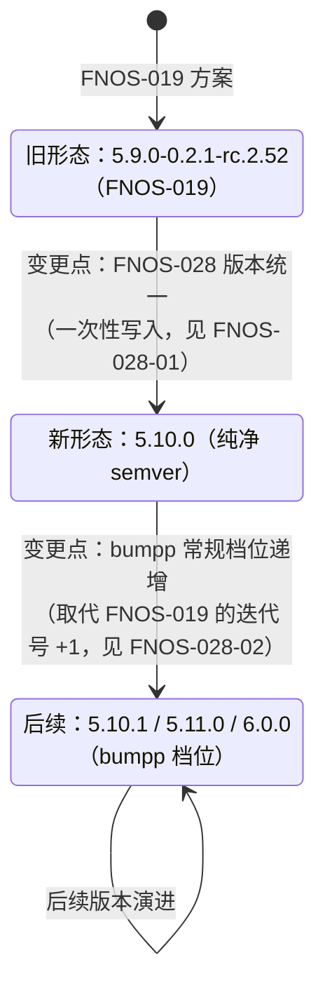
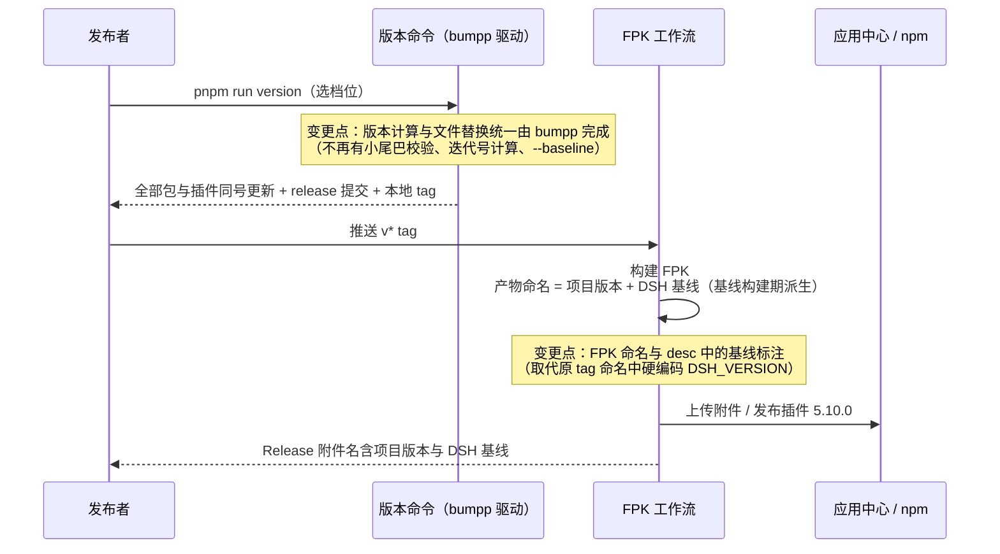

# FNOS-028 项目与插件版本统一 5.10.0 及发布链路 dsh 基线标注

| 项目 | 内容 |
| --- | --- |
| 需求编号 | FNOS-028 |
| 提出日期 | 2026-10-25 |
| 需求状态 | <Badge type="tip" text="已通过验收（2026-10-25）" /> |
| 关联计划 | [PLAN-FNOS-028 项目与插件版本统一 5.10.0 及发布链路 dsh 基线标注](/plans/PLAN-FNOS-028-unified-project-version-bumpp) |
| 关联需求 | [FNOS-019 FPK 版本方案固定前缀与插件基线小尾巴](/requirements/FNOS-019-fpk-version-scheme)（本需求部分取代其版本形态约定） |
| 适用应用 | `fn-deepseek-harness` |

## 需求背景

当前项目版本采用 FNOS-019 确立的「基础段 + DSH 基线 + 应用迭代号」三段式小尾巴（如 `5.9.0-0.2.1-rc.2.52`），插件版本取项目版本去基础段前缀（`0.2.1-rc.2.52`）。该方案运行两年后暴露出维护成本：

1. **版本形态复杂**：`0.2.1-rc.2.52` 对 npm 与 semver 而言是预发布版本，插件发布被迫长期使用 `next` dist-tag，`latest` 需要额外的代际维护逻辑兜底；
2. **升级链路脆弱**：每次 DSH 基线切换都要动 `--baseline` 参数、catalog 改写、迭代号重置三方联动，且插件 peer 依赖（`catalog:dsh`）与基线一致性必须逐项核对；
3. **fnOS 版本比较失效**：fnOS 应用中心对 `x.y.z-m` 后缀中非数字部分「视为同一版本」（见[从电脑上传 FPK 到 NAS 并安装](/guide/nas-fpk-install)），`5.9.0-0.2.1-rc.2.51 → .52` 这类小尾巴递增在 fnOS 侧等价于 `5.9.0`，装机验证必须每次人为换号，小尾巴的「应用迭代可数」价值在 fnOS 场景不成立。

本次调整把**项目侧版本号回归纯净 semver**：全部包与插件统一维护到 `5.10.0`，之后随常规档位（patch/minor/major）演进，版本维护统一改用 [bumpp](https://github.com/antfu-collective/bumpp) 工具完成（含其交互确认、release 提交与本地 tag 能力）。DSH 基线不再进入项目或插件的版本号，改由**发布产物**承载：FPK 产物文件名使用「项目版本 + DSH 基线」的组合（如 `5.10.0-0.2.1-rc.2`），并在 fpk 描述中写明当前版本应用所基于的 DSH 基线版本。

## 需求目标

1. 项目全部 workspace 包（根、docs、packages/*、tooling/fnos-dsh-cli）与全部插件的 `version` 字段统一为 `5.10.0`；此后版本演进由 bumpp 按常规 semver 档位推进，不再维护「基础段-基线.迭代号」小尾巴形态。
2. 版本命令统一由 bumpp 承担版本计算、文件替换、release 提交与本地 tag；仓库不再维护自定义的版本拆解与迭代号计算逻辑，基线切换收敛为 major 档位流程的一部分。
3. 版本统一后，首次插件发布以 `5.10.0` 正式版进入 npm `latest` dist-tag，摆脱长期 `next` 的预发布状态；后续发布走常规 dist-tag 流程。
4. FPK 发布产物（CI Release 附件）文件名保留 DSH 基线信息，使用「项目版本 + DSH 基线」的组合命名（如 `fn-deepseek-harness-v5.10.0-dsh-0.2.1-rc.2.fpk`，具体格式见计划）。
5. FPK 内 `manifest` 的 `version` 与项目版本一致（`5.10.0`）；`desc` 中写明当前版本应用的 DSH 基线（如「运行基线为 DSH 0.2.1-rc.2」），且该描述与实际构建基线一致，不再依赖人工自觉维护。
6. DSH 基线本身（catalog 中 `'@deepseek-ai/dsh'` 与 `install_callback` 的 `DSH_VERSION`）继续独立维护，基线值不再以小尾巴段形式进入版本号；基线变更通过 major 档位表达（版本 major 段 +1）。
7. 版本档位语义固定：`patch` = 无新功能的修复；`minor` = 新功能且 DSH 基线不变；`major` = DSH 基线变更或导致用户无法回退的重大调整。每次发布对应段自增 +1（进位段归零），不跳号；新功能与基线变更同时发生时按 major 处理。

## 功能列表

| 编号 | 优先级 | 功能 | 用户可观察结果 | 状态 |
| --- | --- | --- | --- | --- |
| FNOS-028-01 | P0 | 版本统一到 5.10.0 | 仓库所有 package.json 版本字段为 `5.10.0`；应用中心显示应用版本 `5.10.0`，已装旧小尾巴版本（如 `5.9.0-0.2.1-rc.2.52`）的设备可正常升级且不被判降级 | <Badge type="tip" text="已完成" /> |
| FNOS-028-02 | P0 | 版本维护统一改用 bumpp | `pnpm run version` 由 bumpp 驱动：交互选档位（或非交互传参）后，一次执行完成全部包与插件的版本更新、release 提交与本地 tag；档位语义固定（`patch`=无新功能修复、`minor`=新功能且基线不变、`major`=DSH 基线变更或重大不可回退调整），每次发布对应段 +1；不再出现小尾巴形态校验与迭代号计算 | <Badge type="tip" text="已完成" /> |
| FNOS-028-03 | P0 | 插件 5.10.0 正式版发布与 dist-tag 切换 | 各插件以 `5.10.0` 正式版发布并进入 npm `latest`；安装命令照抄文档（`dsh plugin add <包名>@5.10.0`）可安装成功 | <Badge type="tip" text="已完成" /> |
| FNOS-028-04 | P0 | FPK 产物组合版本命名 | CI 构建的 FPK 附件文件名形如「项目版本 + DSH 基线」的组合（如 `fn-deepseek-harness-v5.10.0-dsh-0.2.1-rc.2.fpk`），从中可直接读出项目版本与 DSH 基线；命名所需基线值不再硬编码于 workflow | <Badge type="tip" text="已完成" /> |
| FNOS-028-05 | P0 | fpk 描述标注 DSH 基线 | 应用中心详情页的 fpk 描述（manifest `desc`）明确写有当前版本应用的 DSH 基线（如「运行基线为 DSH 0.2.1-rc.2」），该基线值随版本命令自动对齐当前 catalog，不靠人工记忆 | <Badge type="tip" text="已完成" /> |
| FNOS-028-06 | P1 | 基线信息可追溯 | 文档站与应用说明中，项目版本与 DSH 基线作为两个独立值分别可见：版本徽标显示 `5.10.0`，DSH 基线单独标注（如「DSH 基线：0.2.1-rc.2」） | <Badge type="tip" text="已完成" /> |
| FNOS-028-07 | P1 | 版本相关校验与文档同步 | 版本命令同步更新插件总览表格、各插件安装命令、文档版本引用与 manifest；相关校验（如同号核对、基线一致性校验）改为对新形态有效，旧小尾巴相关校验与文档说明全部清理 | <Badge type="tip" text="已完成" /> |

## 行为约束

- **升级兼容**：真机已装 `5.9.0-0.2.1-rc.2.x`（fnOS 侧等价 `5.9.0`）的设备，升级安装 `5.10.0` 必须成功且用户数据（凭据、模型配置、会话、工作区、授权目录）完整保留；此路径必须真机实测，不默认可用。
- **插件兼容**：插件 `5.10.0` 的 peer 依赖必须继续满足 DSH `0.2.1-rc.2` 运行时门禁（peer 范围继续取自 catalog），插件安装不被兼容性检查拒绝。
- **版本号语义**：`5.10.0` 的 major 段跃迁（相对历史 `5.9.0` 基础段）是一次性统一动作；此后各包与插件同号推进，插件仍不单独脱离项目递增（同号约束保持，见 [FNOS-019-07](/requirements/FNOS-019-fpk-version-scheme)），只是号本身回归常规 semver。
- **档位选择与基线变更绑定**：DSH 基线变更的发布必须走 `major` 档位（可携带 `--baseline` 一步切换 catalog），新功能发布走 `minor` 且不得同时变更基线；`--baseline` 与 `patch`/`minor` 搭配被拒绝，防止基线变更被小档位静默掩盖。
- **DSH 基线不变**：本次只改版本号承载方式，不升级 DSH 运行时；catalog、`install_callback`、插件 peer 的基线值保持 `0.2.1-rc.2` 不动。
- **首次 5.10.0 发布期间的历史版本不可撤回**：npm 上已有的 `0.2.x-rc.x.y` 系列插件版本与 dist-tag（`next` 指向的旧版本）需妥善处置（如清空或指向 5.10.0），处置方式在计划中明确，不静默留双头。
- **manifest 的 desc/changelog 仍为人工内容**：版本命令只负责把「运行基线为 DSH <基线>」字样与当前 catalog 对齐，不代写功能描述与变更摘要。

## 不在本次范围内

- DSH 运行时基线的升级（`0.2.1-rc.2` → 更高版本）及随之的插件适配。
- fnOS 应用中心侧的版本比较规则与上架流程调整（继续按 [应用上架规范](/charter/app-listing-spec) 走，仅版本号形态变为标准三段式后相关坑自然消除）。
- 历史 FPK 产物、历史 Release 附件的重命名或迁移。
- 插件市场索引机制本身的调整（`market-index` 仍跟随 npm 已发布版本，天然适配新形态）。
- FNOS-019 等已完成需求正文的回改（按 [SDD 维护规范](/charter/sdd-workflow)，新约定在本需求登记，取代关系见变更记录）。

## 调研结论

| 结论 | 出处 | 影响的功能 | 状态 |
| --- | --- | --- | --- |
| 版本档位语义由提出人以规范形式更新：`patch` = 无新功能的修复、`minor` = 新功能且 DSH 基线不变、`major` = DSH 基线变更或导致用户无法回退的重大调整；每次发布对应段自增 +1，不跳号；新功能与基线变更同时发生时按 major 处理 | 本需求提出人补充规范（2026-10-25，截图提供） | FNOS-028-02（档位语义与 AC-03～05） | 已核实 |
| bumpp 已是项目版本的底层执行器（`versionBump` API，catalog: 12.3.0），当前被自定义「迭代号 +1」逻辑包裹；其原生能力（交互选档位、多文件替换、release 提交、tag、`--no-push`）足以覆盖统一后的版本维护，无需引入新工具 | `tooling/fnos-dsh-cli/src/commands/version.ts`（`versionBump` 调用与参数）、`pnpm-workspace.yaml` catalog、[版本管理](/build/versioning) | FNOS-028-02 | 已核实 |
| 全部 8 个插件与 5 个 workspace 包当前版本同为小尾巴形态（`0.2.1-rc.2.52` / `5.9.0-0.2.1-rc.2.52`），由统一命令强制同号；回归 5.10.0 后同号机制可保留 | `plugins/*/package.json`、`packages/*/package.json`、根 `package.json`、`docs/package.json`（2026-10-25 实查） | FNOS-028-01 | 已核实 |
| CI 的 FPK 命名 `fn-deepseek-harness-<tag>-dsh-<DSH基线>.fpk` 中 `DSH_VERSION` 硬编码于 `build-app.yml` env（`0.2.1-rc.2`），与 catalog、`install_callback` 三处人工保持一致；改为组合命名时该值应改为构建期派生 | `.github/workflows/build-app.yml`（Rename FPK 步骤）、`tooling/fnos-dsh-cli/src/commands/build.ts`（`DSH_VERSION` 校验常量）、`docs/development/github-workflows.md` | FNOS-028-04 | 已核实 |
| `manifest` 的 `desc` 已含「运行基线为 DSH 0.2.1-rc.2」字样但纯人工维护；fnOS 版本比较对非数字后缀视为同一版本（`5.9.0-0.2.1-rc.2.51 ≈ 5.9.0`），纯净三段式 `5.10.0` 恢复正常升序比较 | `apps/fn-deepseek-harness/manifest`、[从电脑上传 FPK 到 NAS 并安装](/guide/nas-fpk-install)「版本号必须是可比较的」 | FNOS-028-01、FNOS-028-05 | 已核实 |
| 插件 npm 发布长期走 `next` dist-tag，`latest` 由 `publish-latest.ts` 的代际规则（按小尾巴形态解析 `<上游>.<修订>`）维护；`generationOf('5.10.0')` 返回 `undefined`（无修订段），代际兜底对纯净版本号自然跳过、不产生误判 | `tooling/fnos-dsh-cli/src/commands/publish-latest.ts`（`generationOf`/`maintainLatestTag`）、`publish.ts`（`--tag next`） | FNOS-028-03 | 已核实 |
| 需求提出人确认：FPK 内 manifest `version` 使用纯净 `5.10.0`（应用中心只显示项目版本，DSH 基线体现在 FPK 文件名与描述中）；FPK 产物命名用「项目版本 + DSH 基线」直连组合 | 本需求提出过程中的选项确认（2026-10-25） | FNOS-028-01、FNOS-028-04 | 已核实 |
| 插件版本统一 5.10.0 后，`peerDependencies` 里的 `catalog:dsh` 解析（pnpm 打包时重写为 `0.2.1-rc.2` 精确值）不受版本号变化影响，兼容门禁继续按现有规则判定 | [版本管理](/build/versioning)「插件版本只有一份事实来源」、`plugins/dsh-fnos-plugin/package.json` peer 声明实查 | FNOS-028-03（行为约束「插件兼容」） | 已核实 |

## 既有功能变更关系

本需求对 FNOS-019 确立的版本方案做**部分取代**，取代关系与差异如下（原需求正文按 [SDD 维护规范](/charter/sdd-workflow) 保持不动）：

| FNOS-019 原约定 | FNOS-028 新约定 | 变更性质 |
| --- | --- | --- |
| 项目/FPK 版本 = `<基础段>-<DSH基线>.<迭代号>`，发布只递增迭代号 | 项目/FPK 版本 = 纯净 semver（统一 5.10.0 起，随档位演进） | 取代 |
| 插件版本 = 项目版本去基础段前缀（小尾巴形态） | 插件版本与项目同号（5.10.0 起，常规 semver） | 形态变更，同号机制保留 |
| `--baseline` 一步切换基线并重置迭代号 | 收敛为 major 档位的配套参数：仅 `major --baseline <新基线>` 允许切换基线（版本 major 段 +1 表达基线变更），不再有独立于档位的基线切换入口，也无迭代号重置概念 | 语义收敛 |
| 档位仅 `patch` 有意义，`minor`/`major` 被明确拒绝 | `patch`/`minor`/`major` 三档语义固定（修复/新功能/基线变更或重大调整），由 bumpp 原生处理 | 取代 |
| 插件版本=项目版本去前缀，迭代号只算一次 | 插件直接沿用项目目标版本（同号），不再做字符串派生 | 机制简化 |
| 发布链路 DSH 基线由版本号承载 | 基线由 FPK 产物命名与 fpk 描述承载 | 转移 |
| bumpp 仅做项目版本文件替换，插件版本 CLI 直写 | 版本计算、文件替换、提交、tag 统一由 bumpp 承担 | 机制调整 |

版本形态的状态转换与发布产物命名流程如下：

图示说明：状态图表达版本号形态从 FNOS-019 小尾巴到纯净 semver 的一次性切换及后续演进方式；时序图表达变更后的发布链路中版本命令（bumpp 驱动）、FPK 命名与基线标注的职责重新划分。DSH 基线（0.2.1-rc.2）本身全程不变，只是承载位置从版本号转移到产物命名与描述。

## 验收条件与完成状态

| 编号 | 验收条件 | 状态 |
| --- | --- | --- |
| FNOS-028-01-AC-01 | 仓库根、docs、packages/*、tooling 的全部 `package.json` 与全部插件 `package.json` 的 `version` 字段为 `5.10.0`；FPK 内 `manifest` 的 `version` 为 `5.10.0` | <Badge type="tip" text="已通过" /> |
| FNOS-028-01-AC-02 | 真实 fnOS NAS 上，已装 `5.9.0-0.2.1-rc.2.x` 的设备升级安装 `5.10.0` FPK 成功，不被判同版本或降级，凭据、模型配置、会话、工作区与授权目录完整保留 | <Badge type="tip" text="已通过" /> |
| FNOS-028-02-AC-01 | `pnpm run version -- patch --yes` 一次执行后，全部包与插件版本同号递增（如 `5.10.0 → 5.10.1`），生成一条 `chore: release v5.10.1` 提交与本地 tag（不推送） | <Badge type="tip" text="已通过" /> |
| FNOS-028-02-AC-02 | 传小尾巴形态版本串（如 `5.10.1-0.2.1-rc.2.1`）或触发旧迭代号逻辑时，命令给出明确错误指引，不产出半成品状态 | <Badge type="tip" text="已通过" /> |
| FNOS-028-02-AC-03 | `patch` 档位（无新功能修复）执行后仅 patch 段 +1：`5.10.0 → 5.10.1`，minor/major 段不动 | <Badge type="tip" text="已通过" /> |
| FNOS-028-02-AC-04 | `minor` 档位（新功能且 DSH 基线不变）执行后 minor 段 +1、patch 段归零：`5.10.1 → 5.11.0` | <Badge type="tip" text="已通过" /> |
| FNOS-028-02-AC-05 | `major` 档位（DSH 基线变更或重大不可回退调整）执行后 major 段 +1、其余归零：`5.11.0 → 6.0.0`；携带 `--baseline <新基线>` 时命令内部改写 catalog 并同步 desc 与应用文档页基线字样；`--baseline` 与其他档位搭配被拒绝 | <Badge type="tip" text="已通过" /> |
| FNOS-028-03-AC-01 | 全部随仓库发布的插件以 `5.10.0` 发布到 npm 且 `latest` dist-tag 指向 `5.10.0`；`npm view <包名> dist-tags.latest` 返回 `5.10.0` | <Badge type="tip" text="已通过" /> |
| FNOS-028-03-AC-02 | 文档站插件总览与各插件页安装命令为 `@5.10.0`；照抄执行 `dsh plugin --profile web add <包名>@5.10.0` 安装成功，插件在 DSH `0.2.1-rc.2` 运行时正常加载 | <Badge type="tip" text="已通过" /> |
| FNOS-028-04-AC-01 | CI 构建的 FPK 附件文件名形如「项目版本 + DSH 基线」组合（如 `fn-deepseek-harness-v5.10.0-dsh-0.2.1-rc.2.fpk`）；文件名中的基线值与本次构建使用的 catalog 基线一致，且 workflow 内无硬编码版本常量 | <Badge type="tip" text="已通过" /> |
| FNOS-028-05-AC-01 | FPK 内 `manifest` 的 `desc` 含「运行基线为 DSH 0.2.1-rc.2」字样，且与构建时 catalog 的 `'@deepseek-ai/dsh'` 版本一致；基线切换后再次执行版本命令，desc 中基线字样自动更新 | <Badge type="tip" text="已通过" /> |
| FNOS-028-06-AC-01 | 文档站版本徽标显示 `5.10.0`；应用文档页的项目版本与 DSH 基线作为两个独立值分别展示，不出现小尾巴组合形态 | <Badge type="tip" text="已通过" /> |
| FNOS-028-07-AC-01 | 版本命令执行后：插件总览表格、各插件文档与 README 的安装命令、`published-dsh-plugins.json` 版本副本、文档版本引用全部同步到新版本，`git status` 无遗留未同步的版本文件 | <Badge type="tip" text="已通过" /> |
| FNOS-028-07-AC-02 | 版本相关校验（同号核对、构建校验、SDD 检查）对新形态全部通过；仓库内不再有按小尾巴形态解析版本的代码与文档描述（含 `docs/build/versioning.md`、`generationOf` 类代际逻辑对小尾巴的依赖说明） | <Badge type="tip" text="已通过" /> |

### 目标环境验收说明

| 功能 | 目标环境 |
| --- | --- |
| FNOS-028-01（版本统一与升级兼容） | 真实 fnOS NAS（FPK 安装/升级链路）；本地核对版本文件 |
| FNOS-028-02（bumpp 版本命令） | 本地（命令行为）+ CI（tag 触发链路） |
| FNOS-028-03（插件发布与 dist-tag） | npm registry + DSH Web 与 DSH Desktop（安装加载验证） |
| FNOS-028-04（FPK 组合命名） | CI 发布环境（Release 附件核对） |
| FNOS-028-05（desc 基线标注） | 真实 fnOS NAS（应用中心详情页可见）+ 本地（manifest 内容核对） |
| FNOS-028-06/07（文档与校验） | 文档站构建与本地校验命令 |

## 变更记录

| 日期 | 变更 | 说明 |
| --- | --- | --- |
| 2026-10-25 | 档位语义规范化 | 提出人以规范形式明确三档语义：`patch`（无新功能修复）/ `minor`（新功能且基线不变）/ `major`（DSH 基线变更或重大不可回退调整），每次发布对应段 +1。据此新增目标 7、AC-03～05，并把 `--baseline` 从「删除」收敛为「major 档位专属参数」（仅 `major --baseline` 允许切基线，与其他档位搭配拒绝），新增行为约束「档位选择与基线变更绑定」。 |
| 2026-10-25 | 验收通过 | 需求状态改为已完成，14 条验收条件全部标记已通过。核心链路实测：版本统一 5.10.0、版本命令直接调用 bumpp（原生菜单透传 + execute 同步钩子 + ignoreScripts）、单条 release 提交与本地 tag、FPK 组合命名基线构建期派生、desc/应用文档页基线字样自动对齐；实施发现并修复 4 个缺陷（local-only 路径过滤、bumpp bin 解析、npm 钩子递归、菜单 pre-* 档位）。测试细节与证据见[测试用例 FNOS-028](/tests/FNOS-028-unified-project-version-bumpp)；npm 发布、真机升级与 CI 附件核验为发布后动作，不阻塞验收。测试性发布产物已按纪律移除，仓库停在 5.10.0 待正式发版。测试用例文档回填后 targetVersion 落为 5.10.0。 |
| 2026-10-25 | 初始登记 | 依据用户要求建立本需求：全部包与插件版本统一 5.10.0、版本维护改用 bumpp、FPK 产物命名与 fpk 描述标注「项目版本 + DSH 基线」。登记对 FNOS-019 版本形态约定的部分取代关系，及 bumpp 能力、CI 命名现状、dist-tag 代际逻辑、fnOS 版本比较规则等调研结论。经提出人确认两个关键分叉：manifest version 用纯净 `5.10.0`；FPK 命名用「项目版本 + DSH 基线」直连组合。 |
