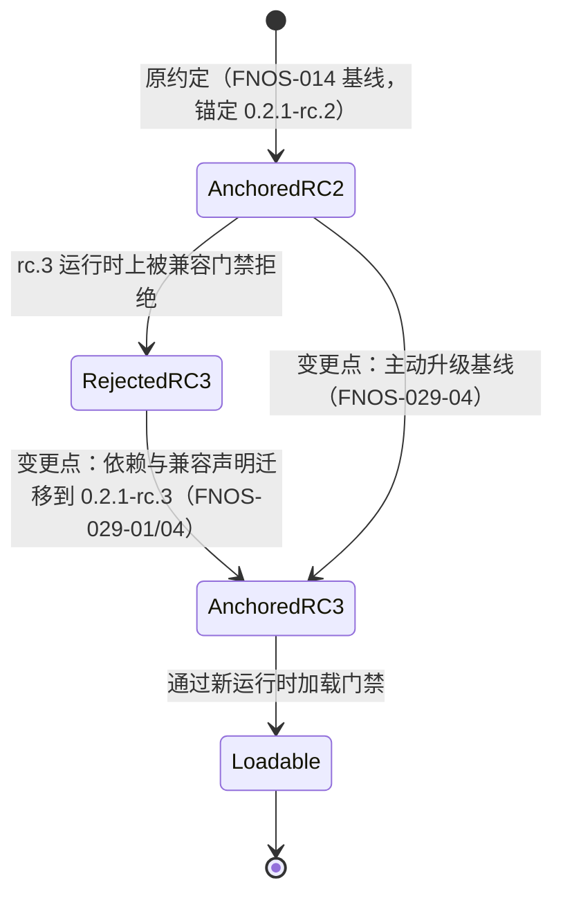
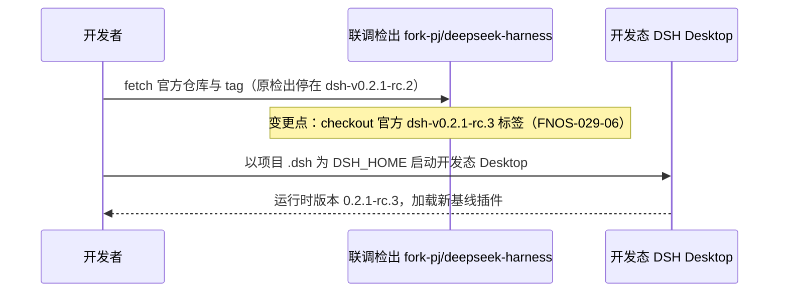

# FNOS-029 DSH 0.2.1-rc.3 插件适配与基线迁移

| 项目 | 内容 |
| --- | --- |
| 需求编号 | FNOS-029 |
| 提出日期 | 2026-10-25 |
| 需求状态 | 规划中 |
| 关联计划 | [PLAN-FNOS-029 DSH 0.2.1-rc.3 插件适配与基线迁移](/plans/PLAN-FNOS-029-dsh-021-rc3-adaptation) |
| 适用范围 | 仓库全部 DSH 插件（codex-auth、fnos、failover-search、midscene、opencode、semi-ui-showcase、zcode，以及不入库的 codebuddy 本地副本）、仓库运行与构建基线、本地联调检出（`fork-pj/deepseek-harness`） |

## 需求背景

DSH 官方已发布 `0.2.1-rc.3`（npm `next` 标签指向它，`latest` 仍在 `0.2.1-rc.2`）。本仓库的运行基线、全部插件的依赖锚定与兼容声明仍停留在 `0.2.1-rc.2`：插件按精确版本锚定 DSH peer（[FNOS-014](/requirements/FNOS-014-dsh-021-rc2-adaptation) 建立的约定），在 rc.3 运行时上会被兼容门禁拒绝，无法安装与加载。

同时，仓库的 Desktop 联调检出（`fork-pj/deepseek-harness`，由 `DSH_DESKTOP_APP_DIR` 指定）需要更新到官方 `dsh-v0.2.1-rc.3` 标签，使 DSH Desktop 侧的验收环境与新基线一致。

用户同时要求：不入库的 CodeBuddy 插件本地副本（[FNOS-025](/requirements/FNOS-025-codebuddy-plugin-delisting) 下架后保留的源码）也同步迁移到新基线，保持可运行，方便后续内部使用与对照。

与 FNOS-014 那次大跨度迁移不同：rc.2 → rc.3 之间只有 5 条非合并提交、无面向插件作者的破坏性升级指南，属于小步基线推进；本需求以「锚定迁移 + 契约复核 + 双客户端回归」为主。

## 调研结论

| 结论 | 出处 | 影响的功能 | 状态 |
| --- | --- | --- | --- |
| `@deepseek-ai/dsh@0.2.1-rc.3` 已发布到 npm，`next` 标签指向它；仓库 catalog 引用的 `@deepseek-ai/*` 系列包在该版本均有同名版本发布 | `npm view @deepseek-ai/dsh dist-tags`、`versions`（2026-10-25 核实） | FNOS-029-04 | 已核实 |
| 官方仓库 `dsh-v0.2.1-rc.2..dsh-v0.2.1-rc.3` 共 6 条提交（5 条非合并），无面向插件作者的新增 upgrade-guide 条目（`docs/upgrade-guide/` 目录在两 tag 间无变化）；变更集中在客户端导航定制、DeepSeek API-key 路由官方模型列表、产品分析埋点 | 官方两 tag 间 `git log`、`git diff --stat`、`docs/upgrade-guide/` 目录比对（2026-10-25） | FNOS-029-01 | 已核实 |
| Web 客户端插座目录新增 3 个（`conversation.session.header.views.actions`、`sidebar.panellist.actions`、`sidebar.right.tab.guide.actions`），无删除；本仓库全部插件注册的 7 类插座（`plugins.detail.section`、`conversation.session.header.utilities`、`conversation.input.left/right`、`sidebar.footer.action`、`shell.overlay`、`settings.action`）在 rc.3 中全部保留且 occupants 不变 | 官方 `slot-catalog.ts` 两 tag 间 key 集合 diff 与 occupants 核对（2026-10-25） | FNOS-029-02 | 已核实 |
| 插件实际使用的宿主接缝在 rc.3 中源码零变化：`dsh-llm` 核心导出、`dsh-llm-pi-ai`（`PiAiAdapter`、`ResolvedPiAiProviderProfile`，`pi-ai` 仍为 `^1.1.0`）、`dsh-attachment`、`dsh-session`、`dsh-settings`、`dsh-client-connection`、`dsh-host-webserver`、`dsh-home-paths`、`dsh-atomic-write`、`dsh-client-ui-primitives` 公共导出、`ui-theme` 契约均与 rc.2 逐字节一致（仅版本号字段变化） | 官方两 tag 间上述包 `src/` 目录 diff（2026-10-25） | FNOS-029-01、FNOS-029-02 | 已核实 |
| Web 组合新增挂载 `entry-customization` 模块（导航入口定制），属官方内置 UI 能力，不与仓库插件注册的插座冲突；CodeBuddy 组合声明注入的 `webStartup` 服务在 rc.3 仍存在 | 官方 `packages/bundle/web-app/cordis.patch.yml` 两 tag diff；官方 `web-app/src/startup.ts` 核对（2026-10-25） | FNOS-029-02、FNOS-029-03 | 已核实 |
| 三方插件 `dshmarket` 现用版本 `1.66.47` 的 peer 范围 `^0.2.1-rc.1` 按语义化版本规则包含 `0.2.1-rc.3`（`satisfies` 判定通过），无需换版本，也无更新的兼容声明可用（最新 `1.70.2` peer 相同） | `npm view dshmarket@1.66.47/1.70.2 peerDependencies`；semver `satisfies('0.2.1-rc.3','^0.2.1-rc.1')` 判定（2026-10-25） | FNOS-029-04 | 已核实 |
| `rc.3` 的 LLM 层变化仅影响官方 DeepSeek API-key 路由（跟随官方 `/models` 列表）；仓库插件不依赖该路由的内部行为 | 官方 `packages/llm/llm-deepseek*/src` 两 tag diff 范围核对（2026-10-25） | FNOS-029-01 | 已核实 |

## 需求目标

- 仓库运行与构建基线（catalog、构建校验常量、安装回调）与本地联调检出统一到 DSH `0.2.1-rc.3`。
- 全部插件（含不入库的 CodeBuddy 本地副本）的依赖与兼容声明锚定 `0.2.1-rc.3`，在新运行时上可安装、可加载、既有功能不回归。
- 用户既有数据（凭据、账号、偏好、授权目录、模型配置）在基线迁移后保持可用。

## 功能列表

| 编号 | 优先级 | 功能 | 用户可观察结果 | 状态 |
| --- | --- | --- | --- | --- |
| FNOS-029-07 | P1 | 插件依赖版本单一事实来源 | 更新 DSH 基线时只需改 `pnpm-workspace.yaml` 一处；插件 manifest 不再出现 DSH 版本字面量，构建门禁拒绝字面版本 | 待验证 |
| FNOS-029-01 | P0 | 七个入库插件在新运行时正常加载 | 七个插件新版本在 DSH `0.2.1-rc.3` 上安装后，插件管理页无「异常」或行挂起，各插件既有功能可用且行为与 rc.2 基线一致 | 待验证 |
| FNOS-029-02 | P0 | 插件界面契约保持 | 插件在详情页、会话区、输入区、设置区与侧栏注册的界面区块在新运行时上位置与信息展示不变 | 待验证 |
| FNOS-029-03 | P0 | CodeBuddy 本地副本随基线可用 | 不入库的 CodeBuddy 插件副本锚定新基线后，在本地开发态运行时上可正常加载，登录、账号与统计入口可见（不发布、不入库） | 待验证 |
| FNOS-029-04 | P0 | 仓库运行与构建基线同步 | 本地 DSH Web 报告的运行时版本、FPK 安装回调安装的运行时版本与插件兼容声明三方一致；三方插件 `dshmarket` 安装不被兼容门禁拒绝 | 待验证 |
| FNOS-029-05 | P0 | 用户数据兼容 | 基线迁移（本地 profile 升级运行时与插件）后，既有凭据、账号、偏好、模型配置继续生效，无需手动迁移 | 待验证 |
| FNOS-029-06 | P1 | Desktop 联调检出更新 | `fork-pj/deepseek-harness` 检出处于官方 `dsh-v0.2.1-rc.3`，开发态 Desktop 以该版本运行并加载新基线插件 | 待验证 |

### 验收环境范围

- FNOS-029-01、02、05 在 **DSH Web 与 DSH Desktop** 双客户端验收；涉及外部登录的环节（Codex Auth、OpenCode、ZCode）另需真实网络/账号条件。
- FNOS-029-03 在本地开发态运行时（DSH Desktop 检出或 DSH Web profile）验收，不要求发布链路。
- FNOS-029-04 在本地构建链路（catalog、构建校验、安装回调常量一致性）验收；FPK 真机安装与升级验证按仓库惯例另行安排，不阻塞本需求双客户端结论。
- FNOS-029-06 在 Desktop 联调检出环境验收（检出 tag 与启动版本核对）。

## 行为约束

- 迁移只改变依赖锚定、兼容声明与基线常量；不改变插件的功能语义、交互流程和数据格式。
- 插件 `package.json` 的 DSH 相关依赖**一律通过 pnpm catalog 引用**（`catalog:dsh`），不在插件内单独维护版本号；兼容判定由 `engines.dsh` 承担，其值必须等于 catalog 基线。
- 不通过版本豁免绕过门禁。
- 用户数据的存储位置和读写行为不变；基线迁移过程不得删除或改写既有数据。
- 不修改官方上游源码；联调检出只做 fetch 与 checkout。
- CodeBuddy 副本保持不入库状态（`.gitignore` 继续生效），其迁移不产生任何受版本管理的改动。

## 不在本次范围内

- 官方 DSH 上游源码的修改或提交。
- 为插件新增功能或改变既有交互（导航定制等 rc.3 新 UI 能力属官方内置，不做插件侧适配）。
- 插件 npm 发布与市场索引更新（按 [FNOS-028](/requirements/FNOS-028-unified-project-version-bumpp) 的发布节奏另行执行）。
- FPK 在真实 fnOS NAS 上的安装与升级验收（基线常量同步后按发布流程安排，登记为后续验证，不阻塞双客户端结论）。
- 旧版本插件在新运行时上的兼容豁免。

## 既有功能变更关系

本次变更覆盖 [FNOS-014](/requirements/FNOS-014-dsh-021-rc2-adaptation) 建立的 `0.2.1-rc.2` 基线约定：依赖锚定与兼容声明迁移到 `0.2.1-rc.3`。FNOS-014 的验收结论在其原验证环境内继续有效，不回改其正文。

原约定下插件的 DSH 依赖锚定 `0.2.1-rc.2`，在 rc.3 运行时上被判定不兼容；新约定下全部锚定 `0.2.1-rc.3`。用户可观察结果：插件管理页从「异常/拒绝安装」恢复为正常状态。

Desktop 联调检出的更新路径同步变化：

变更原因：Desktop 联调必须使用与新基线一致的上游检出，否则插件兼容声明与运行时版本不匹配，验收结果无效。用户可观察结果：开发态 Desktop 关于页/日志报告 `0.2.1-rc.3`。

## 验收条件与完成状态

### FNOS-029-07

- `FNOS-029-07-AC-01`：全部插件 manifest 的 DSH 依赖均为 `catalog:dsh`，`engines.dsh` 等于 catalog 基线。
- `FNOS-029-07-AC-02`：往插件 manifest 写入 DSH 版本字面量时构建门禁报错并指出该依赖。

### FNOS-029-01

- `FNOS-029-01-AC-01`：七个入库插件新版本在 DSH `0.2.1-rc.3` 上安装后，插件管理页无「异常」与不兼容原因，组合包显示为已启用。
- `FNOS-029-01-AC-02`：DSH 运行日志中不出现插件模块未找到、插座未声明或行挂起的错误。
- `FNOS-029-01-AC-03`：各插件代表功能（登录态展示、搜索转移、桥接健康、模型目录、组件展示、额度显示）在 DSH Web 与 DSH Desktop 上分别验证通过。

### FNOS-029-02

- `FNOS-029-02-AC-01`：插件在各界面区域注册的区块位置与 rc.2 基线一致，不与他人区块冲突。
- `FNOS-029-02-AC-02`：亮色与暗色主题下插件界面渲染正常，主题切换实时生效。

### FNOS-029-03

- `FNOS-029-03-AC-01`：CodeBuddy 本地副本的依赖与兼容声明指向 `0.2.1-rc.3`，本地构建通过。
- `FNOS-029-03-AC-02`：在本地开发态运行时上加载该副本，插件行不挂起，配置区块正常渲染（登录入口可见，是否登录不作为验收门槛）。

### FNOS-029-04

- `FNOS-029-04-AC-01`：仓库 catalog、构建校验常量与安装回调指向 `0.2.1-rc.3`，构建校验不因版本不一致失败。
- `FNOS-029-04-AC-02`：本地启动的 DSH Web 报告版本与插件兼容声明一致。
- `FNOS-029-04-AC-03`：`dshmarket` 在新基线上的安装不被兼容门禁拒绝（以 peer 范围判定与本地安装链路为证据）。

### FNOS-029-05

- `FNOS-029-05-AC-01`：基线迁移后，迁移前已有的凭据、账号、偏好、模型配置继续生效。
- `FNOS-029-05-AC-02`：迁移过程与迁移后均不出现数据丢失或被改写。

### FNOS-029-06

- `FNOS-029-06-AC-01`：`fork-pj/deepseek-harness` 检出的 HEAD 为官方 `dsh-v0.2.1-rc.3` 标签。
- `FNOS-029-06-AC-02`：开发态 Desktop 以该检出启动后报告运行时版本 `0.2.1-rc.3` 并正常加载新基线插件。

## 变更记录

| 日期 | 变更 | 说明 |
| --- | --- | --- |
| 2026-10-25 | 编号更正 | 初稿误用 FNOS-030，`FNOS-029` 在文档、git 历史与全部分支均无占用，按「编号连续」规范改回 FNOS-029（三份文档、索引、侧栏与提交引用同步）。 |
| 2026-10-25 | 范围补充 FNOS-029-07 | 用户要求插件依赖统一由 pnpm catalog 管理：DSH peer 全部改为 `catalog:dsh` + `engines.dsh`，构建门禁取消对 DSH peer 的字面版本豁免，守卫断言改为「一律 catalog」。 |
| 2026-10-25 | 初始登记 | 建立 FNOS-029，范围覆盖基线迁移（catalog/构建常量/安装回调）、七个入库插件与 CodeBuddy 本地副本的锚定迁移、联调检出更新与双客户端验收。rc.2→rc.3 契约差异已核实为无破坏点（7 条调研结论），关联 PLAN-FNOS-029。 |
