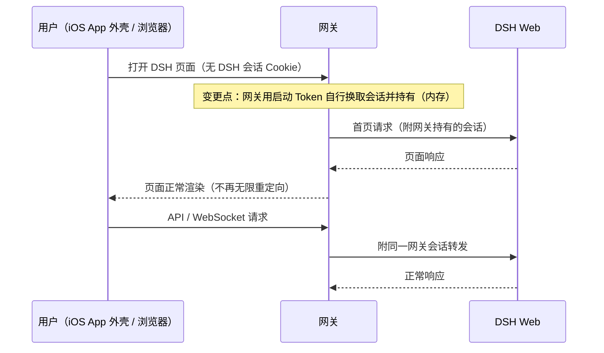

# FNOS-030 飞牛 iOS App 打开 DSH 空白修复

| 字段 | 内容 |
| --- | --- |
| 需求编号 | FNOS-030 |
| 提出日期 | 2026-10-22（GitHub issue #21） |
| 需求状态 | 已完成（包级 10/10；真实 NAS 装成 v6.0.1 并验证网关会话行为；iOS App 实机验证正常访问） |
| 关联计划 | [PLAN-FNOS-030 飞牛 iOS App 打开 DSH 空白修复](/plans/PLAN-FNOS-030-app-shell-blank-page) |

## 需求背景

经 fnOS 网页版打开 DSH 正常；经飞牛 iOS App（网页套壳）打开时页面一直空白或提示「无法打开此页面」，没有可操作的界面。根因是 DSH 的会话 Cookie 带 `SameSite=Strict`：App 外壳与 NAS 不同站，浏览器不保存也不回传这枚 Cookie；网关随后对每个不带 Cookie 的首页请求注入启动 Token，而 DSH 对带 Token 的首页一律重定向回干净首页，形成首页无限重定向，页面永远加载不出来。同一根因在不同 iOS 版本 / WebView 下的表现不同：或显示空白（issue #21），或显示「无法打开此页面」（issue #25，已确认为同一问题并合并到 #21）。

该问题在 iOS App 中 100% 复现，任何已发布版本都受影响；修复方案由外部贡献者已在 fork 上完成并经真实 NAS 验证（见调研结论），本需求将其纳入本仓库实施。

## 调研结论

| 结论 | 出处 | 影响的功能 | 状态 |
| --- | --- | --- | --- |
| DSH 会话 Cookie `SameSite=Strict` 在跨站 App 套壳中不被浏览器保存或回传；网关对无 Cookie 首页注入启动 Token 后，DSH 对带 Token 首页一律 303 回干净首页，形成首页无限重定向（实测修复前连续 20 次 GET 首页、0 次 API 请求） | [GitHub issue #21](https://github.com/FNOSP/fnos-dsh/issues/21) 抓包数据 | FNOS-030-01 | 已核实 |
| 贡献者已在 fork（jiaaom/fnos-dsh-fork 提交 `9b0b27e`）完成修复：网关在服务端持有 DSH 会话并替每个上游 HTTP 与 WebSocket 请求附带；真实 NAS 上 iOS App 与网页版检查全部通过 | [GitHub issue #21](https://github.com/FNOSP/fnos-dsh/issues/21) 描述与截图、fork 提交内的真机验收记录 | FNOS-030-01、FNOS-030-02 | 已核实 |
| 本仓库 main 分支网关仍依赖浏览器持有会话 Cookie（无服务端会话逻辑），修复未合入，任何已发布版本在 iOS App 中都会复现 | 本仓库 main 分支网关源码核查（2026-10-26） | FNOS-030-01 | 已核实 |
| 网关换取会话所依赖的「启动 Token 换会话 Cookie」上游契约在 DSH 0.2.1-rc.3 基线下保持不变，fork 修复（基于 rc.2）可直接对齐当前基线 | 本仓库 main 分支网关对同契约的重放路径与配套测试核查（2026-10-26） | FNOS-030-01 | 已核实 |
| 贡献者修复中同时包含应用英文界面（i18n）改造；经产品决定 i18n 本轮不做，仅采纳网关会话部分 | 2026-10-26 产品决定（会话记录） | FNOS-030-01 | 已核实 |

## 需求目标

把 DSH 登录状态的承担方从浏览器移到网关：网关启动后自行换取并持有 DSH 会话，替每个经过它的上游 HTTP 与 WebSocket 请求附带；浏览器不再需要保存 DSH 会话 Cookie。飞牛 iOS App 与网页版浏览器都以同一路径访问 DSH，跨站外壳不再有会话缺失问题。

访问控制不变：请求仍须通过 fnOS 登录与管理员校验才能到达网关；DSH 侧的签名校验与跨站拒绝照常生效。网关持有的会话只存在于网关进程内存，不落盘。

## 功能列表

| 编号 | 优先级 | 功能 | 用户可观察结果 | 状态 |
| --- | --- | --- | --- | --- |
| FNOS-030-01 | P0 | 飞牛 iOS App 中可以正常打开并使用 DSH | 在飞牛 iOS App 中打开 DSH，页面完整加载并可直接对话，不再出现空白或「无法打开此页面」；首次加载后 API 与 WebSocket 连接正常建立 | 已完成（iOS App 实机验证正常访问） |
| FNOS-030-02 | P0 | 网页版浏览器访问行为保持不变 | 浏览器打开 DSH 的方式与修复前一致：无需手动登录、页面正常加载、对话与会话历史可用；升级后旧的浏览器会话 Cookie 被自动清理，不产生残留影响 | 已完成 |
| FNOS-030-03 | P0 | 访问控制与会话安全边界保持 | 未经 fnOS 登录或非管理员的请求仍被拒绝；DSH 侧的跨站拒绝与签名校验照常生效；网关持有的会话不写入磁盘，应用重启后自动重新换取 | 已完成 |

## 行为约束

- 既有网页版用户的访问方式不变：URL、入口、无感登录体验与修复前一致，不需要任何用户操作。
- DSH 核心不改动：本需求只调整网关侧行为，DSH 对浏览器的契约（Token 换会话、跨站拒绝）保持原样。
- 由外部启动的 DSH（网关未托管 Web 进程的场景）行为保持不变，浏览器 Cookie 原样透传。
- 网关重启或 DSH 重启后，网关自动重新换取会话，用户无需重新打开应用或重新登录。
- 同一 NAS 的多用户隔离不变：到达网关的请求集合由 fnOS 层校验决定，网关代持会话不扩大可访问范围。

## 不在本次范围内

- 应用与网关的英文界面（i18n）：本轮明确不做，后续另行立项。
- DSH 核心代码与 DSH 对浏览器协议的任何改动。
- 其它插件与插件市场行为。
- 非 fnOS 应用中心安装形态下的反向代理部署适配。

## 验收条件与完成状态

### FNOS-030-01

- `FNOS-030-01-AC-01`：在真实 fnOS NAS 上，用飞牛 iOS App 打开 DSH，页面完整加载并可正常发起对话。
- `FNOS-030-01-AC-02`：iOS App 首次打开后，抓包或网关日志显示首页只请求一次、API 正常请求，不再出现连续多次首页请求的循环。
- `FNOS-030-01-AC-03`：iOS App 中页面加载后的 WebSocket 连接建立成功；首次连接如因会话未就绪被拒，客户端自动重连后成功，用户无感。
- 目标环境：真实 fnOS NAS（iOS App）。

### FNOS-030-02

- `FNOS-030-02-AC-01`：浏览器打开 DSH，页面正常加载、无感进入，对话与会话历史可用，行为与修复前一致。
- `FNOS-030-02-AC-02`：从修复前版本升级到修复后版本，浏览器中遗留的旧 DSH 会话 Cookie 被自动清理，页面访问不受残留 Cookie 影响。
- 目标环境：DSH Web（浏览器）＋ 真实 fnOS NAS（升级路径）。

### FNOS-030-03

- `FNOS-030-03-AC-01`：未经 fnOS 登录的请求仍无法通过网关到达 DSH；非管理员的控制操作仍被拒绝。
- `FNOS-030-03-AC-02`：DSH 对跨站请求的拒绝照常生效，不因网关代持会话而放宽。
- `FNOS-030-03-AC-03`：网关持有的会话不写入任何磁盘文件；应用或网关重启后自动重新换取，用户无感恢复。
- 目标环境：真实 fnOS NAS（fnOS 校验链路）＋ 包级测试（会话生命周期）。

## 变更记录

| 日期 | 变更 | 说明 |
| --- | --- | --- |
| 2026-10-22 | 登记问题报告 | GitHub issue #21 提出问题与修复方案，登记为「待评估」 |
| 2026-10-25 | 合并同类问题 | issue #25 确认为同一根因，合并至 #21 |
| 2026-10-26 | 评估通过，建立需求 | 评估确认方案可采纳、安全边界成立；明确 i18n 不在本需求范围（用户决定），仅采纳网关服务端持有会话部分 |
| 2026-10-26 | 实现完成，状态转为待完成 | 网关会话改造已合入并通过包级验证（132 条用例全绿）；三项功能转为「待完成」，真实 NAS 与 iOS App 实机验收待执行 |
| 2026-10-26 | 真机验收通过，状态转为已完成 | 真实 NAS 装成 v6.0.1（详情页 6.0.1 / 手动安装）；网关产物含 UpstreamSession 且旧 Token 注入为 0；页面首页 1 次请求即 200、无 `token=`、浏览器无 `dsh-auth-*` Cookie；应用日志无异常；**iOS App 实机由提出人验证正常访问** |
