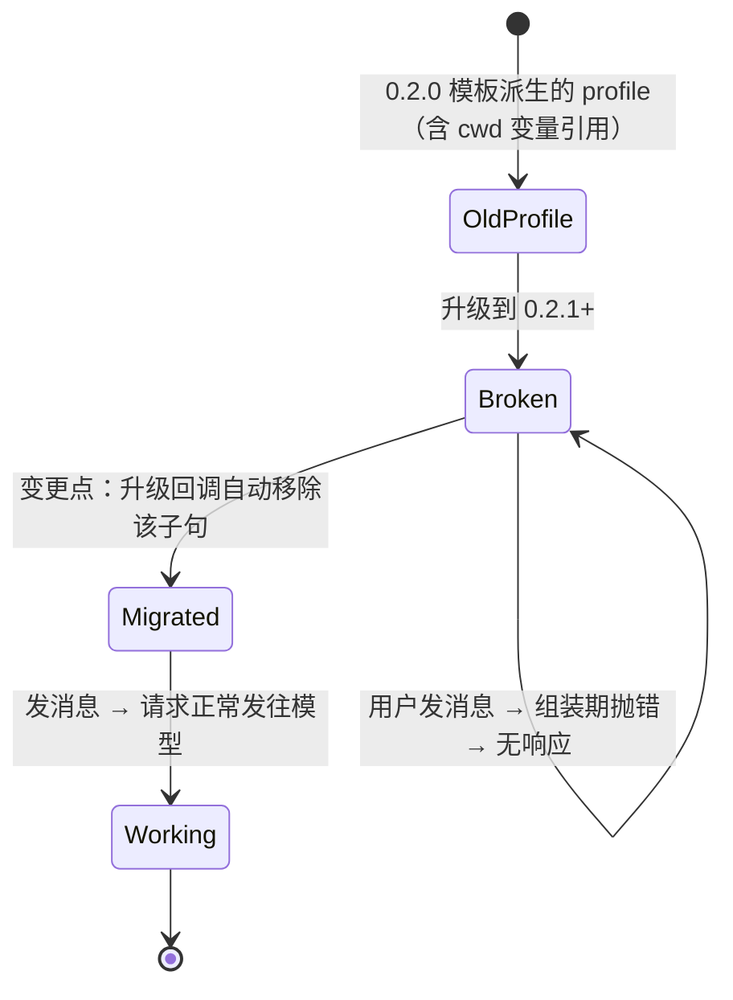

# FNOS-031 升级迁移 cwd 提示词变量引用

| 字段 | 内容 |
| --- | --- |
| 需求编号 | FNOS-031 |
| 提出日期 | 2026-10-26（来自 GitHub Discussion #15） |
| 需求状态 | 阶段一、二完成，待真机验收 |
| 关联计划 | [PLAN-FNOS-031 升级迁移 cwd 提示词变量引用](/plans/PLAN-FNOS-031-cwd-prompt-variable-migration) |

## 需求背景

DSH 在 `0.2.1` 中移除了内置的提示词变量 cwd（写法为双花括号包裹变量名）。由 `0.2.0` 模板派生、或用户手工抄写过旧文档写法的 profile，其 persona 后缀里仍可能含有 <code v-pre>Your working directory is {{cwd}}.</code> 这类引用。

这类 profile 升级到 `0.2.1` 及以后版本后，**发送任何消息都不会得到响应**，界面上也没有可读的错误原因。原因是提示词在**组装阶段**就抛错（`unknown prompt variable "cwd"`），请求根本没有发到模型——因此不会产生模型调用类错误码可供界面展示，表现为静默失败。

用户在 Discussion #15 中报告了这一现象，且明确指出升级过程不扫描 profile、无任何告警。

## 调研结论

| 结论 | 出处 | 影响的功能 | 状态 |
| --- | --- | --- | --- |
| `0.2.1` 起不再注册内置提示词变量 cwd，引用未注册变量会在组装阶段抛错 | 上游源码 `packages/core/system-prompt/src/index.ts:367`；`packages/core/agent-loop/tests/loop.spec.ts` 断言 `variables` 不含 `cwd` | FNOS-031-01 | 已核实 |
| 报错文本为 `unknown prompt variable "cwd" in section "deployment:persona-suffix"`，属组装期异常，不带业务错误码 | 上游 `system-prompt.spec.ts:211` 的同名断言 | FNOS-031-01 | 已核实 |
| 上游给出的官方迁移口径是**移除该子句**，工作目录上下文改由 working-directory 服务提供，因此删除不损失功能 | 上游 `packages/core/system-prompt/README.md:78` | FNOS-031-02 | 已核实 |
| 新建 profile 不含该引用；只有升级或用户手工改过的 profile 会命中 | 本仓库 `.dsh/profiles/web`（空 patch 列表）实测；上游默认 persona 不含该变量 | FNOS-031-01 | 已核实 |
| 上游 `0.2.1-rc.3` 未提供任何兼容开关或自动迁移机制 | 上游 `attachment-local` 与 `system-prompt` 的 `Config` 字段核对 | FNOS-031-02 | 已核实 |

## 需求目标

在应用升级流程中**自动移除**用户 profile 里对 cwd 提示词变量的引用，使升级后的用户可以直接发消息，不需要手工编辑 YAML，也不需要理解提示词变量机制。

改动只涉及「逐字引用 cwd 提示词变量的子句」，其余 persona 文本原样保留；改写前保留备份，可回溯。

## 功能列表

| 编号 | 优先级 | 功能 | 用户可观察结果 | 状态 |
| --- | --- | --- | --- | --- |
| FNOS-031-01 | P0 | 升级后可以直接发消息 | 从含 cwd 变量引用的旧版 profile 升级后，打开 DSH 发送任意消息都能得到模型回复，不再静默无响应 | 包级完成，待真机 |
| FNOS-031-02 | P1 | 迁移过程可见且可回溯 | 升级日志里能看到「已移除 N 处 cwd 变量引用」；被改写的文件旁边留有带时间戳的备份；未命中的 profile 不产生任何文件改动 | 包级完成，待真机 |

## 行为约束

- **只移除 cwd 变量引用**：其它提示词变量、其它 persona 文本、`cordis.patch.yml` 里的无关配置一律原样保留。
- **不打断升级**：迁移不引入新的向导勾选项或确认弹窗，升级按既有流程完成。
- **幂等**：重复执行升级回调不应产生新的备份文件，也不应反复改动已迁移的 profile。
- **失败不阻塞**：迁移失败（文件不可读、格式异常）不得让整个安装/升级失败；应记录可读告警并保持原文件不变。
- **不动会话与凭据**：只处理 persona 相关字段，不触碰会话历史、凭据、插件配置。

## 不在本次范围内

- 其它在 `0.2.1` 中可能失效的提示词变量（仅处理 cwd）。
- 为悬空附件引用提供读侧降级或自动补对象（属上游行为，另议）。
- 修改 DSH 官方代码或向上游提交补丁。
- 对用户手工新增的、格式无法识别的自行改写行为。

## 验收条件与完成状态

### FNOS-031-01

- `FNOS-031-01-AC-01`：构造一个 persona 后缀含 <code v-pre>Your working directory is {{cwd}}.</code> 的 profile，执行升级后发送一条消息，能得到模型回复。
- `FNOS-031-01-AC-02`：升级日志中出现迁移记录，明确写出移除的引用数量。
- `FNOS-031-01-AC-03`：升级后 profile 的 persona 文本除被移除的 cwd 变量子句外，其余内容与升级前逐字一致。
- 目标环境：真实 fnOS NAS（升级路径）。

### FNOS-031-02

- `FNOS-031-02-AC-01`：被改写的 profile 文件旁存在带时间戳的备份文件，内容等于改写前原文。
- `FNOS-031-02-AC-02`：不含 cwd 变量引用的 profile 在升级后文件内容与修改时间均未变化。
- `FNOS-031-02-AC-03`：重复执行升级回调，不产生新的备份文件，且 profile 内容不再变化。
- 目标环境：真实 fnOS NAS ＋ 包级测试。

## 变更记录

| 日期 | 变更 | 说明 |
| --- | --- | --- |
| 2026-10-26 | 建立需求 | 依据 Discussion #15 的问题 1 与上游 rc.3 源码核查建立；确定采用「升级时自动改写、不加确认、只处理 cwd」的口径 |
| 2026-10-26 | 回填阶段一、二结果 | 迁移模块、CLI 子命令、升级回调接入与包级用例完成；真机验收待执行 |
