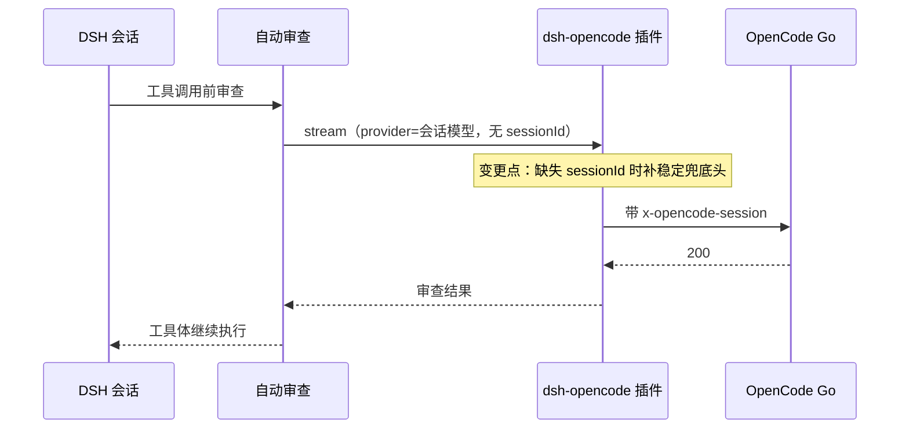

# FNOS-032 OpenCode 辅助调用补齐会话头

| 字段 | 内容 |
| --- | --- |
| 需求编号 | FNOS-032 |
| 提出日期 | 2026-10-26（来自 DSH 自动审查模式下的实测故障） |
| 需求状态 | 阶段一、二完成，待真实会话验证 |
| 关联计划 | [PLAN-FNOS-032 OpenCode 辅助调用补齐会话头](/plans/PLAN-FNOS-032-opencode-aux-session-header) |

## 需求背景

DSH 的自动审查（Auto 权限预设）在每次工具调用前，用**当前会话的 provider/model** 发一次审查请求。该请求由插件 `@deepseek-ai/dsh-experimental-auto-review` 直接构造 `GenerateOptions`，**不带 `sessionId`**。

OpenCode Go 自 2026-09-05 起要求所有推理请求携带稳定的 `x-opencode-session` 头；`@tnnevol/dsh-opencode` 通过 pi-ai 的 `withOpenCodeSessionHeader` 注入该头，但注入条件是 `options.sessionId` 存在。因此：

自动审查请求（无 `sessionId`）→ 不注入头 → OpenCode Go 返回 `400 MissingSessionID` → 审查失败 → 工具调用被中止（提示 `its body was not executed`），本地会话无法继续执行工具。

实测（本仓库 fnos-dsh 会话 seq 4177）：

```text
auto-review: reviewer ended with error INVALID_REQUEST: 400:
{"type":"MissingSessionID","message":"Request is missing x-opencode-session ..."}
```

主对话与压缩调用都带 `sessionId`（压缩在 `compaction-basic` 里显式传 `agent.session.id`），因此只有自动审查等「无会话身份」的辅助调用会命中。

## 调研结论

| 结论 | 出处 | 影响的功能 | 状态 |
| --- | --- | --- | --- |
| OpenCode Go 要求每个推理请求带 `x-opencode-session`，缺失返回 400 `MissingSessionID` | OpenCode 官方 Discussion #5495；本仓库实测（带头发 200、去掉头发 400） | FNOS-032-01 | 已核实 |
| 自动审查构造的 `GenerateOptions` 不含 `sessionId`，且没有为 review 预留 `purpose` | 上游 `packages/experimental/auto-review/src/index.ts:621-631`；`packages/llm/llm/src/types.ts:561-570` | FNOS-032-01 | 已核实 |
| 插件只在 `options.sessionId` 存在时注入头，缺省原样发送 | `@earendil-works/pi-ai` 的 `opencode-headers`；插件 `src/host/provider.ts` 的 `openCodeApis` | FNOS-032-01 | 已核实 |
| 压缩调用显式传 `sessionId: agent.session.id`，可作为「辅助调用也能带会话身份」的对照 | 上游 `packages/compaction/compaction-basic/src/summarizer.ts:158-159` | FNOS-032-02 | 已核实 |
| OpenCode 接受稳定的非 UUID 字符串作为该头值（实测 `diag-session-1` 返回 200） | 本仓库真实账号实测 | FNOS-032-01 | 已核实 |

## 需求目标

在插件侧补齐 `x-opencode-session`：有会话身份时继续使用真实 `sessionId`；没有时使用一个**稳定**的兜底值。这样自动审查等辅助调用不再被网关拒绝，本地会话可以继续发送并执行工具；主对话的路由与缓存语义不变。



## 功能列表

| 编号 | 优先级 | 功能 | 用户可观察结果 | 状态 |
| --- | --- | --- | --- | --- |
| FNOS-032-01 | P0 | 自动审查等辅助调用不再因缺会话头中断 | 在 Auto 权限预设下，工具调用不再报 `MissingSessionID`，会话可以继续 | 包级完成，待真实会话验证 |
| FNOS-032-02 | P1 | 主对话会话头语义不变 | 普通对话仍使用真实会话 id；已有显式 `x-opencode-session` 的请求不被覆盖 | 已完成（包级） |

## 行为约束

- 不覆盖调用方已显式设置的 `x-opencode-session`（大小写不敏感）。
- 有 `sessionId` 时优先使用它；只有缺失或为空串时才使用兜底值。
- 兜底值必须是稳定常量，不能每次请求随机生成（否则破坏上游按会话路由与缓存）。
- 不改 DSH 上游代码，不改自动审查插件。
- 不改动普通对话、压缩、标题生成等已有调用路径的语义。

## 不在本次范围内

- 向上游提交 auto-review 补 `sessionId` 的补丁（本仓库只做插件侧兜底；上游修复另议）。
- 处理其它 400（如 Discussion #10540 的瞬时无信息 400）的重试策略。
- 为兜底值提供用户可配置项（先固定常量，避免扩大配置面）。

## 验收条件与完成状态

### FNOS-032-01

- `FNOS-032-01-AC-01`：无 `sessionId` 的请求带 `x-opencode-session`，值为稳定兜底常量。
- `FNOS-032-01-AC-02`：Auto 权限预设下，工具调用不再因 `MissingSessionID` 中止。
- 目标环境：包级测试 ＋ DSH Web（Auto 权限预设）。

### FNOS-032-02

- `FNOS-032-02-AC-01`：有 `sessionId` 时头值等于该会话 id。
- `FNOS-032-02-AC-02`：调用方已提供该头（任意大小写）时不新增、不覆盖。
- `FNOS-032-02-AC-03`：四种协议族（openai-completions / openai-responses / anthropic-messages / google-generative-ai）都生效。
- `FNOS-032-02-AC-04`：普通对话、压缩等已有调用行为不变。
- 目标环境：包级测试。

## 变更记录

| 日期 | 变更 | 说明 |
| --- | --- | --- |
| 2026-10-26 | 建立需求 | 依据自动审查实测故障与上游源码核查；确定插件侧稳定兜底方案，不改上游 |
