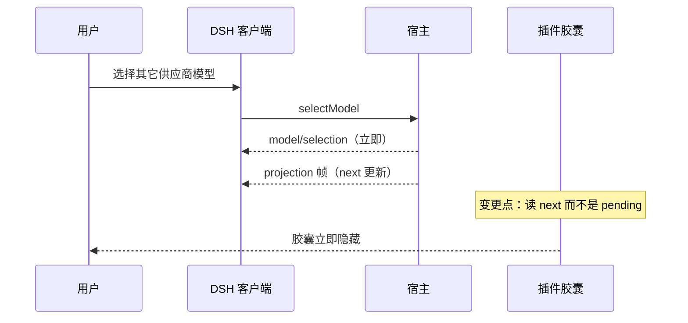

# FNOS-033 用量胶囊按当前选择即时显隐

| 字段 | 内容 |
| --- | --- |
| 需求编号 | FNOS-033 |
| 提出日期 | 2026-10-26（来自 DSH 会话实测与用户反馈） |
| 需求状态 | 已完成（包级 + DSH Web / DSH Desktop 运行时验证） |
| 关联计划 | [PLAN-FNOS-033 用量胶囊按当前选择即时显隐](/plans/PLAN-FNOS-033-usage-capsule-selection) |

## 需求背景

OpenCode、ZCode、Codex Auth 等插件都在输入区右侧挂用量胶囊，显隐依据是会话投影 `modelSelection` 的供应商标识。DSH 的投影 wire view 形状是 `{ lastUsed, next: pending ?? lastUsed }`：**`pending` 只存在于宿主状态，不会下发给客户端**。

`@tnnevol/dsh-opencode` 此前读取 `projection.pending ?? projection.lastUsed`。由于客户端投影里没有 `pending`，判定永远退回 `lastUsed`，而 `lastUsed` 只在 `request/header`（真正发请求）时更新。用户从 OpenCode 模型切到其它供应商后，胶囊仍按旧供应商显示，**必须发送一条消息才隐藏**。

ZCode 在 2026-10-24 的 `fix(zcode)` 中已改为 `next ?? lastUsed`（含在 v6.0.0+），Codex Auth 与 CodeBuddy 也使用 `next`；本次补 ZCode 的回归测试，并统一确认口径。

## 调研结论

| 结论 | 出处 | 影响的功能 | 状态 |
| --- | --- | --- | --- |
| 投影 wire view 是 `{ lastUsed, next: pending ?? lastUsed }`，`pending` 不下发 | 上游 `packages/api/session-controller/src/model-selection-projection.ts:24-28,65` | FNOS-033-01 | 已核实 |
| 用户选择模型时 `model/selection` 立即写入并触发投影变更广播 | 上游 `src/commands.ts:176`、`src/control.ts:24`（`onChanged` 即推） | FNOS-033-01 | 已核实 |
| OpenCode 用量显隐读取 `projection.pending`，实际永远退回 `lastUsed` | `plugins/dsh-opencode-plugin/src/client/services/usage-visibility.ts` | FNOS-033-01 | 已核实 |
| ZCode 已使用 `next ?? lastUsed`，且安装的 v6.0.0 产物同样如此 | 提交 `d89c63b`（2026-10-24）；`plugins/dsh-zcode-plugin/src/client/services/capsule-visibility.ts` | FNOS-033-02 | 已核实 |
| Codex Auth 与 CodeBuddy 的显隐判定均使用 `next` | 两插件各自的 `usage-visibility.ts` | FNOS-033-02 | 已核实 |

## 需求目标

用量胶囊在用户**选中模型的那一刻**按新的供应商显隐：切走立即隐藏，切回立即显示，不依赖是否发送消息。判定只读投影 wire view 的 `next`；`next` 为空时退回 `lastUsed`。

## 功能列表

| 编号 | 优先级 | 功能 | 用户可观察结果 | 状态 |
| --- | --- | --- | --- | --- |
| FNOS-033-01 | P0 | OpenCode 胶囊随选择即时显隐 | 切到其它供应商模型后胶囊立即消失，切回立即出现，不需要发送消息 | 已完成（包级 + 双客户端运行时） |
| FNOS-033-02 | P1 | 同类插件口径一致且有回归 | ZCode 的 next/lastUsed 优先级、切走立即隐藏与策略行为有测试钉住 | 已完成（包级 + 双客户端运行时） |

## 行为约束

- 只读投影 `next`（wire view），不读 `pending`。
- `next` 为 `null` 时退回 `lastUsed`，不能把「没有更新选择」误判成「没有选择」。
- 不改投影契约、不改 DSH 上游、不改用量数据请求。
- `always` 策略仍按用户显式要求常驻；`off` 始终隐藏。

## 不在本次范围内

- OpenCode 目录卡片少显示 `Off` 的显示口径问题（另议）。
- 模型选择器本身的行为（属于 DSH 上游）。

## 验收条件与完成状态

### FNOS-033-01
- `FNOS-033-01-AC-01`：`next` 指向其它供应商时，`readSelectedProvider` 返回新供应商，`auto` 判定为不显示。
- `FNOS-033-01-AC-02`：`next` 为 `null` 时退回 `lastUsed`。
- `FNOS-033-01-AC-03`：包级测试全绿，不改变用量数据请求与 host 代码。
- 目标环境：包级测试。

### FNOS-033-02
- `FNOS-033-02-AC-01`：ZCode 回归用例覆盖 next 优先、切走立即隐藏、`next: null` 回退、`always`/`off`/未登录。
- `FNOS-033-02-AC-02`：全仓库用量显隐不再读取 `projection.pending`。
- 目标环境：包级测试。

## 变更记录

| 日期 | 变更 | 说明 |
| --- | --- | --- |
| 2026-10-26 | 建立需求 | 依据实测与代码核查；确定 opencode 改读 next，zcode 补回归，其余插件已正确 |
| 2026-10-28 | 回填运行时验证 | DSH Web 与 DSH Desktop 各两个方向均即时显隐（未发送消息）；线上 npm 6.0.6 仍为旧构建，另行记录 |
