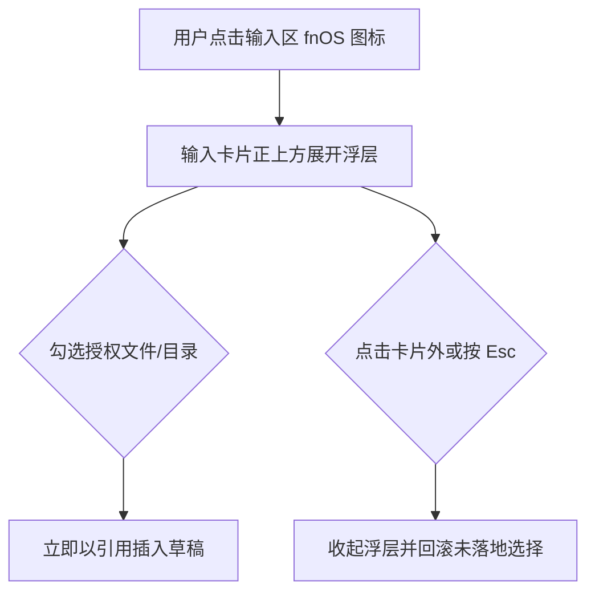

# FNOS-034 fnOS 授权目录选择器改为输入卡片宽浮层

| 字段 | 内容 |
| --- | --- |
| 需求编号 | FNOS-034 |
| 提出日期 | 2026-10-28（来自用户对 DSH Web 输入区的实机反馈） |
| 需求状态 | 实施中 |
| 关联计划 | [PLAN-FNOS-034 fnOS 授权目录选择器改为输入卡片宽浮层](/plans/PLAN-FNOS-034-fnos-input-dock-picker) |

## 需求背景

fnOS 插件在输入区工具栏左侧放了一个 fnOS 图标按钮，点开后是 Semi `TreeSelect` 的下拉树，用来把已授权的 NAS 文件或目录以引用形式插入草稿。

问题出在浮层的几何上，而**不在功能**：

- 浮层锚定在 28px 宽的工具栏按钮上，宽度是插件里写死的 `min(560px, calc(100vw - 32px))`，在宽屏上又窄又贴左。
- 用户已经习惯 DSH 自带斜杠指令面板的位置：紧贴输入卡片上沿、左右与卡片齐边、宽度完全跟随卡片。
- 两个浮层出现在同一片区域却尺寸不一致，读起来像「另一个控件」而不是同一个输入区的延续；授权目录树路径长，窄浮层里频繁横向滚动。

## 调研结论

| 结论 | 出处 | 影响的功能 | 状态 |
| --- | --- | --- | --- |
| 斜杠指令面板不是专用定位，而是 `conversation.input.overlay` 这个普通 list 槽的条目 | DSH 上游 `ui-input-trigger/src/client/index.ts` 向该槽注册 `id: 'slash-menu'` | FNOS-034-01 | 已核实 |
| 该槽锚点是输入卡片内部的零高定位上下文，宽度等于卡片宽度 | 上游 `InputBar.tsx` 的 `overlayAnchor`、`InputBar.module.css` 的 `inset: 0 0 auto; height: 0` | FNOS-034-01 | 已核实 |
| 指令面板靠 `bottom: calc(100% + 4px); left: 0; right: 0` 贴齐卡片左右边并浮在卡片上方 | 上游 `MenuView.module.css` 的 `.menu` | FNOS-034-01 | 已核实 |
| 该槽当在册条目为 `slash-menu`(0)、`command-popup`(1)、`feedback-dialog`(2)，注册只需自有 `id` | 本机 `cordis_inspect_query` 的 `Slots.listSubTree` 实测 | FNOS-034-01 | 已核实 |
| 该槽只在有会话时存在（Hero 空态无锚点），与工具栏按钮的显隐条件一致 | 上游 `InputBar.tsx` 的 `sessionId !== undefined` 判断 | FNOS-034-01 | 已核实 |
| `conversation.input.dock` 是在流内卡片、左右各内缩 16px 且挤占对话高度，不符合「与指令同位置」 | 上游 `TodoPanel.module.css`、`QueueDock.module.css` 的宽度算式 | FNOS-034-01 | 已核实 |
| Semi `Tree` 支持 `multiple` + `checkRelation="unRelated"` + `loadData`，与现有选择语义一致 | `@douyinfe/semi-ui` 2.90.2 的 `TreeProps` | FNOS-034-01 | 已核实 |

## 需求目标

fnOS 授权目录选择器展开后，出现在输入卡片正上方的同一位置，左右与卡片齐边，宽度随卡片自适应；交互手感与斜杠指令面板一致（点击卡片外部或按 Esc 关闭，高度受可用空间约束，不越出视口顶部）。

## 功能列表

| 编号 | 优先级 | 功能 | 用户可观察结果 | 状态 |
| --- | --- | --- | --- | --- |
| FNOS-034-01 | P0 | 选择器改为输入卡片宽浮层 | 展开位置与斜杠指令面板一致；左右贴齐卡片；窗口变窄时宽度随之收窄，不出现横向滚动 | 实现中 |
| FNOS-034-02 | P0 | 保持原有选择语义 | 父子可分别勾选、勾选即插入引用、取消勾选即移除对应引用、切换会话不串数据 | 实现中 |
| FNOS-034-03 | P1 | 浮层收起有明确出口 | 点击卡片外部、按 Esc、再次点击 fnOS 图标都能收起 | 实现中 |

## 行为约束

- 只改 fnOS 插件的客户端呈现层，不修改 DSH 上游，不改授权目录的 Host 路由与数据契约。
- 引用插入仍走 DSH 官方的结构化引用通道（`slash/input-insert-reference`），不新增插入路径。
- 浮层可见性按会话隔离：在 A 会话展开不影响 B 会话。
- 运行时忙碌（`adjudicating` / `submitting`）时保持现有禁用行为。
- 授权目录为空时给出与现在一致的空态文案。
- 不引入定时轮询、不做 `visibilitychange` 监听。

## 不在本次范围内

- 授权目录的增删改设置界面（插件详情页配置块）。
- 已授权目录树的取数方式与截断上限。
- 斜杠指令面板自身的样式与行为。
- 空会话 Hero 态下的选择器入口（Hero 没有输入卡片锚点，按钮本身也不显示）。

## 验收条件与完成状态

### FNOS-034-01
- `FNOS-034-01-AC-01`：浮层注册在 `conversation.input.overlay`，使用自有 `id`，不与 `slash-menu` / `command-popup` / `feedback-dialog` 冲突。
- `FNOS-034-01-AC-02`：浮层几何为左右贴齐卡片（无固定像素宽度常量），宽度随卡片自适应。
- `FNOS-034-01-AC-03`：浮层最大高度按视口上方可用空间钳制，不越出视口。

### FNOS-034-02
- `FNOS-034-02-AC-01`：父子目录可分别勾选，取消父目录不连带取消子项；取消勾选会移除对应引用。
- `FNOS-034-02-AC-02`：勾选后以官方结构化引用插入草稿，草稿投影与 CAS 跨度保持原有一致性。
- `FNOS-034-02-AC-03`：浮层开关状态按会话隔离，切换会话不残留上一次的展开状态。

### FNOS-034-03
- `FNOS-034-03-AC-01`：点击输入卡片外部收起浮层。
- `FNOS-034-03-AC-02`：按 Esc 收起浮层。
- `FNOS-034-03-AC-03`：再次点击 fnOS 图标收起浮层。

## 变更记录

| 日期 | 变更 |
| --- | --- |
| 2026-10-28 | 建立需求：选择器从工具栏下拉改为输入卡片宽浮层（FNOS-034-01/02/03）。 |
