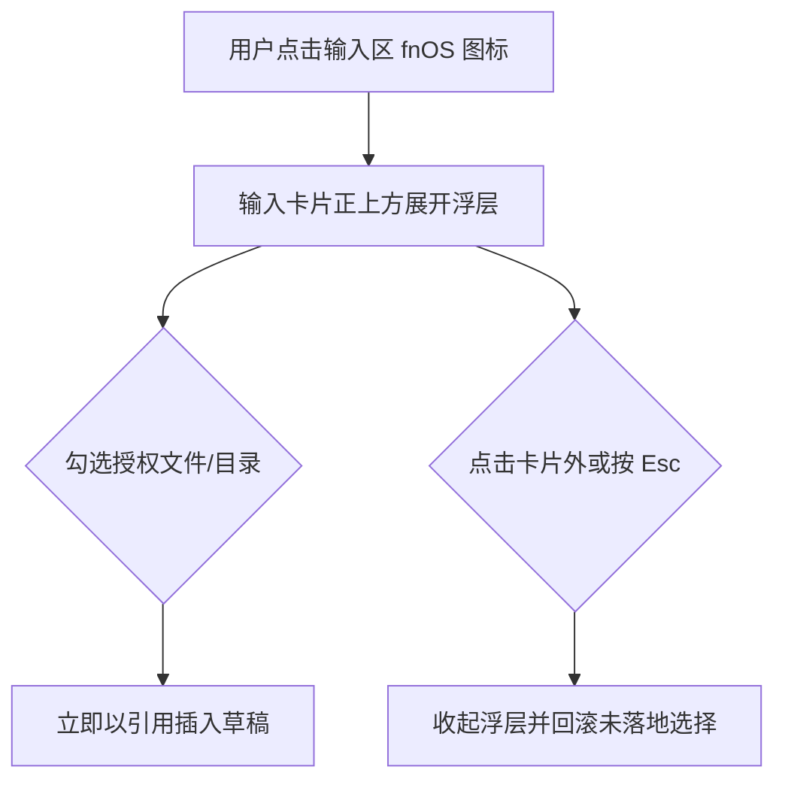

# FNOS-034 fnOS 授权目录选择器改为输入卡片宽浮层

| 字段 | 内容 |
| --- | --- |
| 需求编号 | FNOS-034 |
| 提出日期 | 2026-10-28（来自用户对 DSH Web 输入区的实机反馈） |
| 需求状态 | 已完成 |
| 关联计划 | [PLAN-FNOS-034 fnOS 授权目录选择器改为输入卡片宽浮层](/plans/PLAN-FNOS-034-fnos-input-dock-picker) |

## 需求背景

fnOS 插件在输入区工具栏左侧放了一个 fnOS 图标按钮，点开后是 Semi `TreeSelect` 的下拉树，用来把已授权的 NAS 文件或目录以引用形式插入草稿。

问题出在浮层的几何上，而**不在功能**：

- 浮层锚定在 28px 宽的工具栏按钮上，宽度是插件里写死的 `min(560px, calc(100vw - 32px))`，在宽屏上又窄又贴左。
- 用户已经习惯 DSH 自带斜杠指令面板的位置：紧贴输入卡片上沿、左右与卡片齐边、宽度完全跟随卡片。
- 两个浮层出现在同一片区域却尺寸不一致，读起来像「另一个控件」而不是同一个输入区的延续；授权目录树路径长，窄浮层里频繁横向滚动。

## 调研结论

| 结论 | 出处 | 影响的功能 | 状态 |
| --- | --- | --- | --- |
| 斜杠指令面板不是专用定位，而是 `conversation.input.overlay` 这个普通 list 槽的条目 | DSH 上游 `ui-input-trigger/src/client/index.ts` 向该槽注册 `id: 'slash-menu'` | FNOS-034-01 | 已核实 |
| 该槽锚点是输入卡片内部的零高定位上下文，宽度等于卡片宽度 | 上游 `InputBar.tsx` 的 `overlayAnchor`、`InputBar.module.css` 的 `inset: 0 0 auto; height: 0` | FNOS-034-01 | 已核实 |
| 指令面板靠 `bottom: calc(100% + 4px); left: 0; right: 0` 贴齐卡片左右边并浮在卡片上方 | 上游 `MenuView.module.css` 的 `.menu` | FNOS-034-01 | 已核实 |
| 该槽当在册条目为 `slash-menu`(0)、`command-popup`(1)、`feedback-dialog`(2)，注册只需自有 `id` | 本机 `cordis_inspect_query` 的 `Slots.listSubTree` 实测 | FNOS-034-01 | 已核实 |
| 该槽只在有会话时存在（Hero 空态无锚点），与工具栏按钮的显隐条件一致 | 上游 `InputBar.tsx` 的 `sessionId !== undefined` 判断 | FNOS-034-01 | 已核实 |
| `conversation.input.dock` 是在流内卡片、左右各内缩 16px 且挤占对话高度，不符合「与指令同位置」 | 上游 `TodoPanel.module.css`、`QueueDock.module.css` 的宽度算式 | FNOS-034-01 | 已核实 |
| Semi `Tree` 支持 `multiple` + `checkRelation="unRelated"` + `loadData`，与现有选择语义一致 | `@douyinfe/semi-ui` 2.90.2 的 `TreeProps` | FNOS-034-01 | 已核实 |

## 发版粒度复盘

本需求在实施过程中连续发版 8 次（`6.0.6` → `6.3.3`），其中 7 次是同一功能迭代中途的修补。问题不在档位选错，而在**发版粒度**：每改一次代码就推一格版本号，导致同一个需求跨越 3 个 minor 段，用户视角像经历了多次大版本升级。

事后已把 `6.2.x`/`6.3.x` 的历史重做为连贯的 `6.1.x`，并把根因写进规范：

| 缺口 | 补充位置 |
| --- | --- |
| 「一次发布覆盖多少改动」无判据 | [发布批次](/build/versioning#发布批次一次发布覆盖一批变化不是一个提交) |
| `targetVersion` 字段存在但语义未定义 | [需求文档规范](/charter/requirements-spec#frontmatter-中的-targetversion) |
| 装机验证性升版应固定用 `patch` | [发布批次](/build/versioning#装机验证性升版的档位固定为-patch) |
| 缺机器可判定的发版前自查 | AGENTS.md 硬约束 + [发布检查](/build/versioning#先回答现在该不该发版) |

后续遇到同类需求（一个需求需要多次装机验证）时：修补沿用 `patch` 前进，**不按改动性质重算档位**；收口后确认版本落在 `targetVersion` 上。

## 需求目标

fnOS 授权目录选择器展开后，出现在输入卡片正上方的同一位置，左右与卡片齐边，宽度随卡片自适应；交互手感与斜杠指令面板一致（点击卡片外部或按 Esc 关闭，高度受可用空间约束，不越出视口顶部）。

## 功能列表

| 编号 | 优先级 | 功能 | 用户可观察结果 | 状态 |
| --- | --- | --- | --- | --- |
| FNOS-034-01 | P0 | 选择器改为输入卡片宽浮层 | 展开位置与斜杠指令面板一致；左右贴齐卡片；窗口变窄时宽度随之收窄，不出现横向滚动 | 实现中 |
| FNOS-034-02 | P0 | 保持原有选择语义 | 父子可分别勾选、勾选即插入引用、取消勾选即移除对应引用、切换会话不串数据 | 实现中 |
| FNOS-034-03 | P1 | 浮层收起有明确出口 | 点击卡片外部、按 Esc、再次点击 fnOS 图标都能收起 | 实现中 |
| FNOS-034-04 | P1 | 层级始终低于指令面板 | 两者同时在页面时，指令面板稳定显示在选择器之上，不会出现被遮挡 | 实现中 |
| FNOS-034-05 | P1 | 面板不提供搜索 | 面板里没有搜索框，目录树直接完整展示 | 实现中 |
| FNOS-034-11 | P2 | 系统内置反代前缀只读展示 | 设置页把网关固定前缀单独列出并标注只读，用户可看清哪些路径不由自己配置 | 实现中 |
| FNOS-034-10 | P0 | 网关反代配置在重装后自动恢复 | 卸载时保留数据的用户重装后，代理前缀自动从缓存恢复，无需重新配置 | 实现中 |
| FNOS-034-09 | P0 | 面板内可直接授权 NAS 目录 | 标题栏授权按钮唤起 fnOS 原生选择器；授权成功后目录立刻出现在树里，并写入持久化记录 | 实现中 |
| FNOS-034-08 | P1 | 右键菜单可删除条目 | 目录与文件都可右键删除；删除前弹确认框；菜单项带图标，删除项以危险色区分 | 实现中 |
| FNOS-034-07 | P2 | 用 Typography 的省略自带气泡 | 目录名放得下时悬停没有提示；名字被省略号截断时悬停显示完整名字 | 实现中 |
| FNOS-034-06 | P0 | 面板内新建文件夹与空文件 | 标题栏有新建入口，右键目录也可新建；弹框里填名称即可在 NAS 上建出对应条目，无需先去别的界面 | 实现中 |

## 行为约束

- 只改 fnOS 插件的客户端呈现层，不修改 DSH 上游，不改授权目录的 Host 路由与数据契约。
- 引用插入仍走 DSH 官方的结构化引用通道（`slash/input-insert-reference`），不新增插入路径。
- 浮层可见性按会话隔离：在 A 会话展开不影响 B 会话。
- 运行时忙碌（`adjudicating` / `submitting`）时保持现有禁用行为。
- 授权目录为空时给出与现在一致的空态文案。
- 不引入定时轮询、不做 `visibilitychange` 监听。

## 不在本次范围内

- 授权目录的增删改设置界面（插件详情页配置块）。
- 已授权目录树的取数方式与截断上限。
- 斜杠指令面板自身的样式与行为。
- 空会话 Hero 态下的选择器入口（Hero 没有输入卡片锚点，按钮本身也不显示）。
- 新建条目的重命名、删除与移动（新建之外的编辑操作不在本次范围）。
- 在未授权目录内创建条目（必须先在设置里授权）。

## 验收条件与完成状态

### FNOS-034-01
- `FNOS-034-01-AC-01`：浮层注册在 `conversation.input.overlay`，使用自有 `id`，不与 `slash-menu` / `command-popup` / `feedback-dialog` 冲突。
- `FNOS-034-01-AC-02`：浮层几何为左右贴齐卡片（无固定像素宽度常量），宽度随卡片自适应。
- `FNOS-034-01-AC-03`：浮层最大高度按视口上方可用空间钳制，不越出视口。

### FNOS-034-02
- `FNOS-034-02-AC-01`：父子目录可分别勾选，取消父目录不连带取消子项；取消勾选会移除对应引用。
- `FNOS-034-02-AC-02`：勾选后以官方结构化引用插入草稿，草稿投影与 CAS 跨度保持原有一致性。
- `FNOS-034-02-AC-03`：浮层开关状态按会话隔离，切换会话不残留上一次的展开状态。

### FNOS-034-03
- `FNOS-034-03-AC-01`：点击输入卡片外部收起浮层。
- `FNOS-034-03-AC-02`：按 Esc 收起浮层。
- `FNOS-034-03-AC-03`：再次点击 fnOS 图标收起浮层。

### FNOS-034-04
- `FNOS-034-04-AC-01`：选择器浮层的层级严格低于斜杠指令面板，两者共处时指令面板不会被遮挡。

### FNOS-034-05
- `FNOS-034-05-AC-01`：面板内没有搜索输入框，目录树完整展示。

### FNOS-034-06
- `FNOS-034-06-AC-01`：右键菜单提供新建文件夹与新建文件两项（标题栏不设单独的新建入口）。
- `FNOS-034-06-AC-02`：在目录上右键弹出上下文菜单（含新建文件夹/新建文件），选中后进入命名弹框，父目录为该目录；在文件上右键不弹菜单。
- `FNOS-034-06-AC-03`：新建弹框收集名称，创建成功后新条目出现在该层，已展开的其它节点不被收起。
- `FNOS-034-06-AC-04`：Host 侧独立校验父目录在授权根内、名称是单段且不含分隔符与保留字符；越权请求被拒绝。
- `FNOS-034-06-AC-05`：同名已存在、权限不足、空间不足、只读分别给出可操作的原因文案，不吞成统一失败。
- `FNOS-034-06-AC-07`：右键菜单出现在鼠标位置附近（靠近视口边缘时自动内收，不越界），点击菜单之外或按 Esc 自动收起。
- `FNOS-034-06-AC-08`：菜单经 Portal 挂到 body，不成为选择器面板的子节点——面板的 `backdrop-filter` 会成为 `fixed` 后代的包含块，留在内部会被定位到面板角落。
- `FNOS-034-06-AC-06`：新建弹框或右键菜单打开期间，点击任意处或按 Esc 不会销毁选择器面板；面板在弹层收起后恢复外部点击关闭。

### FNOS-034-07
- `FNOS-034-07-AC-01`：目录名未被省略时不显示气泡提示。
- `FNOS-034-07-AC-02`：名字被省略号截断时，悬停显示完整路径。
- `FNOS-034-07-AC-03`：省略与溢出判定由 Semi `Typography.Text` 的 `ellipsis` 承担，不自行测量文本宽度。

### FNOS-034-08
- `FNOS-034-08-AC-01`：目录与文件都能右键打开菜单；新建项只对目录显示，删除项对两者都显示。
- `FNOS-034-08-AC-02`：菜单项带图标，删除项使用危险色并与其它项拉开。
- `FNOS-034-08-AC-03`：删除必须先经确认（就地 Popconfirm），确认后才调用宿主路由，且**必须真的发出请求**——确认时菜单可能已卸载，目标不能依赖会消失的 state。
- `FNOS-034-08-AC-07`：Popconfirm 使用组件默认尺寸，不自定义宽度或样式。
### FNOS-034-09
- `FNOS-034-09-AC-01`：标题栏提供授权入口，唤起 fnOS 原生目录选择器（权限由用户在系统中确认）。
- `FNOS-034-09-AC-02`：授权成功后重新拉取根列表，新目录立刻出现在树中。
- `FNOS-034-09-AC-03`：授权成功同时写入持久化记录；写盘失败只提示不中断，因为授权已在 fnOS 侧生效。
- `FNOS-034-09-AC-04`：用户取消选择不报错、不提示。取消的判定不依赖响应里 `data` 的形态——官方契约（`@trimjs/web-app` 的 `AppAuthCallbackStatus`）定义取消为 `status: 'cancel'`，而取消文案可能出现在 `data` 缺失、为 `null` 或非数组的响应里。
- `FNOS-034-09-AC-05`：只有官方契约的 `access_denied` 才算权限问题；`code === 1` 不单独作为权限判据（该码在部分 fnOS 版本里也用于普通取消失败）。

### FNOS-034-10
- `FNOS-034-10-AC-01`：settings 为空而 `TRIM_PKGVAR/gateway/path-allowlist.json` 有内容时，启动从缓存回填 settings。
- `FNOS-034-10-AC-02`：settings 已有配置时以它为准写向文件，不反向读取。
- `FNOS-034-10-AC-03`：缓存恢复发生时不得用空 settings 覆盖缓存文件——否则重装首次启动就会把配置清空。

### FNOS-034-11
- `FNOS-034-11-AC-01`：`GET` 反代规则时一并返回网关固定前缀（`/api`、`/plugins`、`/__fnos-gateway`）。
- `FNOS-034-11-AC-02`：设置页把它们渲染为独立只读区，与可编辑输入框视觉分离。

- `FNOS-034-08-AC-06`：删除确认打开期间，点击任意处或按 Esc 不销毁选择器面板；面板在所有 portal 浮层收起后恢复外部点击关闭。
- `FNOS-034-08-AC-04`：授权根本身不可删除；越权、只读、占用、条目不存在分别给出可操作原因。
- `FNOS-034-08-AC-05`：删除成功后该条目从树中移除，其勾选与已插入引用一并失效。

## 变更记录

| 日期 | 变更 |
| --- | --- |
| 2026-10-28 | 建立需求：选择器从工具栏下拉改为输入卡片宽浮层（FNOS-034-01/02/03）。 |
| 2026-10-28 | 追加三项：层级始终低于指令面板（FNOS-034-04）、面板不提供搜索（FNOS-034-05）、面板内右键新建文件夹与空文件（FNOS-034-06）。 |
| 2026-10-29 | `targetVersion` 由 6.1.0 更新为 6.1.3：需求迭代中途按装机验证需要多次 `patch` 前进，实际交付点为 6.1.3。 |
| 2026-10-29 | 修正「取消授权仍提示无法授权该目录」（FNOS-034-09 / AC-04）：判定改用官方类型而非文案——`AppBridgeResponse` 没有取消专用 code，官方只记录 `AppAuthCallbackStatus` 的 `cancel` 与 `AppAuthCallbackError` 的 `access_denied`；没有路径又没有这两种标记的返回一律按取消静默处理。`targetVersion` 更新为 6.1.15。 |
| 2026-10-29 | 调整面板标题栏（FNOS-034-09 / AC-01）：授权入口由图标按钮改为文案按钮「新增授权」，标题栏的授权与关闭两个按钮都去掉原生 `title` 气泡提示（关闭按钮保留 `aria-label`）。`targetVersion` 仍为 6.1.15。 |
| 2026-10-30 | 真机验收通过（提出人在真实 NAS 上确认 6.1.15）：取消授权不再误报、浮层位置与宽度、标题栏文案按钮均符合预期。需求标记为已完成。 |
