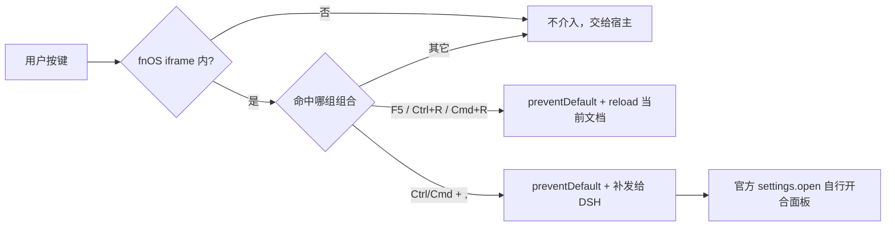

# FNOS-035 fnOS iframe 内拦截浏览器快捷键

| 字段 | 内容 |
| --- | --- |
| 需求编号 | FNOS-035 |
| 提出日期 | 2026-10-29（来自用户对 DSH Web 设置快捷键的实机反馈） |
| 需求状态 | 已完成 |
| 关联计划 | [PLAN-FNOS-035 fnOS iframe 内拦截浏览器快捷键](/plans/PLAN-FNOS-035-browser-shortcut-interception) |

## 需求背景

fnOS 应用把 DSH Web 装在 iframe 里（网关反代 + `type: "iframe"` 入口），因此 DSH 的前端跑在浏览器的子文档中，键盘事件先经过浏览器的默认行为处理，再轮到 DSH 的快捷键适配器。

DSH 官方 `settings.open` 的默认绑定按运行时区分：

| 运行时 | 绑定 |
| --- | --- |
| `desktop:macos` | `Meta + ,` |
| `desktop:windows` / `desktop:linux` | `Control + ,` |
| `web:*` | `primary + Alt + ,` |

fnOS 里运行时被判为 Web，但用户在浏览器中按 `Ctrl/Cmd + ,` 时，该组合会先被浏览器当成自身的「设置」入口消费掉，DSH 适配器根本收不到事件，表现为「按了没反应」。同一机制也让 `F5` / `Ctrl+R` / `Cmd+R` 刷新的是 fnOS 宿主整页，而不是 iframe 里的 DSH Web——刷新会把用户从 DSH 界面甩出去。

问题是**快捷键归属权**：组合键先被解析成了宿主的语义，DSH 就拿不到。插件要做的是在捕获阶段把这两类组合抢先拦下，再按 DSH 的语义处理。

## 调研结论

| 结论 | 出处 | 影响的功能 | 状态 |
| --- | --- | --- | --- |
| 设置键在 Desktop 绑定 `primary + Comma`、在 Web 绑定 `primary + Alt + Comma`，两种形态都要认，否则其中一种会漏 | `src/client/shortcuts/settings-shortcut-matcher.ts` 顶部绑定表 | FNOS-035-02 | 已核实 |
| `Shift` 组合属于 DSH 的另一个命令，抢它会产生错误触发 | 同上文件注释与 `不抢 Ctrl/Cmd + Shift + ,` 用例 | FNOS-035-02 | 已核实 |
| `DshHotKeys` 只做 `preventDefault`，**没有 `stopPropagation`**；监听挂在 window 捕获阶段时，补发的事件会再次进入本监听 | `src/client/shortcuts/settings-shortcut.ts` 的重入注释 | FNOS-035-02 | 已核实 |
| `settings.open` 的 `resolve` 会判断设置弹层是否已打开（已开则关）；插件自行调用会绕过该状态机，出现「开得起来关不掉」 | `src/client/shortcuts/settings-shortcut.ts` 顶部说明 | FNOS-035-02 | 已核实 |
| DSH 的适配器按**事件目标**判断区域（page / editable / terminal），转发必须发到原 `target` | 同上文件 `redispatch` | FNOS-035-02 | 已核实 |
| 浏览器刷新不可协商，没有「让宿主别刷新」的接口，只能自己 `reload` iframe 文档 | `src/client/shortcuts/browser-refresh-shortcut.ts` 实现 | FNOS-035-01 | 已核实 |
| 两套拦截都只在 fnOS iframe 内安装，其它承载环境下不介入 | 两个模块开头的 `isEmbeddedFnosFrame()` 判断 | FNOS-035-01/02 | 已核实 |

## 需求目标

在 fnOS 应用的 iframe 内，`F5` / `Ctrl+R` / `Cmd+R` 只刷新 DSH Web 这一个文档，`Ctrl/Cmd + ,` 能正常唤起 DSH 的设置面板；两者的组合语义互不侵占，且在非 fnOS 承载环境下插件不改变任何快捷键行为。

## 功能列表

| 编号 | 优先级 | 功能 | 用户可观察结果 | 状态 |
| --- | --- | --- | --- | --- |
| FNOS-035-01 | P0 | 刷新快捷键只刷新 DSH Web | 在 fnOS 应用里按 `F5` 或 `Ctrl/Cmd + R`，刷新的是 iframe 里的 DSH 界面，不会把用户甩回 fnOS 桌面 | 实现中 |
| FNOS-035-02 | P0 | 「打开设置」快捷键不被浏览器吞掉 | 按 `Ctrl/Cmd + ,` 能打开 DSH 设置面板，再按一次能关掉 | 实现中 |

## 行为约束

- 只改 `plugins/dsh-fnos-plugin` 的客户端层，不修改 DSH 上游，不改网关与 Host 路由。
- 只在 fnOS iframe 内生效：`isEmbeddedFnosFrame()` 为假时直接返回空卸载函数，不注册任何监听。
- 设置键只**转发**，不自行实现开面板逻辑；否则会绕过官方「已打开则关闭」的状态机。
- 转发必须带重入标志，避免补发的事件被自己的捕获监听再次拦下造成递归。
- 属主省略：不提供用户自定义绑定，不读写 DSH 的快捷键配置。

## 不在本次范围内

- DSH Desktop 与普通 DSH Web 页面里的快捷键行为。
- `primary + Comma` 与刷新三键之外的任何组合键。
- fnOS 宿主页面自身的快捷键（插件只作用于 DSH 所在的子文档）。
- 快捷键的可配置化与冲突检测界面。

## 验收条件与完成状态

### FNOS-035-01

- `FNOS-035-01-AC-01`：`F5`、`Ctrl + R`、`Cmd + R` 三种组合都识别为刷新。
- `FNOS-035-01-AC-02`：命中刷新时调用当前文档的 `location.reload()`，不触碰宿主页面。
- `FNOS-035-01-AC-03`：设置组合不被当成刷新，两组语义互不侵占。

### FNOS-035-02

- `FNOS-035-02-AC-01`：`Ctrl + ,`、`Cmd + ,` 以及带 `Alt` 的 Web 形态都识别为设置键。
- `FNOS-035-02-AC-02`：命中时先 `preventDefault` 掐掉浏览器默认行为，再把等价事件补发给 DSH。
- `FNOS-035-02-AC-03`：补发的目标沿用原事件目标，适配器能据此判定所在区域。
- `FNOS-035-02-AC-04`：带 `Shift` 的同键组合不被拦截。
- `FNOS-035-02-AC-05`：不调用官方私有入口，面板开合完全由 `settings.open` 决定。
- `FNOS-035-02-AC-06`：补发事件带重入保护，不出现递归。

## 变更记录

| 日期 | 变更 |
| --- | --- |
| 2026-10-29 | 建立需求：把此前已随 6.1.x 交付的刷新快捷键拦截与本轮新做的「打开设置」快捷键转发登记为同一需求（FNOS-035-01/02），`targetVersion` 对齐到实际交付点 6.1.13。 |
| 2026-10-29 | 真机反馈「拦截生效但设置弹框没打开」：官方默认绑定在 Web 运行时是 `primary + alt + Comma`（只有 Desktop 才是 `primary + Comma`），补发事件没带 `alt`，两组绑定都命中不了。改为补发时统一置 `altKey: true`。`targetVersion` 更新为 6.1.14。 |
| 2026-10-30 | 真机验收通过（提出人在真实 NAS 上确认 6.1.15）：`Ctrl/Cmd + ,` 能打开并关闭 DSH 设置面板，刷新快捷键仍只作用于内嵌页面。需求标记为已完成。 |
