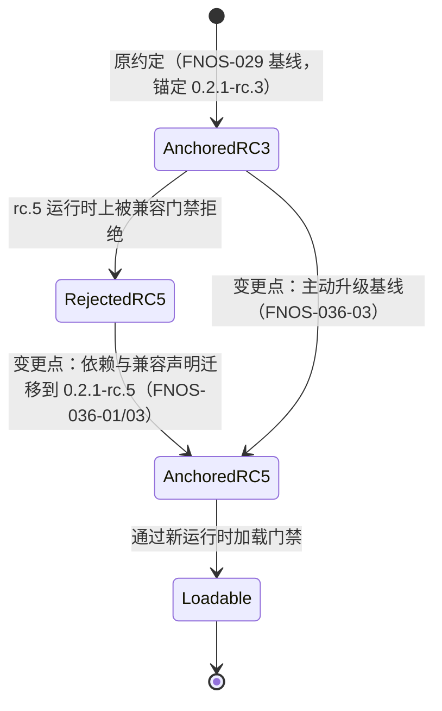
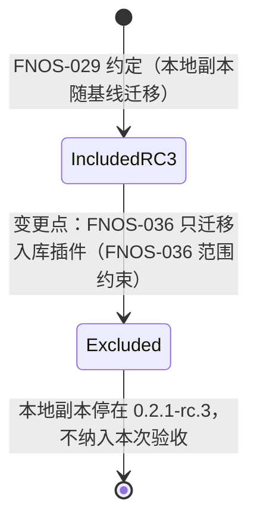
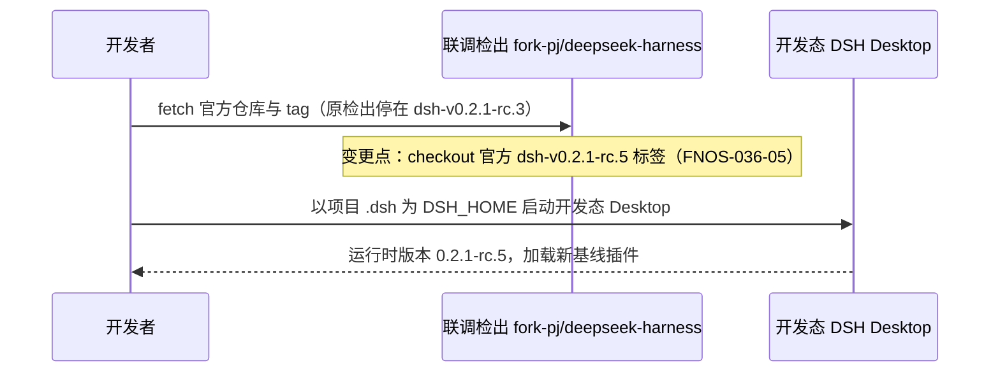

# FNOS-036 DSH 0.2.1-rc.5 插件适配与基线迁移

| 项目 | 内容 |
| --- | --- |
| 需求编号 | FNOS-036 |
| 提出日期 | 2026-10-30 |
| 需求状态 | 待完成（实现、包级验证与双客户端加载面验收完成；代表功能逐项走查、主题切换与 FPK 真机待验） |
| 关联计划 | [PLAN-FNOS-036 DSH 0.2.1-rc.5 插件适配与基线迁移](/plans/PLAN-FNOS-036-dsh-021-rc5-adaptation) |
| 适用范围 | 七个入库 DSH 插件（codex-auth、fnos、failover-search、midscene、opencode、semi-ui-showcase、zcode）、仓库运行与构建基线、本地联调检出（`fork-pj/deepseek-harness`） |
| 明确排除 | CodeBuddy 插件本地副本（[FNOS-025](/requirements/FNOS-025-codebuddy-plugin-delisting) 已下架，本次不随基线迁移） |

## 需求背景

DSH 官方已发布 `0.2.1-rc.5`，npm 的 `next` 与 `latest` 两个标签**都已指向它**（此前 rc.3 阶段 `latest` 仍停留在旧版本）。本仓库的运行基线、插件依赖锚定与兼容声明仍停在 `0.2.1-rc.3`：插件按精确版本锚定 DSH 兼容范围（[FNOS-014](/requirements/FNOS-014-dsh-021-rc2-adaptation) 建立的约定），在 rc.5 运行时上会被兼容门禁拒绝，无法安装与加载。

同时，仓库的 Desktop 联调检出（`fork-pj/deepseek-harness`，由 `DSH_DESKTOP_APP_DIR` 指定）停在官方 `dsh-v0.2.1-rc.3` 标签，需要更新到 `dsh-v0.2.1-rc.5`，使开发态 Desktop 的验收环境与新基线一致。

与 [FNOS-029](/requirements/FNOS-029-dsh-021-rc3-adaptation) 那次迁移结构相同：rc.3 → rc.5 只有 13 条提交（6 条功能性提交、2 条 release 提交），没有面向插件作者的破坏性升级指南之外的接口重写，属于小步基线推进。本需求同样以「锚定迁移 + 契约复核 + 双客户端回归」为主。

与 FNOS-029 的两点差异：

1. **范围收窄**：提出人明确本次只处理入库插件，CodeBuddy 本地副本不再随基线迁移（FNOS-025 已下架，源码保留但不再追踪与适配）。
2. **契约变化存在**：rc.3 → rc.5 新增了一条面向插件作者的升级指南（思考内容 Body 插座的 `rawText` 字段），因此本轮不能只做锚定改写，必须逐项复核该变化是否落在仓库插件的能力面上。

## 调研结论

| 结论 | 出处 | 影响的功能 | 状态 |
| --- | --- | --- | --- |
| `@deepseek-ai/dsh@0.2.1-rc.5` 已发布到 npm，`next` 与 `latest` 两个标签都指向它；`alpha` 标签指向 `0.2.2-alpha.2` | `npm view @deepseek-ai/dsh dist-tags`、`versions`（2026-10-30 核实） | FNOS-036-03 | 已核实 |
| 官方仓库 `dsh-v0.2.1-rc.3..dsh-v0.2.1-rc.5` 共 13 条提交，其中功能性提交 6 条（思考块渲染定制、会话视图标签气泡、ACP/MCP 诊断不再写入 stdout）；改动集中在客户端渲染与诊断输出，不含宿主接缝包的接口重写 | 官方两 tag 间 `git log --oneline --no-merges`、`git diff --stat`（2026-10-30） | FNOS-036-01 | 已核实 |
| 新增一条面向插件作者的升级指南 `docs/upgrade-guide/v0.2.1-rc.4/reasoning-body-props`：`conversation.chat.reasoning.body` 插座的 `ReasoningBodyOwnerProps` 新增 `rawText`（模型原始输出），原 `text` 改为 Chat 预处理后的展示文本，`running` 不变 | 官方 `docs/upgrade-guide/v0.2.1-rc.4/reasoning-body-props/guide.md`（2026-10-30） | FNOS-036-02 | 已核实 |
| 仓库七个入库插件注册的 8 类插座（`conversation.input.left`、`conversation.input.overlay`、`conversation.input.right`、`conversation.session.header.utilities`、`plugins.detail.section`、`settings.action`、`shell.overlay`、`sidebar.footer.action`）在 rc.5 全部保留且 `ownerProps`/`registerOptions` 契约不变；插座目录 12 处改动中 11 处仅为源码行号位移，唯一契约变化是上述思考内容 Body 插座 | 官方 `cordis-client-runner/src/client/slot-catalog.ts` 两 tag diff 与 `ui-chat/src/client/contract/slots.ts` 核对（2026-10-30） | FNOS-036-02 | 已核实 |
| 仓库插件不注册 `conversation.chat.reasoning.body`，也不依赖 `@deepseek-ai/dsh-client-ui-chat` 或思考内容翻译扩展，因此该契约变化不落在插件能力面上 | 仓库插件源码与 manifest 检索（2026-10-30） | FNOS-036-02 | 已核实 |
| 两个 tag 的包清单完全一致（各 352 个包），无新增、删除或改名；仓库 catalog 引用的 `@deepseek-ai/*` 精确版本在 rc.5 均有同名发布 | 官方两 tag `packages/**/package.json` 清单比对；npm 抽样核实 `dsh-api-gateway`、`dsh-web-deepseek-api`、`dsh-client-ui-slots`、`dsh-attachment-local` 的 rc.5 版本（2026-10-30） | FNOS-036-01、FNOS-036-07 | 已核实 |
| 插件实际使用的 40 个宿主接缝包中 38 个 `src/` 目录零变化；唯一有改动的是 `@deepseek-ai/dsh-client-ui-conversation`（2 个文件）：删除语言键 `session.moreViewsCurrent`（该键参与 `ConversationKey` 类型联合，属于公开类型面收窄，仓库插件未引用）、会话视图标签改为仅在文本溢出时显示气泡。该包的插座契约文件 `src/client/contract/slots.ts` 与 `apply.ts` 零改动 | 官方两 tag 逐包 `src/` diff；`ConversationKey = keyof typeof zh` 导出链核对；仓库插件源码检索（2026-10-30） | FNOS-036-01、FNOS-036-02 | 已核实 |
| 全部 349 个 `package.json` 在两 tag 间**只改 `version` 字段**：剥离 `version` 后规范化比对，`exports`、`peerDependencies`、`dependencies`、`engines` 与 `files` 均零差异，即无子路径导出变更、无 peer 范围变更、无包改名或删除 | 官方两 tag 全量 `package.json` 结构化比对（2026-10-30） | FNOS-036-01、FNOS-036-07 | 已核实 |
| 其余源码改动不落在插件能力面上：`dsh-mcp-client` 对未声明 resources 能力的服务器短路返回空列表、`dsh-llm-deepseek-account` 的诊断输出从 `console.info` 改为 `console.error`；仓库插件既不依赖这两个包，也不引用 `ConversationKey` 或 MCP 资源列表 | 官方两 tag diff；仓库插件源码检索（2026-10-30） | FNOS-036-01 | 已核实 |
| 模型底座 `@earendil-works/pi-ai` 在两 tag 间保持 `^1.1.0`，opencode/zcode/midscene 插件落座的适配层源码零变化 | 官方 `packages/llm/llm-pi-ai/package.json` 两 tag 比对、`src/` diff（2026-10-30） | FNOS-036-01 | 已核实 |
| 三方插件 `dshmarket@1.66.47` 的 peer 范围 `^0.2.1-rc.1` 按语义化版本规则包含 `0.2.1-rc.5`，无需换版本 | `npm view dshmarket@1.66.47 peerDependencies`；semver 判定（2026-10-30） | FNOS-036-03 | 已核实 |

## 需求目标

- 仓库运行与构建基线（catalog、基线校验常量、安装回调）与本地联调检出统一到 DSH `0.2.1-rc.5`。
- 七个入库插件的依赖与兼容声明锚定 `0.2.1-rc.5`，在新运行时上可安装、可加载、既有功能不回归。
- 用户既有数据（凭据、账号、偏好、授权目录、模型配置）在基线迁移后保持可用。

## 功能列表

| 编号 | 优先级 | 功能 | 用户可观察结果 | 状态 |
| --- | --- | --- | --- | --- |
| FNOS-036-07 | P1 | 插件依赖版本单一事实来源 | 更新 DSH 基线时插件 manifest 不出现 DSH 版本字面量，版本只在 catalog 维护一处；构建门禁拒绝字面版本 | <Badge type="tip" text="已验（门禁守卫用例）" /> |
| FNOS-036-01 | P0 | 七个入库插件在新运行时正常加载 | 七个插件新版本在 DSH `0.2.1-rc.5` 上安装后，插件管理页无「异常」或行挂起，各插件既有功能可用且行为与 rc.3 基线一致 | <Badge type="warn" text="待验证" /> |
| FNOS-036-02 | P0 | 插件界面契约保持 | 插件在详情页、会话区、输入区、设置区与侧栏注册的界面区块在新运行时上位置与信息展示不变；rc.5 的思考内容插座契约变化不影响插件 | <Badge type="warn" text="待验证" /> |
| FNOS-036-03 | P0 | 仓库运行与构建基线同步 | 本地 DSH Web 报告的运行时版本、FPK 安装回调安装的运行时版本与插件兼容声明三方一致；三方插件 `dshmarket` 安装不被兼容门禁拒绝 | <Badge type="warn" text="待验证" /> |
| FNOS-036-04 | P0 | 用户数据兼容 | 基线迁移（本地 profile 升级运行时与插件）后，既有凭据、账号、偏好、模型配置继续生效，无需手动迁移 | <Badge type="warn" text="待验证" /> |
| FNOS-036-05 | P1 | Desktop 联调检出更新 | `fork-pj/deepseek-harness` 检出处于官方 `dsh-v0.2.1-rc.5`，开发态 Desktop 以该版本运行并加载新基线插件 | <Badge type="warn" text="待验证" /> |

### 验收环境范围

- FNOS-036-01、02、04 在 **DSH Web 与 DSH Desktop** 双客户端验收；涉及外部登录的环节（Codex Auth、OpenCode、ZCode）另需真实网络与账号条件。
- FNOS-036-03 在本地构建链路（catalog、基线校验、安装回调常量一致性）验收；FPK 真机安装与升级按仓库惯例另行安排，不阻塞本需求双客户端结论。
- FNOS-036-05 在 Desktop 联调检出环境验收（检出 tag 与启动版本核对）。
- FNOS-036-07 在仓库构建门禁与守卫用例上验收，属于回归保持项，不单独做界面走查。

## 行为约束

- 迁移只改变依赖锚定、兼容声明与基线常量；不改变插件的功能语义、交互流程和数据格式。
- 插件 `package.json` 的 DSH 相关依赖**一律通过 pnpm catalog 引用**（`catalog:dsh`），不在插件内单独维护版本号；兼容判定由 `engines.dsh` 承担，其值必须等于 catalog 基线。
- 不通过版本豁免绕过门禁。
- 用户数据的存储位置和读写行为不变；基线迁移过程不得删除或改写既有数据。
- 不修改官方上游源码；联调检出只做 fetch 与 checkout。
- CodeBuddy 本地副本**不纳入本次迁移**：不修改其依赖锚定与兼容声明，也不因本次改动产生任何受版本管理的改动。

## 不在本次范围内

- 官方 DSH 上游源码的修改或提交。
- CodeBuddy 插件的基线适配、发布与市场条目（[FNOS-025](/requirements/FNOS-025-codebuddy-plugin-delisting) 的下架决定继续有效）。
- 为插件新增功能或改变既有交互（rc.5 的思考块渲染定制、视图标签气泡属官方内置 UI 能力，不做插件侧适配）。
- 插件 npm 发布与市场索引更新（按 [FNOS-028](/requirements/FNOS-028-unified-project-version-bumpp) 的发布节奏另行执行）。
- FPK 在真实 fnOS NAS 上的安装与升级验收（基线常量同步后按发布流程安排，登记为后续验证，不阻塞双客户端结论）。
- 旧版本插件在新运行时上的兼容豁免。

## 既有功能变更关系

本次变更覆盖 [FNOS-029](/requirements/FNOS-029-dsh-021-rc3-adaptation) 建立的 `0.2.1-rc.3` 基线约定：依赖锚定与兼容声明迁移到 `0.2.1-rc.5`。FNOS-029 的验收结论在其原验证环境内继续有效，不回改其正文。

原约定下插件的 DSH 依赖锚定 `0.2.1-rc.3`，在 rc.5 运行时上被判定不兼容；新约定下全部锚定 `0.2.1-rc.5`。用户可观察结果：插件管理页从「异常/拒绝安装」恢复为正常状态。

CodeBuddy 副本的处置与 FNOS-029 相反，本次保持不动：

Desktop 联调检出的更新路径同步变化：

变更原因：Desktop 联调必须使用与新基线一致的上游检出，否则插件兼容声明与运行时版本不匹配，验收结果无效。用户可观察结果：开发态 Desktop 关于页与日志报告 `0.2.1-rc.5`。

## 验收条件与完成状态

### FNOS-036-07

- `FNOS-036-07-AC-01`：全部入库插件 manifest 的 DSH 依赖均为 `catalog:dsh`，`engines.dsh` 等于 catalog 基线。
- `FNOS-036-07-AC-02`：往插件 manifest 写入 DSH 版本字面量时构建门禁报错并指出该依赖。

### FNOS-036-01

- `FNOS-036-01-AC-01`：七个入库插件新版本在 DSH `0.2.1-rc.5` 上安装后，插件管理页无「异常」与不兼容原因，组合包显示为已启用。
- `FNOS-036-01-AC-02`：DSH 运行日志中不出现插件模块未找到、插座未声明或行挂起的错误。
- `FNOS-036-01-AC-03`：各插件代表功能（登录态展示、搜索转移、桥接健康、模型目录、组件展示、额度显示）在 DSH Web 与 DSH Desktop 上分别验证通过。

### FNOS-036-02

- `FNOS-036-02-AC-01`：插件在各界面区域注册的区块位置与 rc.3 基线一致，不与他人区块冲突。
- `FNOS-036-02-AC-02`：亮色与暗色主题下插件界面渲染正常，主题切换实时生效。
- `FNOS-036-02-AC-03`：rc.5 的思考内容 Body 插座契约变化经复核确认不落在仓库插件能力面上（插件未注册该插座、未依赖该渲染链）。

### FNOS-036-03

- `FNOS-036-03-AC-01`：仓库 catalog、基线校验常量与安装回调指向 `0.2.1-rc.5`，构建校验不因版本不一致失败。
- `FNOS-036-03-AC-02`：本地启动的 DSH Web 报告版本与插件兼容声明一致。
- `FNOS-036-03-AC-03`：`dshmarket` 在新基线上的安装不被兼容门禁拒绝（以 peer 范围判定与本地安装链路为证据）。

### FNOS-036-04

- `FNOS-036-04-AC-01`：基线迁移后，迁移前已有的凭据、账号、偏好、模型配置继续生效。
- `FNOS-036-04-AC-02`：迁移过程与迁移后均不出现数据丢失或被改写。

### FNOS-036-05

- `FNOS-036-05-AC-01`：`fork-pj/deepseek-harness` 检出的 HEAD 为官方 `dsh-v0.2.1-rc.5` 标签。
- `FNOS-036-05-AC-02`：开发态 Desktop 以该检出启动后报告运行时版本 `0.2.1-rc.5` 并正常加载新基线插件。

## 变更记录

| 日期 | 变更 | 说明 |
| --- | --- | --- |
| 2026-10-30 | 补做 DSH Desktop 验收 | 开发态 Desktop（检出 `dsh-v0.2.1-rc.5`）启动成功并完成取证：渲染进程报告运行时 `0.2.1-rc.5`（commit `b830ec9`），78 个 boot 入口含六个在范围内插件，插件管理页六插件可打开且无异常（唯一「异常」为范围外 CodeBuddy），界面可正常交互。至此双客户端加载面与界面区块验收完成；代表功能逐项走查、亮暗主题切换与迁移前后数据比对仍待补测，FPK 真机验证按发布流程另行安排。 |
| 2026-10-30 | 实现与 DSH Web 验收完成 | 基线迁移、七插件锚定改写（统一 `catalog:dsh` + `engines.dsh`）、catalog 三处同步（348 条）与安装回调完成；`pnpm install` 重锁后运行时报告 `0.2.1-rc.5`，六个在范围内插件在插件管理页全部加载且无异常（CodeBuddy 按范围排除、显示「异常」）。测试证据见[测试用例文档](/tests/FNOS-036-dsh-021-rc5-adaptation)。 |
| 2026-10-30 | 初始登记 | 建立 FNOS-036，范围覆盖基线迁移（catalog/基线校验/安装回调）、七个入库插件的锚定迁移、联调检出更新与双客户端验收；CodeBuddy 副本按提出人要求排除。rc.3→rc.5 契约差异已核实为一条插座 props 变化（不落在插件能力面上），8 条调研结论，关联 PLAN-FNOS-036。 |
