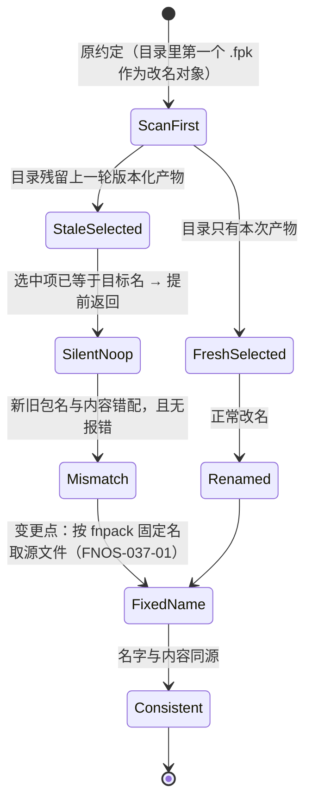

# FNOS-037 本地构建 FPK 改名定位到错误产物

| 项目 | 内容 |
| --- | --- |
| 需求编号 | FNOS-037 |
| 提出日期 | 2026-10-30 |
| 需求状态 | 已完成（包级用例、变异验证与真实构建验证均通过） |
| 关联计划 | [PLAN-FNOS-037 本地构建 FPK 改名定位到错误产物](/plans/PLAN-FNOS-037-local-fpk-rename-source) |
| 适用范围 | 本地构建链路（`tooling/fnos-dsh-cli` 的 FPK 改名与产物命名一致性守卫） |

## 需求背景

本地 `pnpm run build` 在 `fnpack build` 之后会把固定名产物改写成发布名 `<app>-<RELEASE_TAG>-dsh-<DSH_BASELINE>.fpk`，与 CI workflow 的命名保持一致（该能力由 2026-10-29 的提交引入）。

提出人在本地构建后发现：**产物的名字与实际内容对不上**，而构建过程没有任何报错。实测目录里同时存在两份文件：

| 文件 | 名字声称 | 包内 `manifest` 实际内容 |
| --- | --- | --- |
| `fn-deepseek-harness-v7.0.0-dsh-0.2.1-rc.5.fpk` | 项目 7.0.0、基线 rc.5 | `version = 6.1.15`、基线 `0.2.1-rc.3`（10-29 的旧包） |
| `fn-deepseek-harness.fpk` | 无版本 | `version = 7.0.0`、基线 `0.2.1-rc.5`（本次新包，未被改名） |

也就是说：**改名动作作用在了旧包上，本次新包留在了原名。** 这比「没有改名」更危险——旧包顶着一个看起来正确的发布名，装机时无法从文件名分辨，正是命名统一当初要解决的问题。

## 调研结论

| 结论 | 出处 | 影响的功能 | 状态 |
| --- | --- | --- | --- |
| 命名规则本身与 CI 一致，不是需求提出的「命名规范不一致」：两侧模板都是 `<app>-<RELEASE_TAG>-dsh-<DSH_BASELINE>.fpk`，且都由 `catalog` 派生基线 | `tooling/fnos-dsh-cli/src/core/fpk-artifacts.ts` 与 `.github/workflows/build-app.yml` 的 `VERSIONED_FPK` 对照（2026-10-30） | FNOS-037-01 | 已核实 |
| 改名能力接在正确位置：`build.ts` 在 `await runCommand('fnpack', ['build'])` 之后调用 `renameFpkForRelease(app)`，本地构建**不执行** `build-app.yml`，两条路各自实现同一命名契约 | `tooling/fnos-dsh-cli/src/commands/build.ts` 构建流程（2026-10-30） | FNOS-037-01 | 已核实 |
| 真实缺陷是取源文件的方式：旧实现 `(await readdir(appDir)).find(entry => entry.endsWith('.fpk'))` 取目录里**第一个** `.fpk`；目录残留上一轮版本化产物时选中旧包，算出目标名后与自身同名，命中 `original === versioned` 提前返回，本次新包留在原名 | 旧实现源码与实测目录读取顺序（`readdir` 返回 `fn-deepseek-harness-v7.0.0-dsh-0.2.1-rc.5.fpk` 在 `fn-deepseek-harness.fpk` 之前）（2026-10-30） | FNOS-037-01 | 已核实 |
| `fnpack` 的产物名是固定值 `<app>.fpk`，因此源文件可以按确定名字取，无需扫描 | 改名逻辑的既有注释与 E2E 旧配置都按该固定名定位（2026-10-30） | FNOS-037-01 | 已核实 |
| 现有守卫用例只校验「两侧模板同形」，不校验「改名对象是不是本次产物」，因此缺陷可以长期通过全部检查 | `tooling/fnos-dsh-cli/tests/fpk-release-naming.spec.ts` 断言范围（2026-10-30） | FNOS-037-02 | 已核实 |
| CI 侧同步骤用 `find . -maxdepth 1 -name '*.fpk' -print -quit`，同样是「取任意一个」；但 CI 在干净检出上构建，目录内只有本次产物，因此未暴露。本地目录会累积历史产物，才是触发条件 | `.github/workflows/build-app.yml` 改名步骤与本地目录状态对照（2026-10-30） | FNOS-037-01 | 已核实 |

## 需求目标

- 本地构建产出的 FPK **文件名与包内内容始终对应同一次构建**，与 CI 产物的命名口径一致。
- 改名目标已存在时直接覆盖，不留下同名多份；目录里仍有其它 FPK 时明确提示，避免装机拿错。
- 该缺陷必须有能在实现回退时立刻变红的回归用例。

## 功能列表

| 编号 | 优先级 | 功能 | 用户可观察结果 | 状态 |
| --- | --- | --- | --- | --- |
| FNOS-037-01 | P0 | 改名作用于本次构建的产物 | 本地 `pnpm run build -- --fpk` 结束后，带版本名的 FPK 内 `manifest` 版本与基线等于本次构建；目录不再出现「名字是新的、内容是旧的」的文件 | <Badge type="warn" text="待验证" /> |
| FNOS-037-02 | P1 | 残留产物被显式报告 | 目录里存在与本次命名不同的旧 FPK 时，构建输出给出明确警告并列出文件名，而不是静默通过 | <Badge type="warn" text="待验证" /> |

## 行为约束

- 命名模板与 CI 保持同形，不因本次修复改动文件名格式。
- 不静默删除目录里的历史 FPK：这些是构建产物，可能被用于对照或回滚；只在检测到多余产物时提示。
- 不改变 CI workflow 的行为；CI 在干净检出上运行，现有逻辑继续可用。
- 构建失败时的行为不变：取不到固定名产物即报错退出，不退化为「猜一个文件」。

## 不在本次范围内

- 修改 CI workflow 的 `find` 取文件方式（当前在干净检出上无缺陷，另行评估）。
- 历史已错配产物文件的自动清理或迁移（由使用者决定是否删除）。
- E2E 侧「目录内必须恰好一份 FPK」的既有约束调整。
- 产物命名格式本身的变更。

## 既有功能变更关系

本次变更覆盖 2026-10-29 引入的「本地 FPK 产物命名与 CI 一致」能力中的取源方式，命名模板与触发时机不变。

变更原因：改名对象必须由「本次构建产出了什么」决定，不能由「目录里恰好排第一的是什么」决定。用户可观察结果：带版本名的 FPK 打开后，`manifest` 的 `version` 与基线就是本次构建的值。

## 验收条件与完成状态

### FNOS-037-01

- `FNOS-037-01-AC-01`：目录内预先存在一份同名旧 FPK 时，执行一次本地构建后，该文件名下的内容为本次构建产物。
- `FNOS-037-01-AC-02`：构建结束后目录内不再残留 `fnpack` 的固定名产物。
- `FNOS-037-01-AC-03`：命名模板与 CI 的 `VERSIONED_FPK` 仍同形（既有守卫用例保持通过）。

### FNOS-037-02

- `FNOS-037-02-AC-01`：目录内存在与本次命名不同的旧 FPK 时，构建输出包含警告并列出这些文件名。
- `FNOS-037-02-AC-02`：既有旧 FPK 不被删除，保留在原处。
- `FNOS-037-02-AC-03`：取不到固定名产物时报错退出，且错误信息指出期望的文件名。

## 变更记录

| 日期 | 变更 | 说明 |
| --- | --- | --- |
| 2026-10-30 | 初始登记 | 建立 FNOS-037。提出人报告「本地 build 的 FPK 命名与 workflow 不一致」，排查确认为**改名选错源文件**而非命名规则不一致：旧实现扫目录第一个 `.fpk`，残留旧包被选中后与新目标同名，提前返回导致本次产物未改名。命名模板与触发位置本身无误。6 条调研结论，关联 PLAN-FNOS-037。 |
