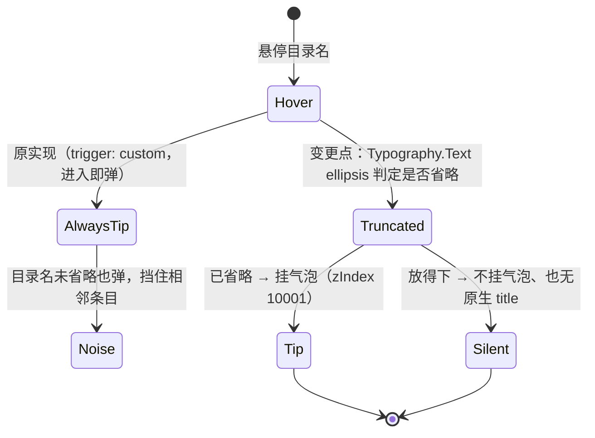

# FNOS-038 工作区快捷入口目录名气泡只在省略时出现

| 项目 | 内容 |
| --- | --- |
| 需求编号 | FNOS-038 |
| 提出日期 | 2026-10-30 |
| 需求状态 | 实施中（包级用例、typecheck、lint 与 client 产物重建通过；真实 NAS 验收待执行） |
| 关联计划 | [PLAN-FNOS-038 工作区快捷入口目录名气泡只在省略时出现](/plans/PLAN-FNOS-038-workspace-shortcut-tooltip) |
| 适用范围 | `@tnnevol/dsh-fnos` 客户端「选择工作区目录」弹框内的授权目录快捷入口（`src/client/shortcuts/workspace-authorized-shortcut.ts`） |

## 需求背景

「选择工作区目录」弹框的路径栏左侧有 fnOS 授权目录快捷入口，展开后是一列已授权目录。提出人在真实 NAS 上使用时发现：**目录名根本没有被省略，气泡照样弹出来**（截图中 `存储空间 2/1000/Files` 完整显示，气泡仍显示同一串文字）。这类「看见什么就写什么」的气泡既不提供信息，还挡住相邻条目。

同一个插件里的输入卡片选择器（[FNOS-034](/requirements/FNOS-034-fnos-input-dock-picker)）此前已经改成「气泡仅省略时提示」，做法是把省略与提示都交给 Semi `Typography.Text` 的 `ellipsis`。工作区快捷入口是同一类列表，却还保留着自建的受控 `Tooltip`，两处行为不一致。

## 调研结论

| 结论 | 出处 | 影响的功能 | 状态 |
| --- | --- | --- | --- |
| 旧实现自建 `trigger: 'custom'` 的受控 Tooltip，鼠标进入即 `setVisible(true)`，判定与文本是否被截断无关；同时在文本上挂原生 `title`，系统提示同样不分是否省略 | 旧版 `src/client/shortcuts/workspace-authorized-shortcut.ts` 的 `AuthorizedDirectoryMenuText`（2026-10-30） | FNOS-038-01、FNOS-038-02 | 已核实 |
| Semi `Typography.Text` 的 `ellipsis.showTooltip` 自带「只有溢出才提示」的判定：`typography/base.js` 中 `showTooltip()` 计算 `noExpandText && overflowed && showTooltip`，单行 CSS 省略时 `overflowed` 取 `isOverflowed`（由 `shouldTruncated` 比较容器宽度与文本内容宽度得出） | `@douyinfe/semi-ui` 2.90.2 `lib/es/typography/base.js`（2026-10-30） | FNOS-038-01 | 已核实 |
| 同一判定已有既定用法与守卫：输入卡片选择器用 <code v-pre>ellipsis={{ showTooltip: true, rows: 1 }}</code>，并由 `input-picker-geometry.spec.ts` 断言「不再自己量 `scrollWidth`、不手写 Tooltip 分支」 | `src/components/FnosAuthorizedPathPicker.tsx`、`tests/client/input-picker-geometry.spec.ts`（2026-10-30） | FNOS-038-01、FNOS-038-02 | 已核实 |
| 下拉条目是 `display: flex` 的容器（`.semi-dropdown-item`，`padding: 8px 16px`、`max-width: 280px`），flex 子项默认按最小内容宽度撑开；文本侧不置 `min-width: 0` 时永远不会出现省略号，`showTooltip` 的溢出判定也就恒为假 | `@douyinfe/semi-ui` 2.90.2 `dist/css/semi.min.css` 的 `.semi-dropdown-item` 规则与 flex 收缩语义（2026-10-30） | FNOS-038-01 | 已核实 |
| 气泡必须压住菜单：菜单由 `DshDropdown` 以 `zIndex: 10000` 渲染到 body，气泡沿用原实现的 `zIndex: 10001` 与 `getPopupContainer: () => document.body` | `src/client/shortcuts/workspace-authorized-shortcut.ts` 的菜单与气泡参数（2026-10-30） | FNOS-038-01 | 已核实 |

## 需求目标

- 目录名**被省略时**悬停出现完整路径气泡；**放得下时不出现任何气泡**（含原生 `title` 系统提示）。
- 省略号本身由 Semi `Typography.Text` 渲染，不再由插件自定义 `text-overflow` / `white-space`，避免两套规则互相抵消。
- 与输入卡片选择器保持同一套机制与同一套守卫写法，两个入口不再出现行为分叉。

## 功能列表

| 编号 | 优先级 | 功能 | 用户可观察结果 | 状态 |
| --- | --- | --- | --- | --- |
| FNOS-038-01 | P1 | 气泡只在目录名被省略时出现 | 目录名放得下时悬停没有气泡；被省略时悬停出现完整路径气泡，且气泡显示在菜单之上 | <Badge type="warn" text="待验证" /> |
| FNOS-038-02 | P2 | 未省略的条目不再有任何系统提示 | 菜单项不再挂原生 `title`，放得下的目录名悬停时既不弹插件气泡也不弹浏览器提示 | <Badge type="warn" text="待验证" /> |

## 行为约束

- 不改变快捷入口的其余契约：仍是图标按钮触发、`onMouseDown.preventDefault()` 保持路径编辑器焦点、点击后仍走 `fillAfterOpening` 回填路径。
- 不改变菜单宽度（250px）、条目文案与排序；省略只作用于目录名文本本身。
- 不引入新的 Semi 依赖：`Typography` 仍从 `@tnnevol/dsh-semi-ui` 导入。
- 不自定义 Semi 的省略样式；样式只提供 `min-width: 0`、`max-width` 与 DSH 语义色。

## 不在本次范围内

- 选择器组件本身的形态调整（提出人明确本次不改组件）。
- 输入卡片选择器（FNOS-034）的气泡位置与层级（已验收，保持现状）。
- 菜单宽度、条目密度、图标等视觉参数。
- 目录名省略规则（例如按中间省略、显示相对路径）的调整。

## 既有功能变更关系

本次变更覆盖 [FNOS-001-10](/requirements/FNOS-001-dsh-fnos-adaptation) 工作区快捷跳转里的**提示方式**，快捷入口的存在与回填行为不变；同时把 [FNOS-034](/requirements/FNOS-034-fnos-input-dock-picker) 已采纳的「气泡仅省略时提示」规则扩展到工作区入口。

变更原因：气泡的价值在于补全**被截断**的信息；文本本身已经完整时，气泡只是噪音。

## 验收条件与完成状态

### FNOS-038-01

- `FNOS-038-01-AC-01`：目录名在菜单宽度内完整显示时，悬停不出现气泡。
- `FNOS-038-01-AC-02`：目录名被省略（显示 `…`）时，悬停出现完整路径气泡，且气泡层级高于菜单、不被菜单遮挡。
- `FNOS-038-01-AC-03`：省略号由 Semi `Typography.Text` 渲染（插件侧没有自定义 `text-overflow` / `white-space` / `scrollWidth` 判定）。

### FNOS-038-02

- `FNOS-038-02-AC-01`：菜单项不带原生 `title` 属性，放得下的目录名悬停时不弹系统提示。
- `FNOS-038-02-AC-02`：守卫用例覆盖上述契约，实现回退为自建 Tooltip 或挂回 `title` 时用例变红。

## 变更记录

| 日期 | 变更 | 说明 |
| --- | --- | --- |
| 2026-10-30 | 初始登记 | 建立 FNOS-038。提出人在真实 NAS 的「选择工作区目录」弹框观察到：目录名未省略时仍弹气泡（截图 `存储空间 2/1000/Files`）。排查确认为自建 `trigger: 'custom'` Tooltip 与原生 `title` 都不看省略状态；改为对齐 FNOS-034 已验收的 `Typography.Text` + `ellipsis.showTooltip` 机制，并补 flex 收缩所需的 `min-width: 0`。5 条调研结论，关联 PLAN-FNOS-038。 |
