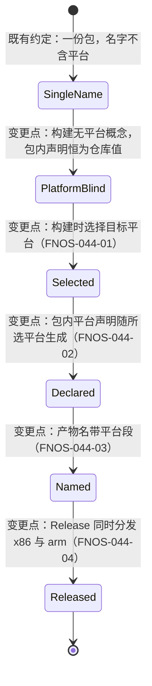

# FNOS-044 FPK 平台产物选择与双包发布

| 项目 | 内容 |
| --- | --- |
| 需求编号 | FNOS-044 |
| 提出日期 | 2026-11-04 |
| 需求状态 | 规划中（实现与包级验证完成，ARM 真机验收待社区反馈） |
| 关联计划 | [PLAN-FNOS-044 FPK 平台产物选择与双包发布](/plans/PLAN-FNOS-044-fpk-platform-selection) |
| 适用范围 | 本地 FPK 构建交互、FPK 产物命名、GitHub Release 分发产物 |

## 需求背景

飞牛 ARM 设备用户（issue #28）请求本应用支持 ARM64。发布方在 2026-11-03 的回复中给出的方向是：**在 Release 里额外提供一份 ARM 包**，与既有 x86 包并列，由 ARM 用户自行选择安装——而不是把单一包的适用范围直接放大。这样做的理由是发布方没有 ARM 设备，无法验证包在 ARM 机器上是否正常；一旦声明全平台，装不上的是全部既有用户，而双包方案出问题只影响主动选择 ARM 包的人。

这个方向落到工程上有两个缺口：

1. **构建侧没有平台这个概念。** 构建流程产出的包，其平台声明始终取自仓库里那份固定的应用清单（当前写的是 x86）。也就是说，即便手工再打一次包，得到的仍然是 x86 包，ARM 用户装上去会被应用中心按平台判定拒绝。
2. **产物名字不区分平台。** 现有名字 `<应用>-<版本>-dsh-<基线>.fpk` 里没有任何平台信息。同一版本的两份包如果只差平台，文件名会完全相同，后打的覆盖先打的——而这两个包恰恰是给两类不同设备的用户用的，拿错的后果是「装不上」，且从文件名看不出哪份是哪份。

同时，构建交互里「Harness 插件」排在「fnOS FPK」之前，与日常使用频率相反：多数时候要构建的是 FPK。

## 调研结论

| 结论 | 出处 | 影响的功能 | 状态 |
| --- | --- | --- | --- |
| fnOS 应用清单的平台字段只接受 `x86`、`arm`、`all` 三个取值；`all` 的适用条件是包内不含架构相关二进制 | [fnOS 官方 Manifest 文档](https://developer.fnnas.com/docs/core-concepts/manifest) 的「平台支持」；原 `arch` 字段已于 2025-12-31 废弃并统一为 `platform` | FNOS-044-02 | 已核实 |
| 打包工具 fnpack 1.2.3 的 `build` 子命令只有 `--directory` 一个选项，**没有**平台或架构参数；产物名恒为 `<appname>.fpk`，落在调用时的工作目录 | `fnpack build --help` 实测输出与 `docs/build/fnpack.md`（2026-11-04） | FNOS-044-02 | 已核实 |
| 平台差异**只能**来自被打包的那份清单：实测把源清单的平台值改成 `arm` 后打包，包内清单与既有 x86 包逐行比对，只有平台声明一行和包自身的校验值不同，其余内容完全一致 | 2026-11-04 实测：临时副本改平台值后打包，解包比对两份包内清单 | FNOS-044-01、FNOS-044-02 | 已核实 |
| 本应用不含随包分发的架构相关产物：运行时依赖 fnOS 的 `nodejs_v24` 系统包，终端能力用的 node-pty 走 npm 包自带的按平台预编译产物 | 安装脚本的 Node 可执行路径与 `packages/fnos-gateway/src/install-callback-helper/node-pty.ts` 的预编译加载顺序（2026-11-04） | FNOS-044-02 | 已核实 |
| ARM 侧的**安装期**原生依赖有对应产物：`node-pty@1.2.0-beta.15` 的 `prebuilds/` 内含 `linux-arm64`，`koffi@3.1.1` 的 `optionalDependencies` 含 `@koromix/koffi-linux-arm64`。两者都在 NAS 上 `pnpm add` 时按平台解析，因此不需要 g++，与 x86 走同一条路径 | 2026-11-04 读取仓库内已安装包的 `prebuilds/` 目录与 `package.json` 的 `optionalDependencies`；与 `pnpm-workspace.yaml` 里「DSH ships fully prebuilt native helpers」的说明一致 | FNOS-044-02 | 已核实（静态）；**运行时是否真的加载成功仍需 ARM 设备反馈** |
| 网关自身没有架构相关内容：依赖只有 `commander`、`connect`、`http-proxy-middleware`（均为纯 JS），构建产物内没有 `.node` 二进制 | 2026-11-04 读 `packages/fnos-gateway/package.json` 与 `apps/fn-deepseek-harness/app/` 产物扫描（`find -name '*.node'` 为空） | FNOS-044-02 | 已核实 |
| 仍未核实的 ARM 前置条件只有 fnOS ARM64 是否提供 `nodejs_v24` 系统包——应用不内置 Node，这一项不成立则 ARM 包在安装依赖阶段就失败 | 2026-11-04 无 ARM 设备可查；issue #28 回复已把它列为待使用者反馈的第一项 | FNOS-044-04 | 待验证 |
| 「双包」是发布方对 issue #28 已经给出的口径，且明确 ARM 包属未经真机验证、需社区自测 | issue #28 回复（2026-11-03，`dsh-agent-bot`）与任务看板记录 | FNOS-044-04 | 已核实 |
| 上架表单的平台项按应用清单取值对应选择，双平台包需同时上传两个文件；但官方自查规则 3 要求「`platform` 取值与提交前已在真实设备自测」，因此**只交已验证的 x86 包**，ARM 包仅走 GitHub Releases | [应用上架规范](/charter/app-listing-spec) 阶段三字段口径与 7 条自查规则（2026-11-04 按此修正原「产出双平台包后改选 x86和arm」的写法） | FNOS-044-04 | 已核实 |
| 本地与 CI 的产物命名由一条守卫用例钉住同形，改命名必须两侧一起改，否则该用例变红 | `tooling/fnos-dsh-cli/tests/fpk-release-naming.spec.ts`（FNOS-037 引入） | FNOS-044-03 | 已核实 |

## 需求目标

- 构建 FPK 时可以选择为哪些平台出包，产出的每个包**包内平台声明与所选平台一致**，装机时应用中心按平台判定不再误拒。
- 产物文件名带平台段，同一版本的不同平台包**名字不冲突**，从文件名即可判断这份包给哪类设备用。
- Release 同时提供 x86 与 arm 两份安装包，ARM 用户有可选项；同时清楚标注 ARM 包未经发布方真机验证。
- 构建交互的默认任务顺序符合日常使用频率。

## 功能列表

| 编号 | 优先级 | 功能 | 用户可观察结果 | 状态 |
| --- | --- | --- | --- | --- |
| FNOS-044-01 | P0 | 构建 FPK 时选择目标平台 | 交互构建在选定 FPK 应用后追加一步「选择目标平台（可多选）」，可勾 x86、arm 或两者；非交互可用参数直接指定 | <Badge type="warn" text="待验证" /> |
| FNOS-044-02 | P0 | 包内平台声明与所选平台一致 | 选 x86 出的包包内声明 `x86`，选 arm 出的包包内声明 `arm`；仓库里那份清单不被改写 | <Badge type="warn" text="待验证" /> |
| FNOS-044-03 | P0 | 产物名带平台段 | 产物名为 `fn-deepseek-harness-<平台>-<版本>-dsh-<基线>.fpk`，例如 `fn-deepseek-harness-x86-v7.1.0-dsh-0.2.1-rc.5.fpk`；一次选两个平台得到两个文件、互不覆盖 | <Badge type="warn" text="待验证" /> |
| FNOS-044-04 | P1 | Release 分发双平台包 | 一次发布在 Release 附件里同时有 x86 与 arm 两份包；发布说明写明 ARM 包未经真机验证 | <Badge type="warn" text="待验证" /> |
| FNOS-044-05 | P2 | 构建任务选项顺序调整 | 「选择构建任务」里 fnOS FPK 排第一，项目文档第二，Harness 插件最后 | <Badge type="warn" text="待验证" /> |

## 行为约束

- **仓库里那份应用清单的取值不因本次改动而变**：它仍是 x86。平台声明是「这一份产物」的属性，由构建按所选平台生成，不是仓库的固定事实。
- 单平台选择时的产物名同样带平台段，不给「选一个就不带平台」的特例——否则 Release 里会同时存在两种命名形状，装机对照时无法判断该看哪个。
- 既有产物文件不删除：改名后目录里留下的历史包仍按 FNOS-037 的约定报出并提示可能拿错。
- 构建校验（插件清单、基线对齐等）不因平台不同而重复执行或放宽；平台只影响包内那一行声明与产物名。
- `all` 是 `manifest` 的合法取值，但**不是**构建可选的平台：它意味着「一份包通吃」，与本需求「双包、出问题只影响主动选 ARM 包的用户」的取舍相反。清单声明 `all` 时构建会说明「该取值不能作为构建目标」，而不是谎称「没声明平台」把人指向错的修改方向。
- 不承诺 ARM 包可用。发布说明与文档必须写明 ARM 包属未经真机验证的社区自测产物，避免用户把它当成已验收版本安装。
- 本地与 CI 的命名模板继续由同一条守卫用例钉住一致，不允许只改一侧。

## 不在本次范围内

- 不把仓库清单改成 `all`，也不据此宣称支持全平台（发布方无 ARM 设备，无法验证）。
- 不在 CI 里做 ARM 真机安装验证；CI 只能产出包，验收依赖社区反馈。
- 不改变 FPK 内部除平台声明外的任何内容（不含按平台裁剪的二进制）。
- 不处理 fnOS 应用中心对同一应用多平台包的分发与升级细节，属平台行为。
- 不改动插件构建、文档构建与版本推进逻辑。

## 既有功能变更关系

本次变更覆盖 [FNOS-037 本地构建 FPK 改名定位到错误产物](/requirements/FNOS-037-local-fpk-rename-source) 的产物命名模板：FNOS-037 确立的「按 fnpack 固定产物名取源、同名覆盖、残留告警」三条约定保持不变，只在其之上插入平台段。同时覆盖 [FNOS-019](/requirements/FNOS-019-fpk-version-scheme) 与[版本管理](/build/versioning)中「FPK 附件命名 = 项目版本 + DSH 基线」的口径，改为「项目版本 + DSH 基线 + 平台」。

变更原因：ARM 支持要以「用户可选」的方式落地，前提是先有真正声明为 ARM 的包，并且这些包在文件名上可区分。

## 验收条件与完成状态

### FNOS-044-01

- `FNOS-044-01-AC-01`：交互构建选定 FPK 应用后出现平台多选，选项为 x86 与 arm，可单选、可双选；清单声明的那个平台预先勾上。
- `FNOS-044-01-AC-02`：非交互执行可用参数指定一个或多个平台，不进入询问；不带平台参数时按 `manifest` 声明的那一份产出，同样不进询问（不能挂在那里等一个不会来的回车）。
- `FNOS-044-01-AC-03`：取消平台选择时不产出任何包，也不退化成「按声明的那一份继续打」。
- `FNOS-044-01-AC-04`：未选择 FPK 任务时不出现平台询问。
- `FNOS-044-01-AC-05`：`--platform` 给出 `x86`/`arm` 之外的取值时报错并列出允许值，不静默忽略。

### FNOS-044-02

- `FNOS-044-02-AC-01`：选 x86 产出的包，解包后清单平台值为 `x86`；选 arm 产出的包，解包后清单平台值为 `arm`。
- `FNOS-044-02-AC-02`：构建结束后仓库清单内容与构建前一致。
- `FNOS-044-02-AC-03`：双平台一次构建产出的两份包，除平台声明与包校验值外内容一致。

### FNOS-044-03

- `FNOS-044-03-AC-01`：产物名为 `fn-deepseek-harness-<平台>-<版本>-dsh-<基线>.fpk`，平台段为 `x86` 或 `arm`。
- `FNOS-044-03-AC-02`：双平台构建后目录内同时存在两份不同名的包，各自内容与名字对应。
- `FNOS-044-03-AC-03`：本地与 CI 的命名模板由守卫用例判定为同形。

### FNOS-044-04

- `FNOS-044-04-AC-01`：CI 一次发布产出并上传 x86、arm 两份附件，任一份失败时该次发布判定为失败。
- `FNOS-044-04-AC-02`：Release 说明或附件命名可判断 ARM 包未经发布方真机验证。

### FNOS-044-05

- `FNOS-044-05-AC-01`：「选择构建任务」的展示顺序为 fnOS FPK、项目文档、Harness 插件。

## 变更记录

| 日期 | 变更 | 说明 |
| --- | --- | --- |
| 2026-11-04 | 初始登记 | 建立 FNOS-044。承接 issue #28 的 ARM 支持诉求与 2026-11-03 已给出的「Release 额外提供 ARM 包」口径；同时按提出人要求把构建任务选项里的 Harness 插件移到最后。7 条调研结论，含 fnpack 无平台参数与「包内清单只有平台行不同」两项实测。关联 PLAN-FNOS-044。 |
| 2026-11-04 | 补充 ARM 前置条件的核实结果 | 建立 FNOS-044 时列的三个 ARM 待验证点，本轮核实掉两个：`node-pty@1.2.0-beta.15` 的 `prebuilds/` 含 `linux-arm64`、`koffi@3.1.1` 的 `optionalDependencies` 含 `@koromix/koffi-linux-arm64`（安装期原生依赖成立，运行时能否加载仍需设备反馈）；网关依赖为纯 JS 且产物内无 `.node` 二进制。调研结论由 7 条增至 10 条，剩余唯一未核实前置收敛为「fnOS ARM64 是否提供 `nodejs_v24` 系统包」一条。同时修正上架口径的调研结论：原写「产出双平台包后改选 x86和arm」与官方自查规则 3「提交前已在真实设备自测」冲突，改为只交已验证的 x86 包。 |
