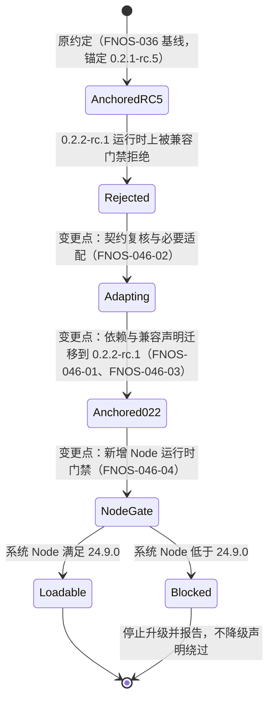
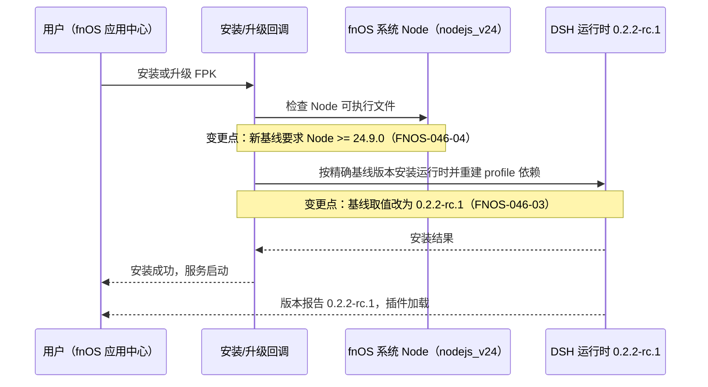
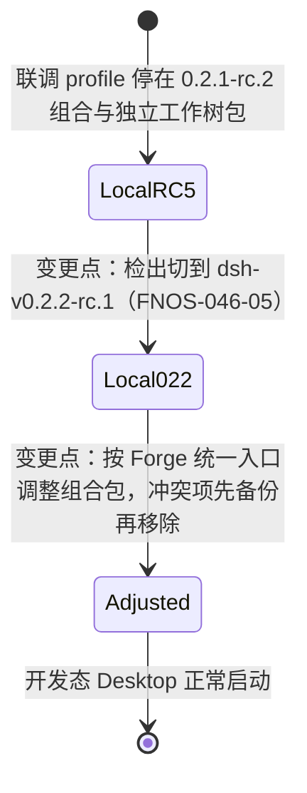

# FNOS-046 DSH 0.2.2-rc.1 插件适配与基线升级

| 项目 | 内容 |
| --- | --- |
| 需求编号 | FNOS-046 |
| 提出日期 | 2026-11-05 |
| 需求状态 | 规划中（调研结论已核实，尚未进入实施） |
| 关联计划 | [PLAN-FNOS-046 DSH 0.2.2-rc.1 插件适配与基线升级](/plans/PLAN-FNOS-046-dsh-022-rc1-adaptation) |
| 适用范围 | 七个入库 DSH 插件（codex-auth、fnos、failover-search、midscene、opencode、semi-ui-showcase、zcode）、应用运行与构建基线、FPK 安装与升级链路、本地联调检出 |
| 明确排除 | CodeBuddy 本地副本（[FNOS-025](/requirements/FNOS-025-codebuddy-plugin-delisting) 已下架）；0.2.2 新增能力（Forge、action-cards、LiveShare、统计与推荐等）的接入 |

## 需求背景

DSH 官方已发布 `0.2.2-rc.1`，npm 的 `next` 标签指向它；`latest` 仍停在 `0.2.1-rc.5`。本仓库的运行基线、插件依赖锚定与兼容声明仍停在 `0.2.1-rc.5`，而插件按精确版本锚定 DSH 兼容范围（[FNOS-014](/requirements/FNOS-014-dsh-021-rc2-adaptation) 建立的约定），在新运行时上会被兼容门禁判定为不满足，无法安装与加载。

这次与最近两轮基线推进（[FNOS-029](/requirements/FNOS-029-dsh-021-rc3-adaptation) 的 rc.2→rc.3、[FNOS-036](/requirements/FNOS-036-dsh-021-rc5-adaptation) 的 rc.3→rc.5）性质不同：那两轮是同一 minor 内的小步修订，只做锚定改写即可；`0.2.1 → 0.2.2` 是一次跨 minor 的推进，两 tag 之间 2623 条提交、8120 个文件变更，包数量从 383 增至 413，官方还发布了 13 条面向插件作者的破坏性升级指南。其中至少一条（模型请求的图片数量上限）直接落在本仓库三个模型通道插件的能力面上。

同时，新基线把 Node 运行时要求从 `^22.19.0 || >=24.0.0` 收紧为 `>=24.9.0`。本应用不内置 Node，运行时用的是 fnOS 系统的 `nodejs_v24` 包，因此「NAS 上的系统 Node 版本是否达到 24.9.0」成为能否升级的硬前提，而不是可以在本地绕过的构建配置问题。

本轮需要回答的不再只是「锚定改哪里」，而是「13 条契约变化里哪些落在我们的插件与应用上、Node 门禁在真实设备上是否成立、用户既有数据能否继续打开」。

## 调研结论

| 结论 | 出处 | 影响的功能 | 状态 |
| --- | --- | --- | --- |
| `@deepseek-ai/dsh@0.2.2-rc.1` 已发布到 npm，`next` 指向它；`latest` 仍为 `0.2.1-rc.5`，`alpha` 为 `0.2.2-alpha.3` | `npm view @deepseek-ai/dsh dist-tags`（2026-11-05） | FNOS-046-03 | 已核实 |
| 新基线 `engines.node` 为 `>=24.9.0`（旧基线为 `^22.19.0 || >=24.0.0`） | npm `@deepseek-ai/dsh@0.2.2-rc.1` 的 `engines` 字段；上游仓库 `dsh-v0.2.2-rc.1` 根 `package.json`（2026-11-05） | FNOS-046-04 | 已核实 |
| 上游 vendor 随本轮升级：`@deepseek-ai/cordis` 4.0.5 → 4.1.0，`@deepseek-ai/schemastery` 3.18.5 → 3.19.0 | 上游 `vendor/cordis/package.json`、`vendor/schemastery/package.json` 两 tag 比对（2026-11-05） | FNOS-046-01、FNOS-046-03 | 已核实 |
| 模型底座 `@earendil-works/pi-ai` 从 `^1.1.0` 升到 `^1.3.0`；本仓库三个模型通道插件（codex-auth、opencode、zcode）直接依赖它并自建 provider 配置 | 上游 `packages/llm/llm-pi-ai/package.json` 两 tag 比对；本仓库插件源码的 provider 配置（2026-11-05） | FNOS-046-01、FNOS-046-02 | 已核实 |
| 两 tag 之间 2623 条提交、8120 个文件变更；包总数 383 → 413，其中 experimental 包 47 → 65（新增 18 个，无删除） | 上游 `git rev-list --count dsh-v0.2.1-rc.5..dsh-v0.2.2-rc.1`、`git diff --stat`、`git ls-tree packages/experimental`（2026-11-05） | FNOS-046-01 | 已核实 |
| 官方为 `v0.2.2-alpha.2` 提供 13 条破坏性升级指南，`rc.1` 未新增指南；13 条覆盖右键菜单类型、Loader 条目树与 Include 持久化、Forge 权限与入口、文件系统先读后写策略、LLM 请求用途声明、pi-ai 图片数量、投影帧与快照范围、已释放检查点、Schedule 工具与宿主 API、SDK run 命令 | 上游 `docs/upgrade-guide/v0.2.2-alpha.2/*/guide.zh.md`（2026-11-05） | FNOS-046-02 | 已核实 |
| 新基线的插件安装门禁仅按插件声明的 DSH 兼容范围判定，且判定时把预发布版本纳入范围（`includePrerelease`）；本仓库当前的精确锚定 `0.2.1-rc.5` 不满足 `0.2.2-rc.1`，升级后会被拒 | 上游 `packages/boot/app-boot/src/plugin-compatibility.ts`（判定与 peer 回退逻辑）；本地 semver 7.5.2 实测：`0.2.2-rc.1` 对 `^0.2.1-rc.1` 严格判定为 false、含预发布判定为 true（2026-11-05） | FNOS-046-01、FNOS-046-03 | 已核实 |
| 13 条指南中 1 条直接落在入库插件能力面，且构成**编译期硬失败**：解析后的 provider 配置新增两个**必填**字段（单请求图片上限、超限省略步长），而 codex-auth、opencode、zcode 三个插件各自构造了该配置字面量，升级基线后类型检查必然报错；运行期语义是超限时把最老的图片替换为占位文本并重试 | 上游指南 `pi-ai-request-image-count`；上游模型通道包配置接口两 tag 比对（新增 2 个必填字段）；本仓库三处 provider 配置（2026-11-05） | FNOS-046-02 | 已核实 |
| 定时任务存储域版本从 1 升到 2（读兼容 1、写为 2）：首次成功写入后旧版本运行时会拒绝打开；打包应用挂载了该存储域与其界面（官方 Web 组合包内含），因此用户既有提醒会随首次写入**单向升级**，降级需先备份 | 上游定时任务包 `storage.ts` 两 tag 比对；上游 Web 组合包补丁清单（挂载定时任务域与界面）（2026-11-05） | FNOS-046-06 | 已核实 |
| 13 条指南是 `v0.2.2-alpha.2` 时点的快照，个别条目与最终 `rc.1` 源码不一致（例如「文件修改默认不再要求先读」指南称已开启补丁工具，`rc.1` 组合包中该开关实际为关闭）；逐条判定必须以 `rc.1` 源码为准 | 上游指南目录与 tag 内源码核对；组合包补丁清单核对（2026-11-05） | FNOS-046-02 | 已核实 |
| 13 条指南中 2 条落在本地联调环境而非入库代码：Forge 统一入口要求移除独立的工作树组合包；Loader/Include 改变了运行时条目变更的持久化语义。两项都不改变用户可见功能，只影响开发者本机 profile 与联调行为 | 上游指南 `forge-worktree-entry`、`cordis-loader-entry-trees`；本仓库本地联调 profile 的组合清单（该目录被 `.gitignore` 忽略，不入库）（2026-11-05） | FNOS-046-05 | 已核实 |
| 客户端插座目录从 103 个增至 109 个：新增 6 个（`contextMenu.content`、`contextMenu.icon`、`conversation.chat.text-interaction`、`conversation.chat.user.before`、`settings.section.icon`、`sidebar.session.row.trailing`），无删除；本仓库注册的 8 个插座的 `ownerProps` 与 `registerOptions` 零变化，唯一变化是标准 props 统一新增右键菜单句柄（附加项，未使用方不受影响） | 上游两 tag 插座目录解析比对；本仓库插件的插座注册点检索（2026-11-05） | FNOS-046-02 | 已核实 |
| 上游在本轮删除了 1 个客户端 UI 包（`@deepseek-ai/dsh-client-ui-deepseek-model-label-1017`，原有目录在新基线不再存在），同时新增 31 个包；本仓库没有代码依赖该包，只在发布龄期豁免清单里引用过它 | 两 tag 全量包名集合比对（379 → 409，删除 1、新增 31）；本仓库检索仅命中豁免清单与锁文件（2026-11-05） | FNOS-046-03 | 已核实 |
| 语言包接缝保持兼容：字典类型仍是字符串映射，注册重载由「仅内置语言」放宽为「任意语言标识」，本仓库九个语言的语言包不受影响 | 上游 `packages/client/locale` 两 tag 类型定义比对；本仓库七个插件的语言包实现（2026-11-05） | FNOS-046-02 | 已核实 |
| 其余 10 条指南经源码检索不落在本仓库插件与应用上：右键菜单类型与图标、文件先读后写策略、LLM 请求用途声明、投影帧结构、投影快照范围、已释放检查点、Schedule 工具与宿主 API、SDK run 命令，在插件、应用壳、网关与工具链源码中均为 0 命中 | 本仓库检索（2026-11-05）：`MenuTarget`/`useMenuTarget`、`fs-observation-policy`/`FS_NOT_OBSERVED`/`FS_STALE_VERSION`、`sessionProjections`/`observeProjections`/`session/control`、`applyEntryPatches`/`EntryTree`、`dsh-schedule`/`schedule_create`、`@deepseek-ai/dsh-sdk` 均无命中；`purpose` 仅出现在注释 | FNOS-046-02 | 已核实 |
| 三方插件 `dshmarket@1.66.47` 的 DSH peer 范围按门禁的含预发布语义包含 `0.2.2-rc.1`，本轮无需换版本 | `npm view dshmarket@1.66.47 peerDependencies`；上游门禁源码的 `includePrerelease` 判定；本地 semver 实测（2026-11-05） | FNOS-046-01、FNOS-046-03 | 已核实 |
| 应用不内置 Node，安装与运行均使用 fnOS 系统包 `nodejs_v24` 的可执行文件，因此新基线的 Node 下限最终由 NAS 上的系统包版本决定 | 应用安装脚本的 Node 可执行路径与启动前检查（2026-11-05） | FNOS-046-04 | 已核实 |
| 安装脚本还会在安装/升级时重建 Web profile 的依赖，并把 DSH 运行时装成与基线一致的精确版本；基线值在仓库内由 catalog 单一来源派生 | 应用安装脚本的依赖重建与版本安装分支；仓库基线读取实现（2026-11-05） | FNOS-046-03、FNOS-046-04 | 已核实 |
| 真实 NAS 上系统 Node 已有 1 条间接实测记录：`nodejs_v24` 为 v24.15.0（≥ 24.9.0）；本次仍应在实际验收设备上复核 | `docs/validation/FNOS-009-node-pty-prebuilds-2026-10-08.md` 记录的设备侧 Node 版本（2026-10-08） | FNOS-046-04 | 部分核实 |
| 应用侧目前**没有** Node 版本门禁：安装脚本只判断 Node 可执行文件是否存在，仓库未启用引擎严格模式，网关也不校验运行版本；新基线下 Node 低于下限时会先「安装成功」，失败延后到启动阶段（命令行自检或 Web 健康检查超时） | 应用安装脚本、网关启动链路与仓库配置检索（2026-11-05） | FNOS-046-04 | 已核实 |
| 应用描述的基线字样不在清单文件里（清单用占位符引用语言包），真实落点在 9 个语言文件；版本命令对该处的同步目标已过时、实际为空操作，而应用文档页的基线行仍由版本命令自动同步 | 应用清单与语言包检索（清单中「运行基线」0 处）；版本命令的同步实现（2026-11-05） | FNOS-046-07 | 已核实 |
| 安装期对上游依赖包做了逐字符串补丁，要求目标文本恰好出现一次且无回退：上游更换打包方式、改函数名或缩进即会导致安装期硬失败 | 网关安装回调辅助代码的补丁实现（失配即失败）（2026-11-05） | FNOS-046-01、FNOS-046-04 | 已核实 |
| 插件还有若干**未在任何清单里声明**的上游接缝：fnOS 插件使用 4 个宿主内部服务并解析特定事件载荷；六个插件共用同一套主题令牌与语言包结构。这些接缝不在兼容声明与类型检查的覆盖范围内，出问题只能靠运行时走查发现 | 仓库插件源码清点（`tmp/analysis/B-plugin-surface.md` 及其扫描数据，2026-11-05） | FNOS-046-01、FNOS-046-02 | 已核实 |
| fnOS 插件通过在宿主首页内联脚本里做一次字符串替换来注入主题偏好；该目标文本只存在于构建产物中（上游源码检索 0 命中），上游改名、压缩或改变内联方式后该注入会**静默失效**，不报错也不影响启动 | 插件主题引导实现与上游源码检索（2026-11-05） | FNOS-046-02 | 已核实 |
| 仓库基线守卫只覆盖 5 个插件，opencode 与 zcode 不在列表中，也不校验 vendor 补丁号与 Node 下限；这两处漏改不会被任何守卫发现 | `tooling/fnos-dsh-cli/tests/fnos-007-baseline.spec.ts` 的插件列表与断言范围（2026-11-05） | FNOS-046-03 | 已核实 |
| 命名 catalog 的 44 个依赖包逐包比对完成：无一改名或删除；37 个仅版本变化，7 个有实质变化（宿主包的运行依赖与引擎下限、模型通道包的 provider 配置、工具包的子路径与 peer）；被删除的导出符号与本仓库实际导入**交集为空** | 上游两 tag 逐包 `package.json` 与入口导出比对；本仓库导入面检索（2026-11-05） | FNOS-046-01、FNOS-046-02 | 已核实 |
| 模型底座自身 `1.1.0 → 1.3.0` 的 API 差异不在上游仓库内，尚未比对；harness 侧的模型通道接缝类型在两 tag 间未收窄 | 上游仓库外的 pi-ai 两版类型声明待取（npm 包） | FNOS-046-01、FNOS-046-02 | 待核实 |

## 需求目标

- 仓库运行与构建基线、七个入库插件的依赖锚定与兼容声明统一迁移到 DSH `0.2.2-rc.1`，插件在新运行时上可安装、可加载。
- 插件在新基线上的表现与 `0.2.1-rc.5` 基线一致：界面区块位置不变、模型通道可用、图片输入行为不被新上限悄悄改变。
- 升级在真实 fnOS NAS 上成立：系统 Node 版本满足新下限，FPK 安装与升级链路可用，升级后既有用户数据继续可用。
- 基线口径在用户可见处保持一致：安装包命名、应用描述与应用文档页报告的 DSH 基线相同，发布版本按基线变更推进。

## 功能列表

| 编号 | 优先级 | 功能 | 用户可观察结果 | 状态 |
| --- | --- | --- | --- | --- |
| FNOS-046-01 | P0 | 七个入库插件在新运行时上正常加载 | 七个插件新版本在 DSH `0.2.2-rc.1` 上安装后，插件管理页无「异常」与不兼容提示，各插件既有功能可用 | <Badge type="warn" text="待验证" /> |
| FNOS-046-02 | P0 | 插件界面与模型通道契约保持 | 插件在详情页、会话区、输入区、设置区与侧栏的区块位置与信息展示不变；三个模型通道插件的对话与图片输入行为与旧基线一致，不因新图片上限出现图片被静默省略 | <Badge type="warn" text="待验证" /> |
| FNOS-046-03 | P0 | 基线单一事实来源同步 | 本地运行的 DSH 版本、FPK 安装回调装载的版本、插件兼容声明三者一致；安装包命名与插件管理页报告的基线相同；三方插件 `dshmarket` 的安装不被门禁拒绝 | <Badge type="warn" text="待验证" /> |
| FNOS-046-04 | P0 | Node 运行时门禁满足 | 在真实 fnOS NAS 上安装或升级后，DSH 服务正常启动并报告 `0.2.2-rc.1`；不出现因系统 Node 版本不足导致的安装失败或启动失败 | <Badge type="warn" text="待验证" /> |
| FNOS-046-05 | P1 | 本地联调环境对齐新基线 | 开发态 Desktop 以 `dsh-v0.2.2-rc.1` 检出启动，报告运行时 `0.2.2-rc.1` 并加载新基线插件；联调 profile 按上游新的组合约定调整后仍可正常启动 | <Badge type="warn" text="待验证" /> |
| FNOS-046-06 | P0 | 用户数据兼容 | 升级后既有会话、凭据、账号、偏好、模型配置与授权目录继续生效，无需手工迁移；升级过程不删除、不改写既有数据 | <Badge type="warn" text="待验证" /> |
| FNOS-046-07 | P1 | 版本与文档基线的发布口径一致 | 发布版本随基线变更推进；安装包文件名含新的 DSH 基线段；应用描述与应用文档页报告的基线值一致 | <Badge type="warn" text="待验证" /> |

### 验收环境范围

- FNOS-046-01、02、06 在 **DSH Web 与 DSH Desktop** 双客户端验收；涉及外部登录的环节（Codex Auth、OpenCode、ZCode）另需真实网络与账号条件。
- FNOS-046-03 在本地构建链路（基线单一来源、安装回调常量、插件兼容声明一致性）与 DSH Web 运行时版本两处验收。
- FNOS-046-04 在**真实 fnOS NAS** 验收：先确认系统 Node 版本，再走应用中心正常安装/升级并观察服务启动与版本报告。该项不因本地构建通过而视为完成。
- FNOS-046-05 在 Desktop 联调环境验收（检出标签与启动版本核对）。
- FNOS-046-07 在版本命令产物与构建产物命名上验收。

## 行为约束

- 迁移只改变依赖锚定、兼容声明、基线常量与必要的契约适配；不改变插件的功能语义、交互流程与数据格式。
- 插件对 DSH 的依赖继续只经 catalog 引用，不在插件内维护版本字面量；兼容判定由插件声明的 DSH 范围承担，其值必须等于 catalog 基线。
- 不通过版本豁免绕过兼容门禁。
- Node 下限以新基线的声明为准：不通过放宽声明、跳过校验或降级安装的方式让应用「看起来能跑」。
- 用户数据的存储位置与读写行为不变；升级前后只做只读核对，不清理、不改写。
- 不修改官方上游源码；联调检出只做 fetch 与 checkout。
- 本地联调 profile 的调整必须先备份再改，且不进入版本管理。
- CodeBuddy 本地副本不纳入本次迁移，不因本次改动产生受版本管理的改动。
- 三方插件版本本次不跟进（`dshmarket` 现有版本的 peer 范围已覆盖新基线），避免把基线升级与三方依赖更新混在一批。

## 不在本次范围内

- 官方 DSH 上游源码的修改或提交。
- 接入 0.2.2 新增能力：Forge（变更请求与工作树统一入口）、action-cards、LiveShare、统计与推荐、Schedule 支持按 RRULE 管理宿主全部任务等。
- 为插件新增功能或改变既有交互。
- 插件 npm 发布与插件市场索引更新（按 [FNOS-028](/requirements/FNOS-028-unified-project-version-bumpp) 的发布节奏另行执行）。
- ARM64 真机验证（[FNOS-044](/requirements/FNOS-044-fpk-platform-selection) 的既有口径不变：发布方无 ARM 设备，ARM 包由社区自测）。
- 三方插件版本升级与新增三方插件。
- CodeBuddy 插件的基线适配与发布（[FNOS-025](/requirements/FNOS-025-codebuddy-plugin-delisting) 的下架决定继续有效）。

## 既有功能变更关系

本次变更覆盖 [FNOS-036](/requirements/FNOS-036-dsh-021-rc5-adaptation) 建立的 `0.2.1-rc.5` 基线约定，并覆盖 [FNOS-019](/requirements/FNOS-019-fpk-version-scheme) 与 [FNOS-044](/requirements/FNOS-044-fpk-platform-selection) 中「安装包命名带 DSH 基线段」的取值（形式不变，值前进）。FNOS-036 的原验收结论在其验证环境内继续有效，不回改其正文。

原约定下插件只声明了一个精确基线，换基线即整批失效；新约定下同一批插件在新运行时上重新可用，但多了一道与主机运行时相关的门禁。用户可观察结果：插件管理页从「异常/拒绝安装」恢复为正常，同时升级不再只是改版本号。

升级与启动链路的交互变化：

变更原因：新基线把运行时要求抬到 Node 24.9.0，而本应用复用系统包而非自带 Node，因此安装链路多了「先确认宿主 Node 版本」这一环。用户可观察结果：满足条件时升级一次完成；不满足时安装阶段即失败并给出可执行的提示，而不是装完后服务起不来。

本地联调环境的组合约定同步变化（不改变用户可见功能）：

## 验收条件与完成状态

### FNOS-046-01

- `FNOS-046-01-AC-01`：七个入库插件新版本在 DSH `0.2.2-rc.1` 上安装后，插件管理页无「异常」、无不兼容原因，组合包显示为已启用。
- `FNOS-046-01-AC-02`：DSH 运行日志中不出现插件模块未找到、插座未声明或行挂起的错误。
- `FNOS-046-01-AC-03`：各插件代表功能（登录态与模型目录、搜索转移、桥接健康、模型目录与额度、组件展示、fnOS 主题与授权目录）在双客户端分别验证通过。
- `FNOS-046-01-AC-04`：`dshmarket` 在新基线上的安装不被兼容门禁拒绝（以本地安装链路为证据）。

### FNOS-046-02

- `FNOS-046-02-AC-01`：插件在各界面区域注册的区块位置与 `0.2.1-rc.5` 基线一致，不与他人区块冲突，不出现重复标识。
- `FNOS-046-02-AC-02`：亮色与暗色主题下插件界面渲染正常，主题切换实时生效。
- `FNOS-046-02-AC-03`：三个模型通道插件完成一轮带图片的对话，图片按用户预期进入请求；在单会话图片数量超过新上限的场景下，得到的是明确的省略提示而非静默丢失。
- `FNOS-046-02-AC-04`：13 条官方升级指南逐条有「落在/不落在本仓库」的复核结论，判定为「落在」的项目均已适配并有验证记录。

### FNOS-046-03

- `FNOS-046-03-AC-01`：仓库默认 catalog、命名 catalog 与发布龄期豁免清单指向 `0.2.2-rc.1`，构建校验不因版本不一致失败；仓库内不残留旧基线取值。
- `FNOS-046-03-AC-02`：本地启动的 DSH Web 报告的版本与插件兼容声明一致，安装回调装载的版本与之相同。
- `FNOS-046-03-AC-03`：安装包文件名包含 `dsh-0.2.2-rc.1` 段，应用描述与应用文档页报告的基线值一致。

### FNOS-046-04

- `FNOS-046-04-AC-01`：真实 fnOS NAS 上的系统 Node 版本达到 24.9.0，并留有版本证据。
- `FNOS-046-04-AC-02`：在真实 NAS 上通过应用中心完成安装或升级，DSH 服务正常启动并报告 `0.2.2-rc.1`。
- `FNOS-046-04-AC-03`：若系统 Node 版本不满足，安装阶段失败并给出指向系统包的可执行提示，不出现「装成功但服务起不来」。

### FNOS-046-05

- `FNOS-046-05-AC-01`：联调检出的 HEAD 为官方 `dsh-v0.2.2-rc.1` 标签。
- `FNOS-046-05-AC-02`：开发态 Desktop 以该检出启动后报告运行时 `0.2.2-rc.1`，并加载新基线插件；联调 profile 调整前已备份。

### FNOS-046-06

- `FNOS-046-06-AC-01`：升级后，升级前已有的会话可以打开，凭据、账号、偏好、模型配置与授权目录继续生效。
- `FNOS-046-06-AC-02`：升级过程与升级后均不出现数据丢失或被改写。

### FNOS-046-07

- `FNOS-046-07-AC-01`：发布版本按基线变更档位推进，与需求声明的目标版本一致。
- `FNOS-046-07-AC-02`：发布产物的安装包命名、应用描述基线与文档页基线三处同值。

## 变更记录

| 日期 | 变更 | 说明 |
| --- | --- | --- |
| 2026-11-05 | 初始登记 | 建立 FNOS-046：范围覆盖基线迁移（默认 catalog、命名 catalog、发布龄期豁免、插件兼容声明、安装回调）、七个入库插件的锚定迁移与契约适配、Node 运行时门禁、本地联调环境、双客户端与真实 NAS 验收。已登记 27 条调研结论（25 条已核实、1 条部分核实、1 条待核实），关联 PLAN-FNOS-046。本轮与 FNOS-029/FNOS-036 的差别在于：存在编译期必改的插件侧契约变化（模型通道 provider 配置新增必填字段）、用户数据单向升级（定时任务存储域）、Node 门禁缺失，以及若干只能在运行时发现的未声明接缝，因此不以「只改锚定」收口。 |
