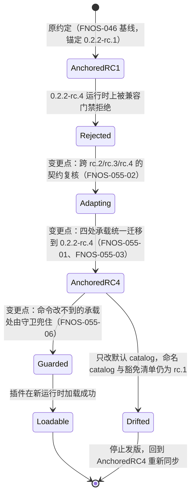
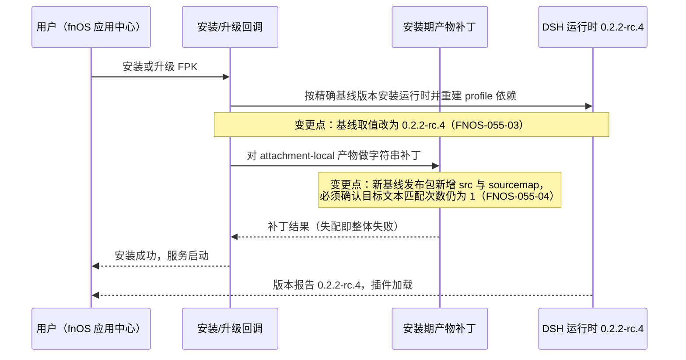

# FNOS-055 DSH 0.2.2-rc.4 插件适配与基线升级

| 项目 | 内容 |
| --- | --- |
| 需求编号 | FNOS-055 |
| 提出日期 | 2026-11-18 |
| 需求状态 | 实施中 |
| 关联计划 | [PLAN-FNOS-055 DSH 0.2.2-rc.4 插件适配与基线升级](/plans/PLAN-FNOS-055-dsh-022-rc4-adaptation) |
| 适用范围 | 七个入库 DSH 插件（codex-auth、failover-search、fnos、midscene、opencode、semi-ui-showcase、zcode）、应用运行与构建基线、FPK 安装与升级链路、本地联调检出、应用与插件多语言文案 |
| 明确排除 | CodeBuddy 本地副本（[FNOS-025](/requirements/FNOS-025-codebuddy-plugin-delisting) 已下架）；0.2.2 新增能力（Forge、action-cards、LiveShare、Office 套件、智能体团队改造、统计与推荐等）的接入 |

## 需求背景

DSH 官方已发布 `0.2.2-rc.4`，npm 的 `next` 标签指向它；`latest` 仍停在 `0.2.2-rc.1`。本仓库的运行基线、七个入库插件的依赖锚定与兼容声明仍停在 `0.2.2-rc.1`，而插件按精确版本锚定 DSH 兼容范围（[FNOS-014](/requirements/FNOS-014-dsh-021-rc2-adaptation) 建立的约定，[FNOS-046](/requirements/FNOS-046-dsh-022-rc1-adaptation) 已沿用），在新运行时上会被兼容门禁判定为不满足，无法安装与加载。

触发本需求的是社区反馈（GitHub issue #38）：有用户要求跟进上游最新预发布版，另一位用户附和「同求」；issue 作者同时表示愿意自行提交适配 PR。仓库最近一次基线升级是 [FNOS-046](/requirements/FNOS-046-dsh-022-rc1-adaptation)（`0.2.1-rc.5 → 0.2.2-rc.1`，交付 8.0.0），此后上游又发布了 `rc.2`、`rc.3`、`rc.4` 三个版本，本仓库连续落后三个基线版本。

这次与最近几轮基线推进的性质不同，需要单独说明三点：

**一、是跨三个版本的累积升级，不是小步修订。** [FNOS-029](/requirements/FNOS-029-dsh-021-rc3-adaptation)（rc.2→rc.3）与 [FNOS-036](/requirements/FNOS-036-dsh-021-rc5-adaptation)（rc.3→rc.5）都是同一 minor 内的单步推进，只做锚定改写即可；本次是 `rc.1 → rc.4` 一步跨过 rc.2、rc.3 两个中间版本，两 tag 之间累计 4731 个文件变更。

**二、真正落在本仓库的破坏性变化很少，但有一处不在官方指南里。** 官方升级指南从 98 条增至 144 条，其中绝大部分是**历史版本目录的补录**（`rc.1` 的 tag 里根本不存在这些文件，是后续版本回填的旧指南），rc.4 时点真正新增的只有 1 条。而经 npm 已发布包的类型声明比对，`@deepseek-ai/dsh-llm` 的 `LlmError` 构造参数从 `code: string` 收窄为 `code: BuiltinLlmFailureCode` 联合类型——**这条变化没有对应的升级指南**，属于必须靠主动比对才能发现的契约收紧。

**三、最大的风险不在锚定改写，而在没有守卫的静默漂移。** `pnpm run version -- major --baseline` 只改写 `pnpm-workspace.yaml` 中默认 catalog 的一行；**命名 catalog 的 42 条与发布龄期豁免清单的 330 条完全无守卫、命令也不碰**。若只依赖命令，会得到「顶层基线是 rc.4、插件依赖仍按 rc.1 解析」的错位状态，且没有任何用例会发现。

## 调研结论

| 结论 | 出处 | 影响的功能 | 状态 |
| --- | --- | --- | --- |
| `@deepseek-ai/dsh@0.2.2-rc.4` 已发布到 npm，`next` 指向它；`latest` 仍为 `0.2.2-rc.1`，`alpha` 为 `0.2.2-alpha.3` | `pnpm view @deepseek-ai/dsh dist-tags`（2026-11-18） | FNOS-055-01、FNOS-055-03 | 已核实 |
| 仓库 catalog 引用的 43 个 `@deepseek-ai/*` 包（默认 catalog 的 dsh、命名 catalog 的 42 个）在 rc.4 均有同名版本发布，无缺失 | 逐包 `pnpm view <包>@0.2.2-rc.4 version`（2026-11-18） | FNOS-055-01、FNOS-055-03 | 已核实 |
| 上游 `dsh-v0.2.2-rc.1 → dsh-v0.2.2-rc.4` 累计 4731 个文件变更（+171580/−58666）；按版本拆分：rc.2 的 4645、rc.3 的 515、rc.4 的 395 | 上游两 tag `git diff --shortstat` 与逐段比对（2026-11-18） | FNOS-055-02 | 已核实 |
| 升级指南从 98 条增至 144 条；其中 **rc.4 时点真正新增的只有 1 条**（`v0.2.2-rc.3/deepseek-refusal-code`），其余 45 条为历史版本目录的补录 | 两 tag `docs/upgrade-guide/` 目录集合比对 + 逐条读中文正文（2026-11-18） | FNOS-055-02 | 已核实 |
| 该唯一新增指南的内容：DeepSeek 以 `stop_reason: "refusal"` 结束流时，错误码由 `MALFORMED_RESPONSE` 改为 `CONTENT_REFUSED`；仓库插件不解析这两个码，也不按流终止原因分类，判定不落在本仓库能力面 | 指南 `v0.2.2-rc.3/deepseek-refusal-code/guide.zh.md`；仓库源码检索 `MALFORMED_RESPONSE`/`CONTENT_REFUSED` 零命中于插件（2026-11-18） | FNOS-055-02 | 已核实 |
| **`@deepseek-ai/dsh-llm` 的 `LlmError` 构造签名由 `code: string` 收窄为 `code: BuiltinLlmFailureCode`（联合类型），无对应升级指南** | npm `dsh-llm@0.2.2-rc.1` 与 `@0.2.2-rc.4` 的 `lib/types/index.d.ts` 比对（2026-11-18）。注意：本地检出的 `lib/` 是陈旧构建，不可作为依据 | FNOS-055-02 | 已核实 |
| 上条的实际影响面为零编译失败：仓库插件只抛 `MISSING_CREDENTIAL` 与 `UNKNOWN_MODEL` 两个码（共 4 处），二者均在 rc.4 的 `LLM_FAILURE_CODES` 联合类型内 | 插件源码检索（opencode `provider.ts:259`、zcode `adapter.ts:109/135/139`）；rc.4 `error.d.ts` 的 `LLM_FAILURE_CODES` 成员核对（2026-11-18） | FNOS-055-02 | 已核实 |
| 客户端插座目录从 109 个增至 116 个：新增 7 个、删除 0 个；**仓库插件注册的 9 个插座的 `ownerProps` 与 `registerOptions` 零变化**，唯一变化是 `shell.overlay` 与 `conversation.session.header.utilities` 的官方 `occupants`（附加项，不影响既有条目） | 上游 `cordis-client-runner/src/client/slot-catalog.ts` 两 tag 结构化比对（2026-11-18） | FNOS-055-02 | 已核实 |
| 7 个新增插座（`conversation.chat.markdown.fence`、`conversation.hero.frame`、`conversation.input.model.options`、`conversation.session.header.actions.subagent.footer`、`settings.launcher.notifications`、`sidebar.session.action`、`workspace.picker.directoryFlow`）在本仓库插件源码中零命中 | 仓库插件源码检索（2026-11-18） | FNOS-055-02 | 已核实 |
| 上游包清单新增 11 个真实包（如 `dsh-client-ui-agent-team`、`dsh-mcp-manager`、`dsh-office-kit`、`dsh-error`、`dsh-util-ripgrep`）、删除 0 个；仓库无代码引用被删除包 | 两 tag `packages/**/package.json` 名称集合比对（2026-11-18） | FNOS-055-01、FNOS-055-03 | 已核实 |
| 两个 tag 的 `engines.node` 均为 `>=24.9.0`，本轮 Node 下限不变 | 上游两 tag 根 `package.json` 与 `apps/cli/package.json` 比对（2026-11-18） | FNOS-055-04 | 已核实 |
| `@deepseek-ai/dsh-llm` 新增 peer `@deepseek-ai/dsh-error`；`@deepseek-ai/dsh-web` 新增 `./types`、`./typert`、`./remote` 三个子路径导出；`@deepseek-ai/dsh-attachment`、`dsh-web-search-deepseek` 的 peer 也有增补 | 上游两 tag 逐包 `package.json`（剥离 version）比对（2026-11-18） | FNOS-055-02 | 已核实 |
| **安装期字符串补丁不因新基线失配**：`@deepseek-ai/dsh-attachment-local` 的 rc.1 与 rc.4 已发布包 `lib/index.js` 字节完全一致（1083 行），三个补丁锚点各命中 1 次；rc.4 仅 `files` 新增 `src`、`*.js.map`、`*.d.ts.map` | npm 两个版本 tarball 下载比对 + 锚点计数（2026-11-18） | FNOS-055-04 | 已核实 |
| 安装期补丁的第四段（`attachment root` 回退分支）在 rc.1 与 rc.4 产物上均命中 0 次，即它一直是不可达兜底；第三段一旦失配就等于硬失败 | 同上锚点计数（2026-11-18） | FNOS-055-04 | 已核实（既有缺陷，本轮不新增风险） |
| `version -- major --baseline` 只改写默认 catalog 一行，**不改命名 catalog（42 条）与发布龄期豁免清单（330 条）**，且这两处无任何守卫 | `tooling/fnos-dsh-cli/src/commands/version.ts` 改写正则与 `pnpm-workspace.yaml` 段范围核对（2026-11-18） | FNOS-055-03 | 已核实 |
| 上一次基线升级（FNOS-046）是手工同步命名 catalog 与豁免清单的（382 增 / 351 删），说明这两处的人工同步是既有惯例而非新负担 | `git show 2e34b02d -- pnpm-workspace.yaml` 统计（2026-11-18） | FNOS-055-03 | 已核实 |
| 带守卫、漏改会失败的基线相关取值点共 4 类 / 16 个物理位置：`DSH_VERSION`（1）、`DSH_MIN_NODE_VERSION`（1，本轮值不变）、7 个插件的 `engines.dsh`、7 个插件的 `compatibility.json` 版本 | `tooling/fnos-dsh-cli/src/commands/build.ts`、`tests/fnos-007-baseline.spec.ts` 断言范围（2026-11-18） | FNOS-055-03 | 已核实 |
| `DSH_MIN_NODE_VERSION` 有测试守卫但本轮无需改动：rc.4 的 `engines.node` 仍为 `>=24.9.0` | `pnpm view @deepseek-ai/dsh@0.2.2-rc.4 engines`（2026-11-18） | FNOS-055-04 | 已核实 |
| 应用 `manifest` 的 `desc` 已是占位符（`${common.desc}`），版本命令对它的基线同步是**空操作**；真实基线字样分布在 9 个语言文件的 18 处，而版本命令不碰 i18n、语言文件也不在 bumpp `files` 清单，全部需人工同步 | `apps/fn-deepseek-harness/manifest`、`i18n/**`、`version-sync.ts` 检索（2026-11-18） | FNOS-055-07 | 已核实 |
| 基线守卫的插件列表目前已含全部 7 个（opencode、zcode 由 `2e34b02d` 补入），与 `plugins/` 实际目录一致；但列表是手写常量、无 `readdir` 对照，新增第 8 个插件漏登记不会被发现 | `tooling/fnos-dsh-cli/tests/fnos-007-baseline.spec.ts` 的 `pluginDirectories`（2026-11-18） | FNOS-055-06 | 已核实 |
| 本地联调检出已无独立工作树组合包冲突，Forge 统一入口已在 FNOS-046 处理完毕；本次检出只需切 tag，无需改组合 | 本地检出 `git checkout dsh-v0.2.2-rc.4` 成功、`apps/cli` 报告 `0.2.2-rc.4`（2026-11-18） | FNOS-055-05 | 已核实 |
| 三方插件 `dshmarket` 现用版本的 DSH peer 范围按兼容门禁的含预发布语义仍覆盖 rc.4 区间，本轮不需换版本（以本地安装链路为最终证据） | 上游 `app-boot/src/plugin-compatibility.ts` 的 `includePrerelease` 判定（两 tag 该文件零差异）；待本地安装链路复核 | FNOS-055-01 | 部分核实 |
| **官方两个头部入口迁出 `conversation.session.header.utilities` 插槽**：`client-ui-open-in-app` 删除了该条目，`session-log-export` 改为 `contextMenus.register({ target: 'sessionHeader' })` 注册 `session-log-download.export` 与 `.feedback`；rc.4 该插槽 occupancy 只剩 schedule、forge、liveshare 三项 | 两 tag 插座目录 occupancy 比对 + 已安装 rc.4 产物的 `lib/client.js` 检索（2026-11-18） | FNOS-055-02 | 已核实 |
| 上条使本插件原有的两处 `priority: -1` 遮蔽成为**空操作**：遮蔽目标已不在插槽中。这是「升级后不报错但语义漂移」的一类问题，靠运行时报错发现不了 | 本仓库 `header-utility-seats.ts` 两处 seat 定义；rc.4 occupancy 核对（2026-11-18） | FNOS-055-02 | 已核实 |
| `settings.action` 的遮蔽仍然有效：官方 `SettingsDocumentAction`（id `open-document`）在两个 tag 中都在该插槽 occupancy 内 | 两 tag occupancy 比对（2026-11-18） | FNOS-055-02 | 已核实 |
| 上游包清单按名称计为**新增 11 个、删除 9 个**（不是无删除）：新增含 `dsh-error`、`dsh-mcp-manager`、`dsh-agent-team`、`dsh-office-kit` 等；删除含 `dsh-web-search-exa`/`-perplexity`（无替代）、`dsh-office-to-pdf`（改名 office-kit）、4 个 `dsh-experimental-agent-team*`（迁入 `dsh-agent-team` 等） | 两 tag `packages/**/package.json` 名称集合比对（2026-11-18） | FNOS-055-01、FNOS-055-03 | 已核实 |
| `dsh-web` 新增 `./types`、`./typert`、`./remote` 子路径导出不影响本仓库：仓库唯一相关导入是从根入口取 `WebError`，根入口的再导出在两 tag 中都在 | 上游 `packages/web/web/src/index.ts` 两 tag 比对；仓库 `plugins/dsh-failover-search-plugin/src/host/web-error.ts` 等 5 处导入核对（2026-11-18） | FNOS-055-02 | 已核实 |
| 三个模型通道插件的 provider 配置字面量在 rc.4 **零变化**：`ResolvedPiAiProviderProfile` 的 11 个字段无新增、无删除、无必填化 | 上游 `llm-pi-ai` 两 tag 的 `config.ts` 逐字段比对；仓库三处字面量核对（2026-11-18） | FNOS-055-02 | 已核实 |

## 需求目标

- 仓库运行与构建基线、七个入库插件的依赖锚定与兼容声明统一迁移到 DSH `0.2.2-rc.4`，插件在新运行时上可安装、可加载。
- 插件在新基线上的表现与 `0.2.2-rc.1` 基线一致：界面区块位置不变、模型通道可用、错误码语义不被收窄的联合类型悄悄改变。
- 基线口径在**所有**承载处一致：默认 catalog、命名 catalog、发布龄期豁免清单、安装回调常量、插件元数据、安装包命名、应用与插件的用户可见文案指向同一个版本，不出现「顶层 rc.4、依赖 rc.1」的错位。
- 升级在真实 fnOS NAS 上成立：FPK 安装与升级链路可用，安装期补丁在新产物上仍然匹配，升级后既有用户数据继续可用。

## 功能列表

| 编号 | 优先级 | 功能 | 用户可观察结果 | 状态 |
| --- | --- | --- | --- | --- |
| FNOS-055-01 | P0 | 七个入库插件在新运行时上正常加载 | 七个插件新版本在 DSH `0.2.2-rc.4` 上安装后，插件管理页无「异常」与不兼容提示，各插件既有功能可用 | <Badge type="warn" text="待验证" /> |
| FNOS-055-02 | P0 | 插件界面与模型通道契约保持 | 插件在详情页、会话区、输入区、设置区与侧栏的区块位置与信息展示不变；三个模型通道插件的对话、图片输入与错误提示行为与旧基线一致 | <Badge type="warn" text="待验证" /> |
| FNOS-055-03 | P0 | 基线在所有承载处一致 | 默认 catalog、命名 catalog、发布龄期豁免清单、插件兼容声明指向同一版本；仓库内不残留 `0.2.2-rc.1` 的运行时取值 | <Badge type="warn" text="待验证" /> |
| FNOS-055-04 | P0 | 安装与升级链路在新基线上可用 | 在真实 fnOS NAS 上安装或升级后，DSH 服务正常启动并报告 `0.2.2-rc.4`；安装期补丁不因上游产物变化而失败 | <Badge type="warn" text="待验证" /> |
| FNOS-055-05 | P1 | 本地联调环境对齐新基线 | 开发态 Desktop 以 `dsh-v0.2.2-rc.4` 检出启动，报告运行时 `0.2.2-rc.4` 并加载新基线插件 | <Badge type="warn" text="待验证" /> |
| FNOS-055-06 | P1 | 基线守卫随基线前进 | 漏改任一承载处（含命名 catalog 与豁免清单）会被用例或构建门禁发现，而不是靠人工比对 | <Badge type="warn" text="待验证" /> |
| FNOS-055-07 | P1 | 用户可见的基线文案一致 | 安装包文件名含新的 DSH 基线段；应用描述、应用文档页与 9 种语言的用户可见说明报告的基线值一致 | <Badge type="warn" text="待验证" /> |
| FNOS-055-08 | P0 | 用户数据兼容 | 升级后既有会话、凭据、账号、偏好、模型配置与授权目录继续生效，无需手工迁移 | <Badge type="warn" text="待验证" /> |

### 验收环境范围

- FNOS-055-01、02、08 在 **DSH Web 与 DSH Desktop** 双客户端验收；涉及外部登录的环节（Codex Auth、OpenCode、ZCode）另需真实网络与账号条件。
- FNOS-055-03 在本地仓库状态（四处承载处的取值一致性）与本地运行时版本报告上验收。
- FNOS-055-04 在**真实 fnOS NAS** 验收：走应用中心正常安装/升级，观察服务启动、版本报告与安装期补丁结果。该项不因本地构建通过而视为完成。
- FNOS-055-05 在 Desktop 联调环境验收（检出 tag 与启动版本核对）。
- FNOS-055-06 在仓库用例与构建门禁上验收，属于回归保持项，不单独做界面走查。
- FNOS-055-07 在版本命令产物、构建产物命名与 9 个语言文件的文案上验收。

## 行为约束

- 迁移只改变依赖锚定、兼容声明、基线常量与必要的契约适配；不改变插件的功能语义、交互流程与数据格式。
- 插件对 DSH 的依赖继续只经 catalog 引用，不在插件内维护版本字面量；兼容判定由插件声明的 DSH 范围承担，其值必须等于 catalog 基线。
- 命名 catalog 与发布龄期豁免清单必须与默认 catalog 同步前进，不得只改默认 catalog 就认为升级完成。
- 不通过版本豁免绕过兼容门禁。
- Node 下限以新基线的声明为准；本轮该值不变，不得因「反正没变」而跳过一致性核对。
- 用户数据的存储位置与读写行为不变；升级前后只做只读核对，不清理、不改写。
- 不修改官方上游源码；联调检出只做 fetch 与 checkout。
- 安装期对上游产物的字符串补丁，只允许在上游产物确认未变时保持原样；上游产物一旦变化，必须按实际产物重新取证后再决定改补丁还是改策略，不得靠放宽匹配次数掩盖失配。

## 不在本次范围内

- 官方 DSH 上游源码的修改或提交。
- 接入 0.2.2 新增能力：Forge 变更请求、action-cards、LiveShare、Office 套件、智能体团队改造、MCP 管理界面、统计与推荐、`dsh-doc` skill 等。
- 为插件新增功能或改变既有交互。
- 修复安装期补丁第四段不可达的既有缺陷（本轮只登记，不扩大改动面；如需要另立需求）。
- 把基线守卫的插件列表改为 `readdir` 自动发现（本轮只登记缺口；如需要另立需求）。
- 插件 npm 发布与插件市场索引更新（按 [FNOS-028](/requirements/FNOS-028-unified-project-version-bumpp) 的发布节奏另行执行）。
- ARM64 真机验证（[FNOS-044](/requirements/FNOS-044-fpk-platform-selection) 的既有口径不变）。
- 三方插件版本升级与新增三方插件。

## 既有功能变更关系

本次变更覆盖 [FNOS-046](/requirements/FNOS-046-dsh-022-rc1-adaptation) 建立的 `0.2.2-rc.1` 基线约定，并覆盖 [FNOS-019](/requirements/FNOS-019-fpk-version-scheme) 与 [FNOS-044](/requirements/FNOS-044-fpk-platform-selection) 中「安装包命名带 DSH 基线段」的取值（形式不变，值前进）。FNOS-046 的原验收结论在其验证环境内继续有效，不回改其正文。

FNOS-046 的功能 FNOS-046-03（基线单一事实来源同步）与 FNOS-046-04（Node 运行时门禁满足）在本轮被重新定义：前者从「三处承载」扩展为「四处承载 + 命名 catalog 与豁免清单必须同步」，后者在本轮因 Node 下限不变而降为一致性核对项。

原约定下插件只声明了一个精确基线，换基线即整批失效；新约定下同一批插件在新运行时上重新可用，但多了一道「命令改不到的承载处必须人工或脚本同步」的约束。用户可观察结果：插件管理页从「异常/拒绝安装」恢复为正常，同时不会出现依赖版本与所报基线不一致的错位安装。

升级链路与安装期补丁的交互变化：

变更原因：新基线的发布包形态变化（多带源码与 sourcemap）理论上会改变压缩产物，而安装期补丁是逐字节匹配、无警告分支。用户可观察结果：匹配仍成立时安装一次完成；不成立时安装阶段即失败并给出可定位的提示，而不是装完后带着半打补丁的产物运行。

## 变更记录

| 日期 | 变化 |
| --- | --- |
| 2026-11-18 | 建立需求；登记 28 条调研结论（27 条已核实、1 条部分核实，含本轮实现中新发现的头部遮蔽失效与包名增删修正）；功能列表定为 8 项，`targetVersion` 定为 8.2.0 |
