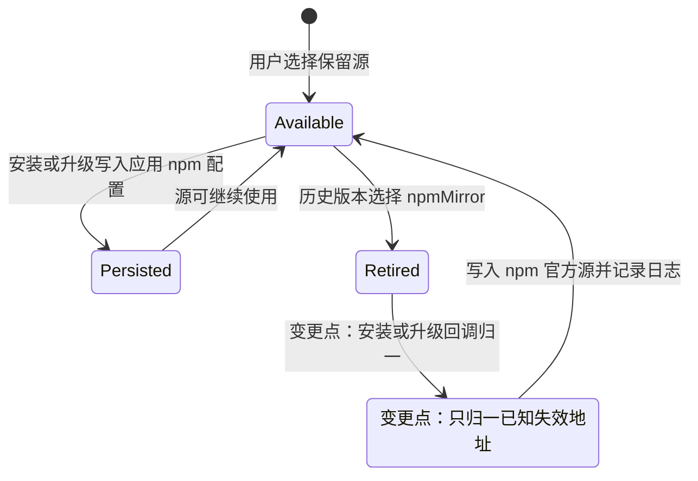
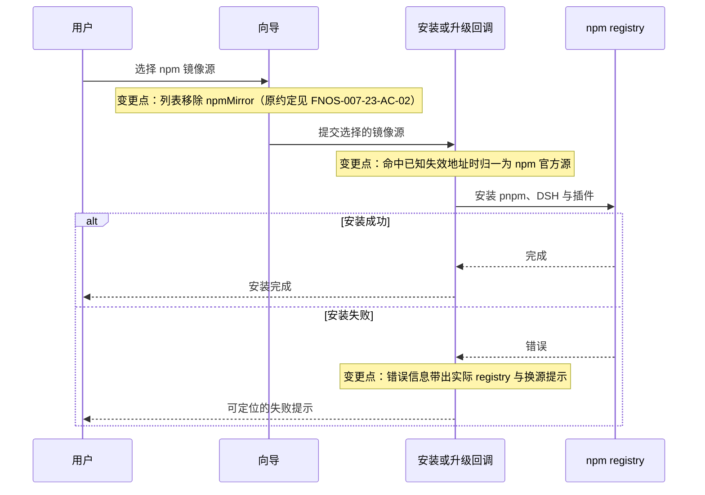

# FNOS-055 安装向导移除失效的 npm 镜像源

| 项目 | 内容 |
| --- | --- |
| 需求编号 | FNOS-055 |
| 提出日期 | 2026-11-18（来自 issue #36） |
| 需求状态 | <Badge type="warn" text="待完成" /> |
| 关联计划 | [PLAN-FNOS-055 安装向导移除失效的 npm 镜像源](/plans/PLAN-FNOS-055-invalid-npm-mirror-removal) |
| 适用范围 | 安装、升级与应用设置向导的「npm 镜像源」选项；安装与升级回调中的 npm 源处理 |
| 明确排除 | 应用内「npm 镜像管理」卡片的 nrm 源列表；issue 模板的应用版本下拉 |

## 需求背景

[issue #36](https://github.com/FNOSP/fnos-dsh/issues/36) 反馈：在应用中心安装应用、进入「服务配置」步骤后，把 npm 镜像源选为 `npmMirror`，安装必然失败。界面只显示：

```text
[install_callback] [ERROR] Unable to install pnpm@11.7.0
```

展开日志才能看到真实原因：

```text
npm error code E404
npm error 404 Not Found - GET https://replicate.npmjs.com/registry/pnpm
```

该选项的值指向 npm 的只读复制存档端点，跳转后的存档库并不提供当前版本的 pnpm；同时安装回调会把向导值写入应用自己的 npm 配置，优先级高于用户已有配置，重装也会被覆盖回来。选项名 `npmMirror` 又与国内常用镜像 `npmmirror` 高度相似，用户在安装前很难识别这是一个早已失效的源。

2026-11-18 的 issue 回复已经向提出人说明会移除该选项。本需求把这次修复正式登记：不再提供失效源，并处理已经被写入旧地址的环境以及失败时的定位成本。

## 调研结论

| 结论 | 出处 | 影响的功能 | 状态 |
| --- | --- | --- | --- |
| 该地址不提供可安装的 pnpm：请求 `https://skimdb.npmjs.com/registry/pnpm` 返回 301，跳转到 `https://replicate.npmjs.com/registry/pnpm` 后返回 404 | 2026-11-18 直接探测该地址；issue #36 的安装日志 | FNOS-055-01、FNOS-055-02 | 已核实 |
| npm 官方、tencent、cnpm、taobao、huawei 五个源均返回含 pnpm@11.7.0 的包元数据；yarn 源在探测环境 TLS 连接失败，未完成验证 | 2026-11-18 读取各源 `/pnpm` 元数据 | FNOS-055-01 | 部分核实（yarn 待真机或换网络复核） |
| 安装、升级、应用设置三份向导各自维护同一份镜像源清单，当前都包含该失效项 | 仓库内三份向导内容核对 | FNOS-055-01、FNOS-055-04 | 已核实 |
| 安装回调会把向导提交值写入应用共享目录的 npm 配置，且写入发生在其安装 pnpm 之前——安装失败也会留下该地址；向导未提交时回退到已持久化值，后续升级仍可能沿用它 | 安装与升级回调的现有处理逻辑；仓库注释记录平台会按上次提交值回填向导 | FNOS-055-02 | 部分核实（平台对「已移除选项」的回填行为待真机确认） |
| 当前 pnpm 安装失败只报包名与版本，不含实际使用的 registry，用户无法从界面判断是网络问题还是源失效 | issue #36 日志；安装回调现有失败分支 | FNOS-055-03 | 已核实 |
| 应用内「npm 镜像管理」展示的是 nrm 自己的源列表，nrm 2.1.0 的输出同样包含该地址；它与向导选项是两套来源 | 插件 npm 镜像管理实现与解析用例（2026-11-18 核对） | 不在本次范围 | 已核实 |
| 应用中心描述与更新说明里的镜像源列举对应工具箱的 nrm 清单，不是向导选项；该清单本次不改，因此描述与既有条目保持原样 | 九语言 `desc` 与 `changelog` 内容核对（2026-11-18） | FNOS-055-04 | 已核实 |

## 需求目标

- 安装、升级和应用设置向导不再提供该失效源，用户无法再选到必失败的项。
- 已经写入旧地址的环境在下次安装或升级时自动恢复为可用源，不需要用户手工编辑文件。
- 安装失败信息直接指出实际使用的 registry，并把「换一个镜像源」变成明确的下一步。
- 官方源仍是默认项，其余可用源与字段顺序保持不变。

## 功能列表

| 编号 | 优先级 | 功能 | 用户可观察结果 | 状态 |
| --- | --- | --- | --- | --- |
| FNOS-055-01 | P0 | 向导不再提供失效镜像源 | 安装、升级、应用设置三个向导的「npm 镜像源」列表里都没有 `npmMirror`；npm 官方源仍是第一项与默认值，其余五个源保持不变 | <Badge type="warn" text="待完成" /> |
| FNOS-055-02 | P0 | 旧配置自动恢复 | 旧环境的应用 npm 配置若仍指向该失效地址，下一次安装或升级后自动改为 npm 官方源，日志同时记录原值与新值；用户自定义的其他源不被改写 | <Badge type="warn" text="待完成" /> |
| FNOS-055-03 | P1 | 安装失败信息可定位 | pnpm 安装失败时，界面与日志中的错误包含实际使用的 registry，并提示在向导中更换镜像源后重试 | <Badge type="warn" text="待完成" /> |
| FNOS-055-04 | P1 | 三份向导与发布说明一致 | 三份向导的源清单、字段顺序与多语言标签保持一致；本次更新的发布说明记录该失效源已从向导移除，工具箱的 nrm 源清单保持不变 | <Badge type="tip" text="已完成" /> |

## 行为约束

- npm 官方源继续排在第一位并作为默认值；其余保留源不得增删或改变顺序。
- 只对**已知失效地址**做归一，包括带或不带结尾斜杠、以及跳转后的同源地址；其他自定义 registry 原样保留，不做自动换源。
- 归一结果仍写入原有位置并保持幂等，重复安装或升级不产生额外改写。
- 安装、升级主流程、服务启动方式、用户数据、凭据与会话不受影响。
- 不引入新的运行时依赖；判定逻辑随现有安装帮助器分发。

## 不在本次范围内

- 应用内「npm 镜像管理」卡片（nrm 源列表）的过滤、标注或禁用。nrm 自带列表中仍可能出现该地址，若需处理另立需求。
- 应用设置页修改 npm 源后立即写入应用 npm 配置的时机调整，既有语义保持不变。
- issue #36 评论中提到的「向导版本下拉只到 7.0.x」。该问题由版本清单与 issue 模板的独立工作处理。
- 为镜像源增加自动测速、自动切换或健康检查。
- 更改 DSH 运行时基线或升级 pnpm 版本。

## 既有需求变更关系

本需求改变 [FNOS-007](/requirements/FNOS-007-dsh-017-rc2-adaptation) 中关于向导源清单的两条约定，不改写已完成的需求正文：

| 原约定 | 变更后 |
| --- | --- |
| `FNOS-007-23-AC-02`：原有 npm 官方源默认值和镜像选项保持不变 | 保留官方默认值与其余五个源，移除一个已知失效源 |
| `FNOS-007-28-AC-02`：三份向导的 npm 源 item 一致，且位于字段列表最后 | 三份向导仍一致、仍位于最后，清单少一项 |

`FNOS-007-27-AC-02` 关于「安装向导选择的源只写入应用 npm 配置文件」的约定不变。

## 需求流转

历史版本的失效源会被写入应用 npm 配置；新版本在回调中把它归一为可用源。只处理这一个已知地址，用户自定义的源保持原样。



从用户操作到 registry 使用的链路如下。变更点在向导清单与回调两处：前者不再产生失效值，后者兜住历史值。



## 验收条件与完成状态

### FNOS-055-01

- `FNOS-055-01-AC-01`：安装、升级、应用设置三份向导的 npm 镜像源列表都不再出现 `npmMirror` 或 `https://skimdb.npmjs.com/registry/`。
- `FNOS-055-01-AC-02`：npm、yarn、tencent、cnpm、taobao、huawei 六个源仍在；npm 官方源仍是第一项与默认值。
- `FNOS-055-01-AC-03`：在真实 fnOS NAS 上全新安装并选择 taobao 源，安装完成且 DSH Web 可以正常打开。

### FNOS-055-02

- `FNOS-055-02-AC-01`：应用 npm 配置或旧版持久化文件中的 registry 为该失效地址时，安装或升级完成后变为 `https://registry.npmjs.org/`，日志同时包含原值与新值。
- `FNOS-055-02-AC-02`：自定义 registry（例如 `https://npm.example.internal/`）保持不变。
- `FNOS-055-02-AC-03`：即使升级向导提交的仍是该失效地址，升级也能继续（归一后安装），不因 404 中止。

### FNOS-055-03

- `FNOS-055-03-AC-01`：pnpm 安装失败时，错误信息包含实际使用的 registry 与「更换镜像源后重试」的提示。
- `FNOS-055-03-AC-02`：其他失败分支的原有步骤信息不丢失。

### FNOS-055-04

- `FNOS-055-04-AC-01`：守卫用例对三份向导断言失效源不存在、其余源齐全、字段顺序与九语言标签检查通过。
- `FNOS-055-04-AC-02`：九种语言的发布说明记录该失效源已从向导移除；应用中心描述里属于工具箱 nrm 清单的源列举保持不变。

### 目标环境

| 功能 | 必须覆盖的目标环境 | 说明 |
| --- | --- | --- |
| FNOS-055-01、FNOS-055-02、FNOS-055-03 | 真实 fnOS NAS（应用中心安装与升级）＋包级用例 | 安装向导、升级回调与 npm 配置写入都依赖 fnOS 生命周期，构建通过不能替代 NAS 验证 |
| FNOS-055-04（文案与菜单） | 包级用例与文档站构建 | 文案与菜单随仓库检查验证，不额外要求 NAS |

## 变更记录

| 日期 | 变更 | 说明 |
| --- | --- | --- |
| 2026-11-18 | 初始登记 | 源自 [issue #36](https://github.com/FNOSP/fnos-dsh/issues/36)。按提出人反馈与 issue 回复决定移除该源，而不是改指向 npmmirror（会与现有 taobao 项重复并继续制造混淆）。新增旧配置自动恢复与失败信息两项，保证已写入旧地址的环境不需要手工修文件。关联 PLAN-FNOS-055。 |
| 2026-11-18 | 实施与包级验证 | 三份向导已移除失效源；帮助器新增归一与失败诊断；九语言发布说明更新；网关 188 条、CLI 163 条与 `check --all` 27 个任务通过；x86 FPK 构建并核对包内向导与帮助器。FNOS-055-04 完成，FNOS-055-01～03 待真实 NAS 验收。 |
