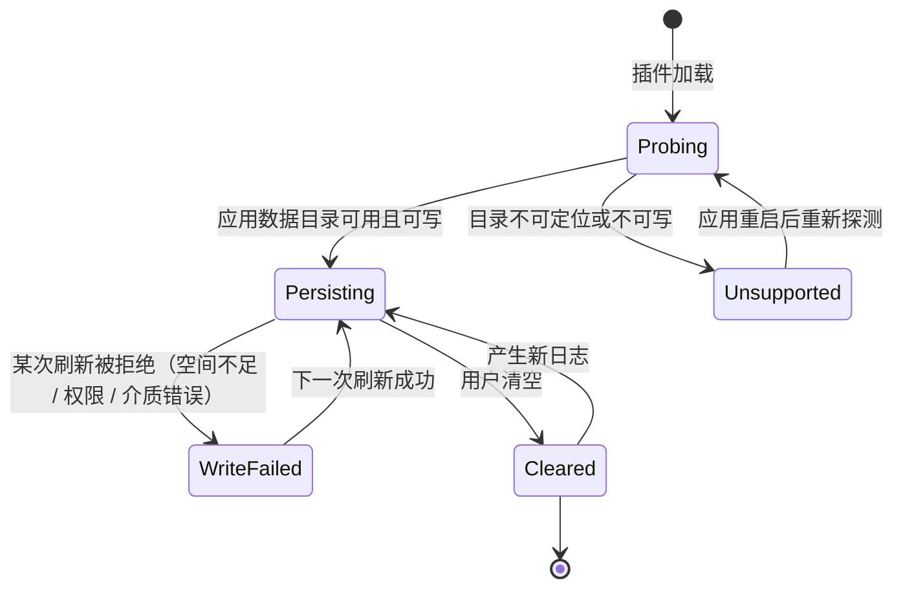
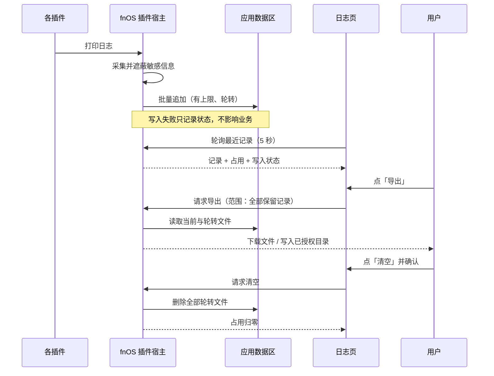

# FNOS-058 运行日志持久化与导出

| 项目 | 内容 |
| --- | --- |
| 需求编号 | FNOS-058 |
| 提出日期 | 2026-11-19 |
| 需求状态 | 规划中 |
| 关联计划 | [PLAN-FNOS-058 运行日志持久化与导出](/plans/PLAN-FNOS-058-runtime-log-persistence) |
| 适用范围 | `plugins/dsh-fnos-plugin`（日志采集、日志页、日志相关路由与文案） |
| 关联需求 | [FNOS-042](/requirements/FNOS-042-session-log-menu)（会话日志「下载到电脑 / 导出到已授权 NAS 目录」的既有导出口径）、[FNOS-003](/requirements/FNOS-003-fpk-runtime-settings)（凭据类信息不在普通日志与页面中回显的既有口径） |
| 明确排除 | 修改 DSH 上游日志服务；接管 DSH 会话日志、插件安装日志与应用中心日志 |

## 需求背景

fnOS 设置的「日志」页展示的是宿主进程运行日志。它现在能用的部分只有「看当前这一次运行」：

- **重启即清空**：日志只存在于宿主进程的内存里。应用重启、插件禁用再启用之后，页面里空无一物。而用户想看日志的典型时刻恰恰是「刚出过问题、已经重启过了」——这个顺序正好把证据抹掉。
- **没有出口**：页面能看到报错，但拿不出来。要发给开发者只能截图，长堆栈截不全，行号与时间戳也容易错位。
- **不知道会不会写满**：用户无法判断这个页面背后的数据有没有上限，也就不敢长期开着。

### 这份能力目前没有登记

「日志」分组是随「运行」页一起加入的（提交 `e69248b9`，2026-11-10），但当时只改了插件代码与文案，没有建立需求与计划文档。也就是说它现在是**已经上线、却没有 SDD 登记的能力**。本需求在补持久化的同时，把它正式登记进来，让后续改动有据可依。

## 调研结论

| 结论 | 出处 | 影响的功能 | 状态 |
| --- | --- | --- | --- |
| 官方日志服务只提供「接收器」接缝，不提供写入文件的实现；随发行版只有终端渲染一种接收器 | DSH 0.2.2-rc.5：Cordis 日志服务 `LoggerService`、`@deepseek-ai/cordis-plugin-logger-console` | FNOS-058-01、06 | 已核实 |
| 宿主自身不写连续日志文件，只有两份快照性质的文件：CLI 启动失败诊断、桌面端崩溃报告 | DSH 0.2.2-rc.5 上游 CLI 与桌面端源码 | FNOS-058-01 | 已核实 |
| 本应用在 fnOS 上的 stdout/stderr 由平台接管，`/proc/<pid>/fd/1` 读不到，「读现有日志文件」这条路不存在 | 2026-11-10 真机确认，结论已记录在仓库提交说明与源码注释中 | FNOS-058-01 | 已核实 |
| 上游提供「应用数据目录定位」与「原子写入 / 跨进程写锁」两个可直接使用的库，足以支撑自有文件落盘 | `@deepseek-ai/dsh-home-paths`、`@deepseek-ai/dsh-atomic-write`（0.2.2-rc.5） | FNOS-058-01、02 | 已核实 |
| 上游基础组合默认挂载了持久 KV 存储（枢纽 + json 后端 + 领域层），但领域层是「一次写入等待持久、每个领域单条写链」，形态是记录而非追加流，不适合高频日志 | 基础组合 patch；`@deepseek-ai/dsh-storage-domain` 文档；本地 `--dump-config` 确认三行存在 | FNOS-058-01 | 已核实 |
| 「插件自己往应用目录写诊断文件」在本仓库已是既有范式：官方插件管理器的每次包操作都会写一份日志文件 | `@deepseek-ai/dsh-plugin-manager` 0.2.2-rc.5 | FNOS-058-01、02 | 已核实 |
| 日志接收器拿到的是**所有插件**的日志，不限于本插件 | 现有实现与运行实测（页面可见其它插件记录） | FNOS-058-05 | 已核实 |
| 会话日志已有「下载到电脑 / 导出到已授权 NAS 目录」两条出口，可作为运行日志导出的交互基线 | [FNOS-042](/requirements/FNOS-042-session-log-menu) | FNOS-058-03 | 已核实 |
| 追加写加定期刷新无法保证异常退出时不丢最后一段：进程被强杀时，仍在内存里的那部分不会落盘 | 追加写与缓冲刷新的固有语义 | FNOS-058-01（边界） | 已核实 |
| 上游日志服务有一个可写的内存缓冲容量字段（默认 1000 条），但官方文档未说明，不能作为本需求的依赖 | DSH 0.2.2-rc.5 源码 | FNOS-058-01 | 已核实 |

结论：落盘没有现成能力可用，但也没缺底层条件——路径与安全写入都有官方库，写入策略需要自己实现。因此本需求的难点不在「能不能写」，而在**写什么、写多少、什么时候写、出问题怎么让人看见**。

## 需求目标

| 编号 | 优先级 | 功能 | 用户可观察结果 | 状态 |
| --- | --- | --- | --- | --- |
| FNOS-058-01 | P1 | 日志跨重启保留 | 重启应用或宿主后，日志页仍能看到重启前的记录 | 规划中 |
| FNOS-058-02 | P1 | 磁盘占用有上限 | 日志数据不会无限增长，超出上限自动淘汰最旧内容，页面显示当前占用 | 规划中 |
| FNOS-058-03 | P1 | 导出日志 | 可把保留的日志导出为文件：下载到电脑，或保存到已授权的 NAS 目录 | 规划中 |
| FNOS-058-04 | P1 | 清空日志 | 可清空历史日志；清空后页面立即为空，磁盘内容一并清除 | 规划中 |
| FNOS-058-05 | P0 | 敏感信息不入盘 | 凭据、令牌与密钥不以明文出现在页面与导出文件中 | 规划中 |
| FNOS-058-06 | P1 | 写入状态可见 | 日志页显示持久化是否生效与最近一次写入结果；写入失败时明确提示 | 规划中 |

### FNOS-058-01 日志跨重启保留

日志在产生后不久即进入持久存储，因此：

- 应用重启、进程重启后，日志页仍显示重启前的记录，最上面一行最新；
- 插件禁用再启用后，记录同样还在；
- 跨重启连续：不重复、不倒序、不出现时间戳倒退；
- 页面默认只展示最近一段（与现在的「条数」上限一致），不是整个文件全铺出来。

:::warning 异常退出的最后一段
持久化走缓冲写入，进程被强杀或崩溃时，**还在内存里、尚未刷新到文件的那几条会丢**。这是追加写加批量落盘的固有代价，本需求不承诺消除（见「不在本次范围内」）。界面不为此额外提示——把它写进文档比写进界面更有用。
:::

### FNOS-058-02 磁盘占用有上限

- 单文件有上限、轮转保留若干份，总量有明确上限（默认 8 MiB）；
- 超出上限后淘汰最旧的内容，而不是停止写入——诊断价值最高的永远是最近的日志；
- 日志页显示当前占用（例如「2.1 MiB / 8 MiB」）与保留份数，让用户知道这块数据会不会长大；
- 上限是固定默认值，**不提供用户配置项**：这个页面是排障工具，多一个需要解释的设置项只会让用户多一处犹豫。

### FNOS-058-03 导出日志

两个出口，交互与会话日志导出保持一致：

| 出口 | 结果 |
| --- | --- |
| 下载到电脑 | 浏览器直接下载一个文本文件，文件名带时间戳 |
| 保存到已授权 NAS 目录 | 写入用户已授权的目录，界面提示保存位置 |

约定：

- **导出范围是全部保留记录**（含轮转的历史文件），不是页面当前显示的那 N 条。页面给人看最近发生的，导出给开发者排查——两者的合理范围本就不同；
- 导出文件开头附一段说明：导出时间、DSH 基线版本、插件版本、导出时的筛选条件与总条数。没有这段，收到的日志只能靠猜上下文；
- 导出失败要给可读原因（目录不可写、磁盘空间不足等），不静默失败。

### FNOS-058-04 清空日志

- 清空需二次确认，说明「会删除已保存的全部运行日志」；
- 清空后页面立即为空、占用归零、磁盘上的轮转文件一并删除；
- **不影响其它数据**：DSH 会话日志、插件安装日志、应用中心日志的位置与内容都不变。这三点必须在确认文案里说清——「清空日志」四个字很容易让人以为连会话记录一起删了。

### FNOS-058-05 敏感信息不入盘

日志里有插件打印的任意内容，可能包含令牌、密钥、密码或凭据文件路径。持久化把「临时显示」变成了「长期留在磁盘上」，因此必须在**写入的唯一入口**做遮蔽：

- 常见的凭据形态（密钥、令牌、密码、私钥块、会话凭据）替换为固定占位符，保留少量前缀便于辨认类型；
- 页面与导出文件用的是同一份已遮蔽的文本——**不能只在导出时遮蔽**，否则页面里仍能直接看到；
- 遮蔽后仍要能诊断：保留「哪一类凭据出现在哪一行」这个信息，不整行吞掉；
- 已知边界：无法识别自由文本里的业务数据（见「不在本次范围内」）。

### FNOS-058-06 写入状态可见

日志页在工具条附近显示一行状态：

| 状态 | 显示 |
| --- | --- |
| 正常 | 已保存到磁盘 · 当前占用 |
| 环境不支持 | 未启用持久化（附原因），本次运行内的日志仍可查看 |
| 最近一次写入失败 | 写入失败（时间 + 原因）；已有文件不受影响，后续会继续尝试 |

写入失败**不得阻断业务**：日志写不进去只是少一份证据，不能让插件或宿主因此报错。同时也不能静默——用户以为日志留着，重启后才发现是空的，比一开始就说明白更糟。

三种状态与转换关系：

文字说明：

- **探测只在加载时做一次**：环境不支持时不做周期性重试，避免在一个注定失败的路径上反复写盘；应用重启后再重新判断。
- **写入失败是可恢复的**：不清空已有文件、不停止采集，下一次刷新成功即回到正常态。这条转换是「不阻断业务」的具体表达。
- **清空不等于退出持久化**：清空后状态回到正常写入，新日志照常落盘。
- **任何状态下页面都能看本次运行内的日志**：持久化失效只影响「历史是否留存」，不影响「现在能不能看」。

## 交互与数据流

从日志产生到用户拿到导出文件，涉及宿主采集、文件落盘与浏览器三个环节：

## 行为约束

- 现有日志页能力全部保留：级别筛选、搜索、条数设置、级别配色与文字徽标（不只靠颜色）、只在用户停在顶部时自动跟随、日志行自动换行；
- 轮询节奏保持 5 秒，不因为落盘而改；
- 日志页仍以只读为主：除「导出」「清空」外不新增写操作；
- 持久化只在日志的写入入口做一次，采集范围与现在一致（所有插件的日志），不缩窄也不扩大；
- 日志文件只落在应用自己的数据区：不进入用户工作区、不进入会话目录、不被工作区索引或检索；
- 同一设备上不同 profile 的日志互不覆盖；
- 升级后不回填历史：首次启用时从空开始，不伪造「之前发生过什么」；
- 插件安装日志的位置与格式不变，本需求不迁移、不合并它。

## 不在本次范围内

- **异常退出的最后一段**：不承诺进程被强杀时内存中未刷新的日志一定落盘；
- **上限的配置项**：不做用户可调的上限、保留份数或轮转策略；
- **修改上游日志服务**：不向 DSH 新增文件型日志接收器，不改宿主；
- **结构化检索**：仍是名称与正文的子串匹配，不引入字段级查询或正则检索；
- **远程上报**：官方已有 OTel 与 Session 上传通道，本需求不接入、不转发；
- **运行期切换日志级别**：沿用 profile 现有的日志级别配置；
- **接管其它日志**：DSH 会话日志、插件安装日志、应用中心日志的存储位置与导出口径都不变；
- **跨设备汇聚**：不做多台 NAS 的日志汇总。

## 验收条件与完成状态

| 编号 | 验收条件 | 判定方式 | 状态 |
| --- | --- | --- | --- |
| AC-01 | 产生若干条日志后重启应用，日志页仍能看到重启前的记录，顺序与时间戳正确、无重复 | 包级用例 + DSH Web 走查 + 真实 NAS 走查 | 待验证 |
| AC-02 | 持续产生日志直到超过上限，占用稳定在上限附近，最旧内容被淘汰而最新内容保留 | 单元测试 + 界面核对占用显示 | 待验证 |
| AC-03 | 导出到电脑得到的文件包含全部保留记录与头部说明；导出到已授权目录后文件确实落盘 | 包级用例 + 真实 NAS 走查 | 待验证 |
| AC-04 | 清空后页面为空、占用归零、磁盘文件消失；会话日志与安装日志不受影响 | 单元测试 + 界面走查 | 待验证 |
| AC-05 | 构造含凭据形态的日志，页面与导出文件中均为占位符；同一行仍可读出「哪类凭据」 | 单元测试（固定样例）+ 导出文件核对 | 待验证 |
| AC-06 | 磁盘不可写时：业务不受影响、页面显示写入失败原因、已有文件不被破坏、恢复后继续写入 | 单元测试（故障注入）+ 走查 | 待验证 |
| AC-07 | 现有筛选、搜索、条数、换行、自动跟随行为在改造后保持不变 | 包级用例 + 界面走查 | 待验证 |
| AC-08 | 权限与请求来源不变：清空与写入类操作仍只接受同源请求，跨站请求被拒绝 | 单元测试 | 待验证 |

目标环境：本需求全部功能属于 `dsh-fnos` 插件，按仓库规范需覆盖 **DSH Web 与真实 fnOS NAS**；其中涉及应用数据目录推导与磁盘写入的分支（AC-01、AC-03、AC-06）必须做真机验证，构建通过与包级单元测试不能替代。

## 变更记录

| 日期 | 变更 |
| --- | --- |
| 2026-11-19 | 建立需求：确认日志页当前为纯内存环形缓冲、重启即清空且无导出出口；登记六项功能（跨重启保留、占用上限、导出、清空、敏感信息不入盘、写入状态可见）；明确「异常退出丢最后一段」与「上限不可配置」两项边界；同时补记「日志分组上线时未做 SDD 登记」这一历史事实。目标版本定在 8.3.1——本会话已将 `y` 段推进到 8.3，按版本通道冻结规则后续只升 `z`。 |
