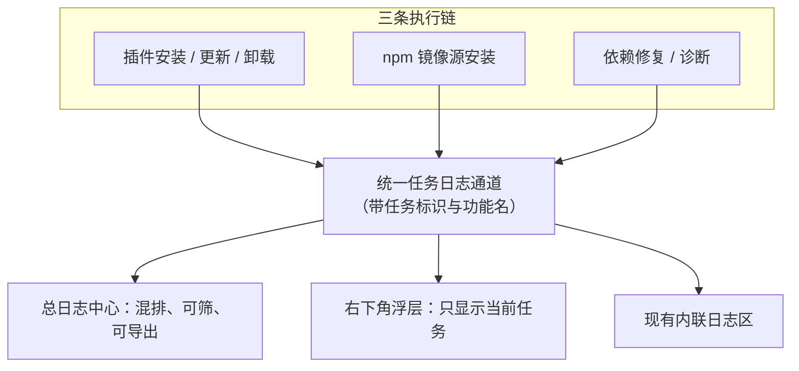
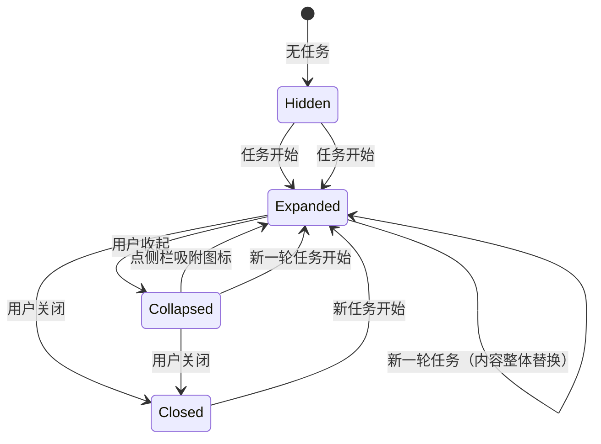

# FNOS-059 功能执行日志汇入总日志与右下角浮层

| 项目 | 内容 |
| --- | --- |
| 需求编号 | FNOS-059 |
| 提出日期 | 2026-11-20 |
| 需求状态 | 规划中 |
| 关联计划 | [PLAN-FNOS-059 功能执行日志汇入总日志与右下角浮层](/plans/PLAN-FNOS-059-feature-log-feedback-panel) |
| 适用范围 | `plugins/dsh-fnos-plugin`（插件安装与更新、npm 镜像源、依赖修复三条执行链的日志出口；日志浮层组件；九语言文案） |
| 关联需求 | [FNOS-058](/requirements/FNOS-058-runtime-log-persistence)（运行日志中心本身）、[FNOS-050](/requirements/FNOS-050-dependency-repair)（依赖修复的日志与进度现状）、[FNOS-054](/requirements/FNOS-054-fnos-footer-entry-standalone)（浮层挂载与运行环境判据） |
| 明确排除 | 修改 DSH 上游；把日志浮层做成通用第三方组件；接管会话日志 |

## 需求背景

插件里有三类「跑起来要几十秒到几分钟」的操作：装/更新/卸载插件、装 nrm 镜像源、修依赖。它们现在各自有一份日志，但三份日志的去向互不相同，而且**一份都进不了运行日志中心**：

| 功能 | 现在日志去哪了 | 用户能看到吗 |
| --- | --- | --- |
| 插件安装 / 更新 | 写 `gateway/install-log.txt`，前端轮询这个文件 | 只在卡片内联区或安装弹框里，关掉就没了 |
| npm 镜像源安装 | 写**同一个** `install-log.txt` | 同上，两份日志还会互相覆盖 |
| 依赖修复 | `console.log`，走 SSE 实时推给发起请求的那个页面 | 只有发起的那次请求能看到，页面一刷新就没了 |

三个问题由此而来：

- **总日志里看不到这些操作**。运行日志中心采的是宿主日志服务的记录，而上面三条链路都不经过它。用户在「日志」页翻半天，找不到「刚才那次安装到底报了什么」。而排障时最需要的恰恰是这类长耗时操作的完整过程。
- **两处日志互相踩**。插件安装与 nrm 安装写同一个文件，一方开始就清空另一方——先装插件再装 nrm，插件那份记录就没了。用户以为「历史都在」，其实只剩最后一次。
- **长操作的过程没有统一落点**。依赖修复的日志只存在于当次请求的流里；用户想边操作别的边看进度，只能守着那个弹框。

此外，用户明确提出了第三种观察方式：**右下角浮出的小窗**。它解决的是「我不想为看进度而放弃整个界面」——内联日志绑在卡片上、弹框挡住页面，都不适合几分钟的等待。

## 调研结论

| 结论 | 出处 | 影响的功能 | 状态 |
| --- | --- | --- | --- |
| Semi 的 `Feedback` 组件有 `type: 'custom'`，此时直接渲染传入的 `children`，可用于承载任意内容；`mode: 'popup'` 走 SideSheet、`mode: 'modal'` 走 Modal，两种外壳都可复用 | `@douyinfe/semi-ui` 源码 `feedback/index.js` 与 `semi-foundation` 的 `strings.TYPE`（含 `custom`） | FNOS-059-02 | 已核实 |
| Semi 自带 `DragMove` 组件（受控拖动，支持约束容器与自定义移动回调），但当前共享包 `@tnnevol/dsh-semi-ui` **尚未导出** | `@douyinfe/semi-ui` 的 `dragMove` 包；共享包 `src/components.ts` 导出清单 | FNOS-059-03 | 已核实 |
| 插件安装与 nrm 安装共用同一个日志文件与 offset 增量接口；两处都在开始时清空文件 | `plugin-install.ts` 的 `installLogPath` / `startLog`，`npm-mirror.ts` 的调用处 | FNOS-059-01 | 已核实 |
| 依赖修复的日志走模块内 `log()` 函数，先 `console.log` 再推给 `logSink`；`console.log` 不经过宿主日志服务，因此**不出现在运行日志中心** | `dependency-repair.ts` 的 `log()` 与 `setRepairLogSink`；`dependency-repair-routes.ts` 的 SSE 推送 | FNOS-059-01 | 已核实 |
| 运行日志中心通过宿主日志服务的接收器采集**所有插件**的日志，采集范围不限于本插件 | [FNOS-058](/requirements/FNOS-058-runtime-log-persistence) 调研结论 | FNOS-059-01 | 已核实 |
| 会话头部右侧菜单中的「下载 Session 日志」用的是官方导出，与本需求的运行日志不是同一份数据 | [FNOS-042](/requirements/FNOS-042-session-log-menu) | FNOS-059-02 | 已核实 |
| `shell.overlay` 是根级 list 座位，用于挂 portal 浮层，生命周期与会话无关；本插件已用它挂配置弹框与登录浮层 | DSH 布局包的座位声明；`plugins/dsh-fnos-plugin/src/client/index.ts` 的三处注册 | FNOS-059-02 | 已核实 |
| `sidebar.footer.action` 是 list 座位，当前已被「飞牛 OS」入口占用，可叠加更多条目 | DSH 侧栏包的座位声明；本插件现有注册 | FNOS-059-03 | 已核实 |
| 日志浮层与「飞牛 OS」入口都在同一会话无关的宿主层，不随会话切换卸载 | 同上两行 | FNOS-059-02、03 | 已核实 |

**最关键的结论**：本需求不是「加一个浮层」，而是**先把三条日志链路合并到一处，再让浮层只是它的一个视图**。如果只做浮层而不合并链路，浮层里看到的仍然不是总日志里的内容，两个界面会继续各说各话。

## 需求目标

| 编号 | 优先级 | 功能 | 用户可观察结果 | 状态 |
| --- | --- | --- | --- | --- |
| FNOS-059-01 | P0 | 功能日志汇入总日志 | 装插件、装 nrm、修依赖的过程日志都出现在「日志」页，可筛选可搜索可导出 | 规划中 |
| FNOS-059-02 | P1 | 右下角浮层实时展示 | 执行上述操作时，右下角浮出小窗实时滚动显示本次任务的日志 | 规划中 |
| FNOS-059-03 | P1 | 浮层可拖动 | 浮层可拖到屏幕任意位置，位置在本次会话内保持 | 规划中 |
| FNOS-059-04 | P1 | 关闭 / 收起 / 展开 | 可关闭浮层；收起后在侧栏留一个吸附图标入口，点击重新展开 | 规划中 |
| FNOS-059-05 | P0 | 新一轮覆盖上一轮 | 未关闭时执行另一个任务，浮层内容切换为新任务的日志，不并存 | 规划中 |
| FNOS-059-06 | P1 | 日志文件不再互相踩 | 插件安装与 nrm 安装的日志互不覆盖，各自可回溯 | 规划中 |

### FNOS-059-01 功能日志汇入总日志

三类操作的每条过程日志同时进入两个去处：

- **总日志中心**：与其它宿主日志混排，带功能名标识，可按功能筛出来；
- **任务日志区**：按「一次任务」组织，供浮层展示。

约定：

- 两处内容一致——不会出现「浮层里有、总日志里没有」；
- 总日志里能看出这条记录属于哪个功能、哪一次任务，而不是一堆没有归属的行；
- 原有的内联日志区不删除（见「行为约束」），但改为从合并后的链路取值，不再各自读文件或各自推流。

### FNOS-059-02 右下角浮层实时展示

- 任务开始时浮层自动出现在右下角，日志逐行滚动，默认跟随最新；
- **只显示当前这一个任务**的日志，不显示总日志，也不列表堆叠多个任务；
- 浮层头部说明这是什么任务（如「依赖修复」「安装插件 dsh-taskboard」）与当前状态（进行中 / 成功 / 失败）；
- 任务结束不自动关闭：失败时保留现场是排障刚需；成功时可保留若干秒或等用户关闭（细节见计划）。

### FNOS-059-03 浮层可拖动

- 按住头部区域可拖动整个浮层，拖到屏幕内任意位置；
- 拖动不改变内容与状态，松手即落位；
- 位置在本次会话内保持：下次浮出仍在用户放下的位置；
- 拖到边缘时限制在可视区域内，不让人把窗口拖到看不见的地方；
- 窗口尺寸变化后仍在可视区域内。

### FNOS-059-04 关闭 / 收起 / 展开

三种动作，语义不同：

| 动作 | 结果 | 能否找回 |
| --- | --- | --- |
| 收起 | 浮层隐去，侧栏留一个吸附图标 | 点图标重新展开，内容原样 |
| 关闭 | 浮层卸载，吸附图标也不出现 | 执行下一个任务时重新出现 |
| 展开 | 从收起态恢复，回到收起前的位置与内容 | — |

- **收起与关闭必须区分**：收起是「先挪开一会儿」，关闭是「我不看了」。混成一个动作会让用户无法预判点完还能不能找回来。
- 吸附图标挂在侧栏底部区域，位于现有「飞牛 OS」入口旁，位置见计划。
- 关闭后，任务日志仍可在总日志中心查到——关闭的是浮层，不是记录。

### FNOS-059-05 新一轮覆盖上一轮

- 浮层未被关闭时，执行另一个任务即**整体替换**为那个任务的日志，不与上一轮并存、不追加；
- 浮层已被关闭时不强行弹出（尊重用户「不看了」的决定），但新任务的日志照常进入总日志；
- 同一时刻只可能有一个长任务在跑（现有安装互斥已保证），因此不存在两个并发任务争用浮层。

:::warning 覆盖不是清空日志
「覆盖」只作用于浮层这一处显示，不删除上一轮的日志记录。上一轮的完整日志仍在总日志里，可翻可搜可导出。
:::

### FNOS-059-06 日志文件不再互相踩

插件安装与 nrm 安装不再共用同一个会被清空的文件：

- 两者各自独立留存，先做的操作不会因为后一个操作开始而消失；
- 内联日志区仍能显示**本次**操作的日志，不受历史影响；
- 历史可见性由总日志中心统一承担，不再依赖这两个文件的取舍。

## 行为约束

- **现有内联日志区保留**：插件卡片内联进度、nrm 卡片日志、依赖修复弹框都留在原位。浮层是新增的第三个观察入口，不是替代。三者显示同一份内容，不出现分叉。
- **现有互斥行为不变**：安装与修复各自的「同时只允许一个」限制不因新增浮层而放松。
- **失败态继续常显**：现有「失败时日志常显」的约定保留。
- **不改变操作的执行结果与耗时**：日志链路合并不能引入额外等待，尤其不能让任务因为写日志变慢。
- **浮层不拦截页面操作**：除浮层自身区域外，其它区域照常可点；不出现覆盖整页的半透明遮罩。
- **浮层在窄屏可用**：小宽度下浮层不横向溢出，可缩小或改为占满宽度。
- **不新增用户配置项**：位置、开关都由用户当下的操作决定，不做设置项。
- **会话无关**：切换会话、新建会话不导致浮层丢失或内容错乱。

## 不在本次范围内

- **把浮层抽成面向第三方的通用组件**：本需求只服务本插件的三类任务；
- **历史任务列表**：浮层只显示当前任务，不做「最近 10 次任务」这类列表（总日志中心承担回溯）；
- **并发多任务**：现有互斥已保证单任务，不为此改造执行链；
- **跨设备或跨会话的浮层位置同步**：位置只在本次会话内保持；
- **浮层内的日志检索**：浮层只做滚动展示，检索在总日志中心；
- **运行日志中心本身的持久化与导出**：那是 [FNOS-058](/requirements/FNOS-058-runtime-log-persistence) 的范围，本需求只负责把三条链路接进去。

## 交互与数据流

三条执行链汇入一处，再由两个视图分别呈现：

浮层自身的状态与用户动作：

文字说明：

- **关闭态下新任务会重新出现**：关闭表达的是「这一轮我不看了」，不是「以后都别弹」。因此 `Closed → Expanded` 在任务开始时成立。
- **收起态下新任务直接展开**：用户只是挪开了，新任务来了应当重新引起注意。
- **覆盖发生在 `Expanded` 自身上**：状态不变，内容替换。

## 验收条件与完成状态

| 编号 | 验收条件 | 判定方式 | 状态 |
| --- | --- | --- | --- |
| AC-01 | 完成一次插件安装后，日志页能搜到该次安装的过程记录，并标明属于哪个功能 | 包级用例 + DSH Web 走查 | 待验证 |
| AC-02 | 依次安装插件与 nrm 后，两者日志都留在总日志中，互不覆盖 | 包级用例 + 界面核对 | 待验证 |
| AC-03 | 执行任一长任务时，右下角浮层实时出现并滚动显示该任务日志；内容与总日志一致 | 包级用例 + DSH Web 走查 | 待验证 |
| AC-04 | 浮层可拖到屏幕任意位置，松手后位置保持；窗口缩放后仍在可视区内 | 界面走查 | 待验证 |
| AC-05 | 收起后侧栏出现吸附图标，点击可恢复原位置与内容；关闭后图标消失且下一轮任务重新出现浮层 | 界面走查 | 待验证 |
| AC-06 | 未关闭浮层时执行第二个任务，浮层内容整体切换为新任务，上一轮日志仍可在总日志中心查到 | 包级用例 + 界面走查 | 待验证 |
| AC-07 | 原有内联日志区行为不变：安装进度、失败常显、修复弹框实时日志均照常 | 包级用例 + 界面走查 | 待验证 |
| AC-08 | 浮层在窄屏（390px）下不横向溢出，且不拦截浮层之外区域的点击 | 界面走查 | 待验证 |

目标环境：本需求全部功能属于 `dsh-fnos` 插件，按仓库规范需覆盖 **DSH Web 与真实 fnOS NAS**。其中浮层定位与拖动在真实 NAS 的 iframe 环境中可能受宿主页面影响，AC-04 与 AC-08 必须做真机验证。

## 变更记录

| 日期 | 变更 |
| --- | --- |
| 2026-11-20 | 建立需求：确认真实根因是三条执行链的日志**都不进总日志**（安装与 nrm 写同一文件且互相清空、依赖修复只走控制台与 SSE），因此本需求的核心是把链路合并，浮层只是其一个视图；登记六项功能；澄清「覆盖只作用于浮层显示，不删日志」与「关闭不等于以后都不弹」两条易误读语义；`targetVersion` 沿用 8.3.1（本会话 `y` 段已冻结）。 |
