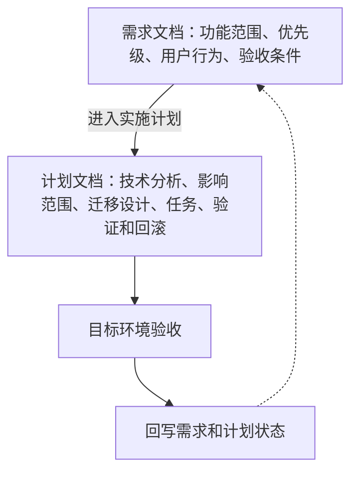

# 需求清单

这里记录本项目的正式需求。需求文档只描述用户问题、功能范围、可观察结果和验收条件；需求文档规范统一维护在[开发指南 → 章程规范 → 需求文档规范](/charter/requirements-spec)。

## 需求与计划的关系

规则摘要：

- 需求记录完整范围，包括已完成、正在规划、待验证和暂未排期的功能。
- 计划只展开已经进入当前实施阶段的功能。
- 未进入计划的 P2、后续计划或待确认功能，不得出现在计划任务和测试清单中。
- 需求范围变化时，先更新当前开发中的需求，再同步调整计划。
- 目标环境未完成验收时，需求不能标记为“已完成”。

完整规则见：[需求文档规范](/charter/requirements-spec) 和 [SDD 维护规范](/charter/sdd-workflow)。

## 当前需求整合结果

历史上明确标记为规划、后续或待评估的 fnOS/DSH 适配内容已统一纳入 `FNOS-001`：

| 历史内容 | 当前归属 | 状态 |
| --- | --- | --- |
| fnOS 主题桥接 | FNOS-001-02 | 已完成验证 |
| fnOS 应用入口、统一网关和访问权限 | FNOS-001-01 | 已完成验证 |
| FPK 安装阶段集成 DSH 插件 | FNOS-001-09 | 已完成验证 |
| 授权目录展示、添加、删除和刷新 | FNOS-001-04 | 已完成验证 |
| 工作区快捷跳转已授权 fnOS 目录 | FNOS-001-10 | 已完成验证 |
| 内容输入框选择 NAS 目录和文件 | FNOS-001-11 | 已完成验证 |
| 上下文文件访问适配 | FNOS-001-12 | 已完成验证 |
| 后续 fnOS JS SDK 能力 | FNOS-001-08 | 后续计划 |

已完成需求作为历史验收记录，不回改正文；后续变更登记到当前开发中的需求，并通过变更记录说明关系。

## 当前需求文档

| 编号 | 需求文档 | 状态 |
| --- | --- | --- |
| FNOS-001 | [DSH 飞牛 NAS 适配](/requirements/FNOS-001-dsh-fnos-adaptation) | P0/P1 已完成验证 |
| FNOS-002 | [DSH 应用与插件优化](/requirements/FNOS-002-dsh-app-plugin-optimization) | 已完成 |
| FNOS-003 | [FPK 应用运行设置统一](/requirements/FNOS-003-fpk-runtime-settings) | 已完成 |
| FNOS-004 | [DSH 0.1.5-rc.2 适配与 FPK 运行修复](/requirements/FNOS-004-dsh-015-rc2-adaptation) | 已完成 |
| FNOS-005 | [CodeBuddy 成长任务移植与仓库内 DSH 开发环境](/requirements/FNOS-005-codebuddy-and-local-dsh) | 已完成 |
| FNOS-006 | [安装脚本与安装流程优化](/requirements/FNOS-006-installation-script-optimization) | 规划中 |
| FNOS-007 | [DSH 0.1.7-rc.2 适配与插件错误修复](/requirements/FNOS-007-dsh-017-rc2-adaptation) | 已完成 |
| FNOS-008 | [插件配置统一迁入插件管理页](/requirements/FNOS-008-plugin-config-in-plugin-manager) | 已完成 |
| FNOS-009 | [DSH 0.2.0-rc.2 插件适配](/requirements/FNOS-009-dsh-020-rc2-adaptation) | 规划中（含授权目录持久化 FNOS-009-09/10） |
| FNOS-010 | [三方搜索接入与官方兜底](/requirements/FNOS-010-thirdparty-web-search-failover) | 已完成（随插件 v0.2.0-rc.2.1 发布；DSH Web 与 DSH Desktop 验收通过） |
| FNOS-011 | [凭据文件权限异常的可诊断性](/requirements/FNOS-011-credential-permission-diagnostics) | 已完成（随 0.2.0-rc.2.6 发布） |
| FNOS-012 | [CodeBuddy 模型倍速展示与客户端版本更新](/requirements/FNOS-012-codebuddy-model-speed-and-client-version) | 已完成（随 0.2.0-rc.2.6 发布） |
| FNOS-013 | [Midscene 浏览器自动化桥接插件](/requirements/FNOS-013-midscene-browser-automation-bridge) | 已完成（随 0.2.0-rc.2.6 发布） |
| FNOS-014 | [DSH 0.2.1-rc.2 插件适配与新能力支持](/requirements/FNOS-014-dsh-021-rc2-adaptation) | 已完成（52 条用例全部通过，含真机验收） |
| FNOS-015 | [主题缓存写入死循环修复](/requirements/FNOS-015-theme-cache-write-loop) | 实现完成（本地验证通过）；目标环境验收待执行 |
| FNOS-016 | [插件市场索引与插件元数据](/requirements/FNOS-016-plugin-market-index) | 待完成（双客户端已验；干净 profile 安装链路待复验） |
| FNOS-017 | [fnOS 插件路由 403 误拒修复](/requirements/FNOS-017-fnos-route-403) | 修复完成；真机验收待执行 |
| FNOS-018 | [Midscene 桥接使用说明准确性修正](/requirements/FNOS-018-midscene-skill-accuracy) | 已完成（说明已修正并实测通过） |
| FNOS-019 | [FPK 版本方案固定前缀与插件基线小尾巴](/requirements/FNOS-019-fpk-version-scheme) | 已完成（本地单测、打包一致性与真实设备升级均通过） |
| FNOS-020 | [CodeBuddy 瞬时 400 终止整轮修复](/requirements/FNOS-020-codebuddy-transient-400) | 已完成（11 条用例全部通过，含 DSH Web 与 DSH Desktop 双客户端运行时验证） |
| FNOS-021 | [Midscene 库能力对齐与接入简化](/requirements/FNOS-021-midscene-library-integration) | 已完成（2026-10-23 整体验收通过） |
| FNOS-024 | [CodeBuddy 403 纳入账号切换](/requirements/FNOS-024-codebuddy-403-failover) | 已完成（403 触发换号；适配器级集成验证通过） |
| FNOS-023 | [CodeBuddy 受限账号触发自动切换](/requirements/FNOS-023-codebuddy-restricted-account-failover) | 已完成（受限账号自动切换；DSH Web 已验，Desktop 待补） |
| FNOS-022 | [CodeBuddy 模型调用被内容审核拦截修复](/requirements/FNOS-022-codebuddy-content-block-fix) | 已完成（17 条用例全部通过，DSH Web 与 DSH Desktop 双客户端已验；原参考项目对齐项因来源项目停更已取消） |
| FNOS-025 | [CodeBuddy 插件下架](/requirements/FNOS-025-codebuddy-plugin-delisting) | 已完成（上游收紧非官方客户端通道风控，插件停止维护并下架；源码保留在本机但不再由仓库追踪；15 条用例全部通过） |
| FNOS-026 | [OpenCode Zen 与 OpenCode Go 模型接入及套餐用量](/requirements/FNOS-026-dsh-opencode-plugin) | 已完成验证（插件已发布到 npm，DSH Web 与 DSH Desktop 验收通过） |
| FNOS-027 | [ZCode Start Plan 模型接入与账号额度](/requirements/FNOS-027-dsh-zcode-plugin) | 已完成（登录、目录、能力、额度、对话、图文、智能体团队与限流退避已实测；DSH Web 与 DSH Desktop 均通过功能验收；插件未发布） |
| FNOS-028 | [项目与插件版本统一 5.10.0 及发布链路 dsh 基线标注](/requirements/FNOS-028-unified-project-version-bumpp) | 已完成（2026-10-25 提出人验收通过；版本命令直接调用 bumpp，版本统一 5.10.0；npm 发布与真机升级为发布后动作） |
| FNOS-030 | [DSH 0.2.1-rc.3 插件适配与基线迁移](/requirements/FNOS-030-dsh-021-rc3-adaptation) | 规划中（锚定迁移 + 契约复核 + 双客户端回归；FPK 真机验证列为后续） |

新增需求先登记在本页和对应需求文档，确认进入实施后再创建或调整对应计划。
